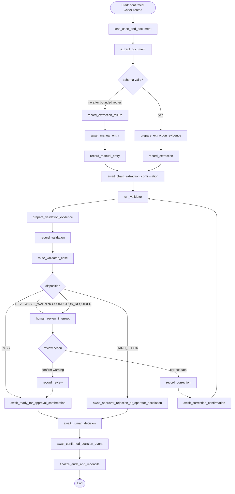

# AI Workflow
# ActionLoop — AI Workflow Specification

| Field | Value |
|---|---|
| Document version | 0.1 — Draft for team review |
| Date | October 31, 2026 |
| Product | ActionLoop — AI-assisted document processing with blockchain-backed approval and verification |
| Buildathon | MST Blockchain Buildathon 2.0 |
| Source documents | ActionLoop PRD v0.1; System Architecture v0.2; Smart Contract Specification v0.1; Database Schema v0.1; API Specification v0.1; MST Blockchain Buildathon 2.0 Guide |
| Workflow runtime | LangGraph with PostgreSQL checkpoint persistence |
| Backend runtime | Python + FastAPI; separate worker process |
| Status | Proposed workflow contract; team review required before implementation |

> **Purpose.** This document specifies the ActionLoop invoice-processing workflow: graph stages, node inputs and outputs, AI component boundaries, deterministic validation, policy routing, human interrupts, blockchain evidence operations, persistence, retries, failure handling and acceptance tests. It is the implementation contract for the backend/AI workstream and the interface reference for the frontend and blockchain workstreams.
>
> **Authority rule.** LangGraph coordinates work; it does not own the authoritative approval state. PostgreSQL persists application data and workflow checkpoints. The MST `WorkflowRegistry` contract is authoritative for on-chain case state and final approval/rejection. AI components cannot authorize or execute sensitive decisions.

---

## 1. Scope and Design Principles

### 1.1 MVP workflow

The MVP supports one organization and one use case: college invoice and reimbursement approval. A submitter uploads a PDF or image invoice. ActionLoop registers its document hash on MST Blockchain, extracts structured invoice data, validates it with deterministic rules, recommends a route, requests human review when required, and waits for an authorized human decision. Approve/reject is recorded by the Workflow Registry contract. The application displays a decision as blockchain-confirmed only after the indexer observes the matching canonical event at the configured confirmation depth.

### 1.2 In scope

- PDF, JPG and PNG invoice intake (file checks and storage are owned by the document service).
- Vision-capable LLM extraction into a versioned Pydantic schema.
- Field-level confidence and source evidence where the provider supports it.
- Deterministic validation and duplicate/vendor checks.
- Policy-based routing and optional natural-language explanation.
- Human review, correction and manual entry after extraction failure.
- LangGraph checkpointing, interrupts, bounded retries and resumability.
- Blockchain evidence recording through the backend chain adapter and contract interface.
- Human approval/rejection through a wallet-signed intent and relayer, subject to the MST POC gate.
- Audit, progress events and reconciliation behavior.

### 1.3 Out of scope

- AI deciding, signing, approving, rejecting or initiating payment.
- Autonomous external actions such as bank transfers or ERP updates.
- Generic workflow builder or multi-sector workflows.
- Training or fine-tuning a foundation model during the MVP.
- Treating model-generated confidence as a statistically calibrated probability without evaluation.
- Putting source documents, invoice fields, GSTIN, amounts, free-text explanations, prompts or model outputs on a public chain.

### 1.4 Non-negotiable principles

1. **Extractor output is untrusted.** Schema validity does not establish factual correctness.
2. **Validator is deterministic.** The Validator does not call an LLM and does not modify the extracted data.
3. **Planner is constrained.** A versioned policy table selects the route. An optional LLM may explain the route but cannot alter it.
4. **Human authority is mandatory.** Only an authorized human signature accepted by the contract can produce `APPROVED` or `REJECTED`.
5. **Hard failures cannot be overridden by confirmation.** A correction creates a new data version and is revalidated.
6. **Evidence is append-only.** A new extraction/manual/correction version never overwrites the previous one.
7. **On-chain confirmation gates progress.** A submitted transaction is not a confirmed transition.
8. **Every side effect is idempotent and recoverable.** Re-running a node must not create duplicate cases, versions, transactions or decisions.
9. **Chain state is authoritative for contract state.** The graph may wait for a chain event; it may not manufacture one.

---

## 2. Component Responsibilities and Trust Boundaries

| Component | Responsibilities | Prohibited responsibilities |
|---|---|---|
| Document intake service | Validate file type/size/integrity, malware-conscious processing, compute SHA-256, store file privately | AI interpretation or approval decisions |
| Extractor Agent | Read document content and return schema-conforming invoice fields, confidence and source evidence | Tools, arbitrary code execution, chain access, relayer access, workflow authorization |
| Pydantic/schema gate | Parse and validate the Extractor response; reject malformed or out-of-range values | Deciding whether business rules pass |
| Validator | Run deterministic rule functions against one immutable data version and a captured reference-data snapshot | LLM calls, modifying invoice values, approving/rejecting |
| Action Planner | Apply versioned policy table and assign route/tier | Overriding validator results, signing or executing decisions |
| Explanation generator (optional) | Explain an already-selected route using allow-listed facts | Changing route, setting approval tier, authorizing actions |
| Reviewer | Inspect source evidence, confirm reviewable warnings, correct fields or enter data manually | Clearing hard blocks by confirmation, approving/rejecting the same case |
| Approver | Make human approve/reject decision and sign the exact evidence version | Editing extraction/validation evidence during approval |
| LangGraph orchestrator | Sequence nodes, store state, pause, resume, bound retries and route exceptions | Becoming source of truth for contract state or human decisions |
| Chain adapter / outbox | Submit typed evidence operations, track transaction status and idempotency | Sending invoice contents/free text to the contract |
| Indexer/reconciler | Observe canonical contract events, update chain projection and resume chain waits | Writing contract state or inventing missing events |

### 2.1 Import/dependency rule

Modules under `backend/app/agents/` may import Pydantic schemas, model-provider adapters, pure utilities and validation types only. They must not import `backend/app/chain/`, `relayer_client/`, wallet/key-management modules or approval services. An automated architecture test must enforce this restriction.

### 2.2 LLM input boundary

The model receives only the document content required for extraction and a fixed extraction instruction. Document text is untrusted data, not instructions. No tools or function calling are exposed. The model receives no user session, wallet, database credential, contract interface, relayer capability or unrelated case records.

---

## 3. Workflow State Model

ActionLoop has three distinct state dimensions. They must not be collapsed into one status field.

### 3.1 Application state (operational projection)

| State | Meaning |
|---|---|
| `UPLOADED` | File accepted and stored; case draft exists |
| `REGISTERING` | Submitter's `createCase` transaction submitted; awaiting chain confirmation |
| `EXTRACTING` | Extractor node is running |
| `VALIDATING` | Deterministic validation is running |
| `PLANNING` | Policy planner is selecting the next route |
| `NEEDS_REVIEW` | A reviewer action is required or the case is awaiting reviewer resolution |
| `READY_FOR_APPROVAL` | Contract has reached the corresponding eligible state and the case awaits an approver |
| `DECISION_PENDING` | Signed decision has been accepted for relayer submission or is awaiting chain confirmation |
| `APPROVED` | Indexer/reconciler has confirmed the on-chain `APPROVED` state |
| `REJECTED` | Indexer/reconciler has confirmed the on-chain `REJECTED` state |
| `FAILED` | Operational failure requiring retry or operator action; not a business decision and not an on-chain terminal state |

### 3.2 Contract state

The workflow graph must use the state names exposed by the deployed `WorkflowRegistry` ABI. The proposed contract states are:

`NONE → SUBMITTED → EXTRACTED → VALIDATED → (NEEDS_REVIEW or READY_FOR_APPROVAL) → (APPROVED or REJECTED)`

A correction from `NEEDS_REVIEW` appends a new data version and returns the contract to `EXTRACTED`, after which validation runs again. Extraction failure from `SUBMITTED` records failure evidence and moves the contract to `NEEDS_REVIEW`; manual entry creates the first data version and moves the case to `EXTRACTED`.

`APPROVED` and `REJECTED` are terminal. A hard block can be rejected from `NEEDS_REVIEW` by an eligible approver under the contract rules; it cannot be cleared by reviewer confirmation or ordinary correction.

### 3.3 Sync and transaction status

| Dimension | Values | Owner |
|---|---|---|
| `sync_status` | `IN_SYNC`, `PENDING_CHAIN`, `DISCREPANCY` | Indexer/reconciler projection |
| Transaction status | `PREPARED`, `SUBMITTED`, `PENDING`, `CONFIRMED`, `FAILED`, `REPLACED` | Outbox/chain adapter/indexer |
| Signature UI status | `AWAITING_SIGNATURE`, `SIGNED`, `EXPIRED` | API/frontend decision-intent lifecycle |

The frontend may show `APPROVED` or `REJECTED` only when the chain projection has the terminal state and the relevant event meets the configured confirmation policy. `PENDING_CHAIN` is not equivalent to success. `DISCREPANCY` blocks further state-changing actions until reconciled.

### 3.4 Validation disposition

| Disposition | Meaning | Reviewer action | Contract route |
|---|---|---|---|
| `PASS` | All mandatory checks pass | No review required | `READY_FOR_APPROVAL` |
| `REVIEWABLE_WARNING` | Non-blocking uncertainty that a human can resolve by inspecting source evidence | Confirm warning or correct field | `NEEDS_REVIEW`; confirmation may move to `READY_FOR_APPROVAL` |
| `CORRECTION_REQUIRED` | Extracted/missing data must be corrected from the source | Create a new version; rerun all validation | `NEEDS_REVIEW`; correction returns to `EXTRACTED` |
| `HARD_BLOCK` | Confirmed duplicate or prohibited condition under current policy | Cannot confirm or correct away; eligible approver may reject | `NEEDS_REVIEW`; approval route prohibited |
| `NONE` | No validation result exists yet | Not applicable | Pre-validation only |

A suspected duplicate may be `REVIEWABLE_WARNING` only when the deterministic rule cannot establish a duplicate conclusively. A confirmed vendor+invoice-number duplicate is `HARD_BLOCK` for the MVP.

---

## 4. LangGraph Topology

### 4.1 Graph overview

The diagram represents logical nodes. Chain-write nodes submit through the transactional outbox and complete only after the matching transaction/event is confirmed to the configured depth. The graph must not treat a relayer response containing only a transaction hash as a completed transition.

### 4.2 Interrupt points

The graph has two required human interrupt categories:

1. `human_review`: pauses on `REVIEWABLE_WARNING`, `CORRECTION_REQUIRED`, or manual-entry needs. It resumes only after an authorized reviewer action has been submitted and its required chain evidence is confirmed.
2. `await_human_decision`: pauses after the case is confirmed `READY_FOR_APPROVAL`. It resumes only after the indexer observes a confirmed `CaseApproved` or `CaseRejected` event.

A frontend API call by itself must never resume either interrupt as though the contract transition succeeded. The API records the intent/request; the graph resumes on the appropriate confirmed evidence.

### 4.3 Graph execution identity

- LangGraph `thread_id`: internal `workflow_id` UUID string.
- Contract `case_id`: 32-byte identifier; never substitute the workflow UUID for it.
- Graph run metadata: `organization_id`, `workflow_id`, `case_id`, `correlation_id`, graph version and environment.
- One active logical graph execution per workflow at a time. Database job claiming and optimistic version checks prevent concurrent duplicate execution.

---

## 5. Graph State Contract

The graph state is persisted by the PostgreSQL checkpointer. It should contain references and bounded structured values, not copies of large files or secrets.

| Field | Type / shape | Description |
|---|---|---|
| `workflow_id` | UUID string | Application aggregate ID |
| `organization_id` | UUID string | Organization scope |
| `case_id` | 32-byte hex string | On-chain case identifier |
| `document_id` | UUID string | Off-chain document record |
| `document_sha256` | 32-byte hex string | Hash of original bytes |
| `storage_ref` | internal reference | Private storage locator; never emitted to the LLM or chain |
| `contract_state` | enum | Last confirmed on-chain state only |
| `application_state` | enum | Operational state projection |
| `sync_status` | enum | Chain/database synchronization status |
| `current_data_version` | non-negative integer | Latest confirmed evidence version |
| `extraction_result_ref` | UUID or null | Reference to immutable extraction record |
| `validation_result_ref` | UUID or null | Reference to immutable validation record |
| `validation_disposition` | enum | Current confirmed disposition |
| `planner_route` | enum | Deterministic policy route |
| `planner_explanation_ref` | UUID or null | Off-chain optional explanation record |
| `review_action_ref` | UUID or null | Pending/confirmed reviewer action record |
| `transaction_refs` | list of transaction-record IDs | References only; no private signing material |
| `retry_counts` | map of node to integer | Bounded retry counters |
| `last_error_code` | enum/string or null | Safe operational error code |
| `interrupt_kind` | enum or null | `HUMAN_REVIEW` / `HUMAN_DECISION` |
| `graph_version` | string | Workflow graph implementation version |
| `rule_set_version` | integer | Deterministic validation version |
| `policy_version` | integer | Routing policy version |
| `schema_version` | integer | Extraction schema version |
| `model_provenance` | object or null | Provider/model/prompt identifiers; no API key |

### 5.1 State update rules

- A node returns only the fields it owns; do not rewrite the entire graph state from a stale snapshot.
- Database records are committed before a checkpoint references them.
- A confirmed contract event is read from the indexer's canonical event store before `contract_state` advances.
- The `storage_ref`, model key, wallet private key, relayer key, raw API credential and hash salt must never be copied into public progress events or LLM prompts.
- Checkpoint serialization must be reviewed to ensure that sensitive invoice fields are not retained longer than required by the data retention policy.

---

## 6. Node Specifications

Each node has a narrow contract. Nodes that perform external side effects must use an idempotency key and persist an operation record before attempting the side effect.

### 6.1 `load_case_and_document`

**Purpose:** Load the confirmed workflow metadata and authorize the worker to access the stored document.

**Preconditions:** `CaseCreated` is confirmed; workflow is not terminal; document scan status is acceptable; chain sync is not `DISCREPANCY`.

**Reads:** `workflows`, `documents`, confirmed `chain_events`, private storage metadata.

**Writes:** graph references; application state `EXTRACTING`; audit event `EXTRACTION_STARTED`.

**Failure behavior:** Missing file, rejected scan or hash mismatch stops extraction and sends the case to an operational/manual-attention path. It must not silently substitute another file.

### 6.2 `extract_document`

**Purpose:** Convert the invoice into a typed, versioned candidate data object.

**Input:** Rendered pages/text from the private file, fixed system instruction, Pydantic schema version and extraction configuration.

**Output:** Candidate `InvoiceExtraction` object plus provenance and model-reported confidence/source evidence.

**Retries:** Bounded retry count, default 2 retries after the initial attempt (3 total attempts). Retry only transient/provider or schema-format failures; do not retry indefinitely. The attempt count is configuration and is stored with the extraction operation.

**Success:** Parse with Pydantic; run field-level type/format constraints; persist a provisional extraction result. Do not yet mark the case validated or approval-ready.

**Failure after retries:** Continue to `record_extraction_failure`; do not fabricate missing values or default financial values to zero.

### 6.3 `prepare_extraction_evidence`

**Purpose:** Create an immutable candidate evidence version and canonical hash.

**Operations:** Normalize values according to the canonicalization rules; include schema version and per-case salt where required; compute SHA-256; persist candidate extraction and provenance in an append-only or pending-action record.

**Important:** The contract records only the hash and version metadata. Never pass vendor names, GSTIN, invoice number, amounts, line-item descriptions or raw extracted JSON to the contract.

### 6.4 `record_extraction`

**Purpose:** Commit extraction evidence to `WorkflowRegistry`.

**Contract precondition:** confirmed case state is `SUBMITTED`.

**Caller:** Dedicated backend `VALIDATOR_ROLE` wallet through the chain adapter.

**Action:** Submit `recordExtraction(caseId, dataHash)` through the transactional outbox. The node waits for `ExtractionRecorded` and the configured confirmation depth.

**Idempotency key:** `case_id:RECORD_EXTRACTION:data_version_1`.

**Completion:** Set confirmed chain state to `EXTRACTED`, set current version to 1 and continue to validation. A transaction hash alone is not completion.

### 6.5 `record_extraction_failure`

**Purpose:** Record a bounded extraction failure so the workflow does not remain silently stuck in `SUBMITTED`.

**Input:** Safe failure category and canonical failure-evidence hash. The raw provider response and document contents remain off-chain.

**Contract action:** `recordExtractionFailure(caseId, failureHash)` from `VALIDATOR_ROLE`.

**Completion:** Wait for confirmed `ExtractionFailed`; case enters `NEEDS_REVIEW` with no data version. The graph then interrupts for reviewer manual entry.

### 6.6 `await_manual_entry`

**Purpose:** Pause until an assigned reviewer has entered the invoice fields from the original document.

**Reviewer input:** Required invoice fields, optional line items, source evidence, correction/manual-entry reason. Values must conform to the same data schema as model extraction.

**Controls:** Reviewer must be authenticated and assigned; API checks the reviewer role; the user's linked wallet is used for the on-chain action; raw fields remain off-chain.

**Resume behavior:** A submitted API request creates a pending review action only. The graph waits until the transaction for `recordManualEntry` is confirmed and the `ManualEntryRecorded` event matches case ID, reviewer, version 1 and data hash.

### 6.7 `record_manual_entry`

**Purpose:** Append reviewer-supplied version 1 after an extraction failure.

**Contract preconditions:** state `NEEDS_REVIEW`, current version 0, a confirmed extraction-failure record exists.

**Contract action:** `recordManualEntry(caseId, dataHash, reasonHash)` from the assigned wallet with `REVIEWER_ROLE` (direct BridgeKey transaction in MVP; gasless reviewer actions are not a core requirement).

**Completion:** Wait for the matching confirmed event. Persist immutable manual-entry version 1 with author kind `MANUAL_ENTRY`; move application state to `VALIDATING` and run the Validator.

### 6.8 `run_validator`

**Purpose:** Determine whether one data version satisfies the configured validation rules.

**Input:** Immutable extraction/manual/correction version, versioned rule set, versioned organization policy and a read-only reference-data snapshot (vendor list and prior invoice identifiers).

**Output:** `ValidationResult` containing disposition, rule-by-rule results, stable error codes, approval-tier suggestion, rule-set version, threshold values and reference snapshot identifiers.

**Determinism:** Same normalized input, same rule-set version, same policy version and same reference snapshot identifiers must produce byte-identical canonical result content and hash. No LLM calls are permitted in this node or its imports.

**Failure:** A software exception is an operational failure, not a validation fail. Do not write a partial validation result or send a guessed disposition on-chain. Retry only safe transient infrastructure failures; alert after bounded retries.

### 6.9 `prepare_validation_evidence`

**Purpose:** Canonicalize and hash the complete validation result.

**Hash inputs:** result disposition, rule outcomes, error codes, selected approval tier, rule-set version, policy version, thresholds used and reference snapshot identifiers. Normalize key order, decimal formatting, dates, enum values and null handling consistently.

**Privacy:** Use a per-case salt for structured-data and validation hashes. Salt stays off-chain and is disclosed only to an authorized verification process. The original file hash remains the plain SHA-256 of file bytes, as specified by the architecture.

### 6.10 `record_validation`

**Purpose:** Commit a deterministic validation result for the current data version.

**Contract action:** `recordValidation(caseId, dataVersion, validationHash, disposition, approvalTier, ruleSetVersion, policyVersion)` from `VALIDATOR_ROLE`.

**Preconditions:** chain state is `EXTRACTED`; data version equals current on-chain version; no validation for that version has already been recorded.

**Completion:** Wait for confirmed `ValidationRecorded`. Set operational state to `PLANNING`.

### 6.11 `route_validated_case`

**Purpose:** Ask the contract to transition based on the disposition it already stored.

**Contract action:** `routeValidatedCase(caseId, dataVersion)` from `VALIDATOR_ROLE`.

**Route:**

- `PASS` → `READY_FOR_APPROVAL`.
- `REVIEWABLE_WARNING` → `NEEDS_REVIEW`.
- `CORRECTION_REQUIRED` → `NEEDS_REVIEW`.
- `HARD_BLOCK` → `NEEDS_REVIEW`.

The destination is determined by the contract's stored disposition. The worker must not pass an arbitrary desired destination or infer a different state from an LLM explanation.

**Completion:** Wait for the matching confirmed `CaseReadyForApproval` or `CaseNeedsReview` event. Continue to the appropriate interrupt.

### 6.12 `plan_route`

**Purpose:** Apply the versioned policy table to the confirmed validation result and produce a user-facing recommendation.

**Input:** Validation disposition, rule outcomes, configured policy and approval threshold; no raw model prompt or free-text document instruction.

**Output:** `REQUEST_APPROVAL`, `HUMAN_REVIEW`, `CORRECTION_REQUIRED`, `INVESTIGATE_HARD_BLOCK`, plus optional approval tier and explanation reference.

**Important:** The Planner's route must agree with the contract disposition. If a mismatch exists, stop and create a discrepancy/error; do not let the Planner override the contract. The policy table is authoritative for assignment/tier recommendation, while the contract is authoritative for permitted state transitions.

### 6.13 `human_review_interrupt`

**Purpose:** Pause for a reviewer when disposition requires human attention.

The UI presents the original document beside extracted fields, confidence, source evidence, validation rule results and previous versions. The reviewer can select only an action valid for the current disposition:

| Current disposition | Allowed action |
|---|---|
| `REVIEWABLE_WARNING` | `CONFIRM_WARNING` or `CORRECT_DATA` |
| `CORRECTION_REQUIRED` | `CORRECT_DATA` only |
| `HARD_BLOCK` | No confirmation or ordinary correction; display investigation details and allow eligible approver to reject |
| Extraction failure with version 0 | `MANUAL_ENTRY` |

The reviewer cannot edit prior versions. Any correction or manual entry creates a new version and reason record. If the user leaves the page, the graph remains checkpointed in the interrupt.

### 6.14 `record_review`

**Purpose:** Record a reviewable-warning confirmation on-chain.

**Contract preconditions:** state `NEEDS_REVIEW`; current version matches; current disposition is exactly `REVIEWABLE_WARNING`; reviewer has `REVIEWER_ROLE`; reviewer is not eligible to approve the same case under separation-of-duties policy.

**Contract action:** `markReviewed(caseId, dataVersion, reviewEvidenceHash)` from the reviewer wallet via direct BridgeKey transaction in MVP.

**Completion:** Wait for confirmed `CaseReviewed`; update review action to confirmed and continue to approval wait. Confirmation does not change extracted data and does not bypass any hard failure.

### 6.15 `record_correction`

**Purpose:** Append a corrected data version without overwriting the original extraction.

**Contract preconditions:** state `NEEDS_REVIEW`; base version equals current version; disposition is `CORRECTION_REQUIRED` or permitted `REVIEWABLE_WARNING`; not `HARD_BLOCK`; version limit not exceeded.

**Contract action:** `recordCorrection(caseId, baseVersion, newDataHash, reasonHash)` from the reviewer wallet.

**Completion:** Wait for confirmed `CorrectionRecorded`; persist the new immutable data version; set application state to `VALIDATING`; rerun every applicable deterministic rule against the new version and current versioned snapshot. An old validation result must not be reused.

### 6.16 `await_ready_for_approval_confirmation`

**Purpose:** Wait until contract state is confirmed `READY_FOR_APPROVAL`.

For a clean `PASS` case, this is reached after confirmed `routeValidatedCase`. For a confirmed warning, it is reached after confirmed `CaseReviewed`. The worker verifies chain state and sync status before setting the application state to `READY_FOR_APPROVAL` and assigning the appropriate approver tier.

### 6.17 `await_human_decision`

**Purpose:** Pause the workflow while an authorized approver reviews the case and signs `APPROVE` or `REJECT`.

The approver sees the exact current data version, validation result, vendor/amount, source document, review history, policy tier and evidence hash. The API prepares EIP-712 data bound to case ID, decision, data version, evidence hash, reason hash, nonce and deadline. BridgeKey signs the typed data if compatibility is proven. The relayer submits the signed intent and pays gas; the recovered signer, not the relayer, must hold the required role.

The graph resumes only after the indexer observes a confirmed `CaseApproved` or `CaseRejected` event and reconciles it with the contract's current state. A signed intent or pending transaction does not resume the graph to a terminal state.

### 6.18 `finalize_audit_and_reconcile`

**Purpose:** Finalize the operational projection after chain confirmation.

**Actions:**
- Load the canonical contract event and transaction receipt.
- Verify case ID, event type, signer/decider, data version and evidence hash.
- Reconcile database chain state with contract state.
- Set application state to `APPROVED` or `REJECTED` only if confirmed.
- Append application audit metadata and progress events.
- Mark the graph complete and emit the final workflow notification.

Any mismatch becomes `DISCREPANCY`; do not report a successful workflow.

---

## 7. Extractor Agent Specification

### 7.1 Output schema (conceptual)

The exact Pydantic class is implemented in the backend and exported as a versioned schema. Required fields:

| Field | Type | Required | Notes |
|---|---|---:|---|
| `document_type` | enum/string | Yes | MVP accepts invoice |
| `vendor_name` | string or null | Yes | Missing value represented as null, not fabricated |
| `vendor_gstin` | string or null | No | Preserve source formatting, normalize separately for validation |
| `invoice_number` | string or null | Yes | Preserve leading zeros and punctuation where visible |
| `invoice_date` | ISO date or null | Yes | Ambiguous dates must be flagged, not guessed |
| `line_items` | array | No | Description, quantity, unit price and line total when legible |
| `subtotal` | decimal string or null | Yes | Decimal string; no binary float |
| `tax` | decimal string or null | Yes | Decimal string; components may be retained separately if schema supports it |
| `total_amount` | decimal string or null | Yes | Decimal string |
| `currency` | ISO 4217 code | Yes | MVP expected currency is INR unless policy explicitly supports another |
| `fields_confidence` | map of field to `[0,1]` | Yes | Model-reported indicator, not a calibrated probability |
| `source_evidence` | map/array | Yes | Page number and quoted text or region coordinates where available |
| `schema_version` | integer | Yes | Version identifier |

### 7.2 Extraction constraints

- Never infer a missing vendor, invoice number, date or amount from context outside the invoice.
- Preserve raw text alongside normalized values when normalization could lose meaningful characters.
- Use decimal strings for monetary values.
- Return `null` plus low confidence for illegible/missing values.
- Do not silently sum line items and replace the printed total.
- Distinguish tax components only when visible; do not invent a GST split.
- Record page/source evidence for material fields when available.
- A malformed response is not stored as a successful extraction version.

### 7.3 Prompt-injection controls

1. System instruction defines extraction task and fixed schema.
2. Document text/images are clearly delimited as untrusted source material.
3. Instructions inside the document are ignored as instructions and treated only as document content.
4. No tools, web access, shell, database, wallet or chain functions are available to the model.
5. Output is parsed and validated as Pydantic data.
6. Deterministic checks run after extraction.
7. Low-confidence or anomalous values route to review.
8. Log prompt/schema version and model ID, not sensitive full prompt payloads or API credentials.

### 7.4 Confidence policy

Confidence thresholds are configurable per field and policy version. Suggested initial demo threshold: `0.85` for vendor name, invoice number, invoice date and total amount. This is a starting policy value, not a claim that LLM confidence is calibrated. The team must evaluate the five test invoices and adjust thresholds based on observed errors. Any required field below threshold routes to `REVIEWABLE_WARNING` or `CORRECTION_REQUIRED`, depending on whether the source is legible and the value can be corrected.

---

## 8. Deterministic Validator Specification

### 8.1 Required input snapshot

Validator input is immutable and includes:
- workflow/case ID and data version;
- normalized invoice fields;
- extraction provenance and field confidence;
- registered vendor snapshot ID/version;
- existing invoice duplicate-check snapshot ID/version;
- organization policy version and thresholds;
- rule-set version.

The validator reads reference data through repository interfaces. It must not query mutable tables repeatedly during one validation run; it captures stable identifiers/snapshot content required to reproduce the result.

### 8.2 MVP rule catalogue

| Rule ID | Rule | Result when it fails | Disposition contribution |
|---|---|---|---|
| `REQ_VENDOR` | Vendor name must be present | Missing vendor | `CORRECTION_REQUIRED` |
| `REQ_NUMBER` | Invoice number must be present | Missing invoice number | `CORRECTION_REQUIRED` |
| `REQ_DATE` | Invoice date must be present and parseable | Missing/ambiguous date | `CORRECTION_REQUIRED` |
| `REQ_TOTAL` | Total amount must be present and non-negative | Missing/invalid total | `CORRECTION_REQUIRED` |
| `MONEY_FORMAT` | Monetary values parse as bounded decimals | Invalid numeric format | `CORRECTION_REQUIRED` |
| `ARITHMETIC_TOTAL` | Subtotal + tax equals total within configured tolerance | Arithmetic mismatch | `CORRECTION_REQUIRED` pending source review |
| `DUPLICATE_EXACT` | Same normalized vendor identity + invoice number exists | Confirmed duplicate | `HARD_BLOCK` |
| `DUPLICATE_POSSIBLE` | Similar record but identity cannot be conclusively matched | Possible duplicate | `REVIEWABLE_WARNING` |
| `GSTIN_FORMAT` | If GSTIN present, format must pass configured validation | Invalid GSTIN | `CORRECTION_REQUIRED` or warning according to policy |
| `VENDOR_REGISTERED` | Vendor exists and is active in registered vendor data | Unknown vendor | `REVIEWABLE_WARNING` (P1) unless policy says hard block |
| `FIELD_CONFIDENCE` | Required-field confidence meets threshold | Low confidence | `REVIEWABLE_WARNING` if source can be inspected |
| `CURRENCY_ALLOWED` | Currency is permitted by organization policy | Unsupported currency | `HARD_BLOCK` if prohibited; otherwise review |
| `AMOUNT_POLICY` | Amount is within configured approval policy | High amount | Does not fail validation; assigns `SENIOR` tier |

The final disposition is selected by an explicit precedence rule, not by the order in which rules happen to execute:

`HARD_BLOCK` > `CORRECTION_REQUIRED` > `REVIEWABLE_WARNING` > `PASS`.

An amount above the senior threshold does not make the invoice invalid. It changes `approval_tier` to `SENIOR` if all other rules permit progression.

### 8.3 Arithmetic handling

- Store and calculate currency using `Decimal`, never binary floating point.
- Use an organization-configured tolerance, default `0.01 INR` for demo data.
- If the invoice shows tax components, the implementation must define whether `tax` is their normalized sum and record the component breakdown in the data schema.
- If subtotal/tax/total cannot be reconciled, do not auto-correct. Return a correction-required result with expected and observed values in an off-chain rule result.

### 8.4 Duplicate detection

The primary deterministic key is normalized vendor identity plus normalized invoice number, scoped to the organization. Document hash may be a secondary exact duplicate signal. A duplicate match must include the prior record ID in the private validation result, but no vendor or invoice data is sent on-chain. If identity matching is ambiguous, use `DUPLICATE_POSSIBLE`, not a confirmed duplicate.

### 8.5 Approval tier calculation

A versioned organization policy defines `standard_max_amount` and approver tier mapping. Example demo configuration may set `standard_max_amount = INR 50,000`; this is a configurable demonstration threshold, not a claim about NMIET policy. The validator records the selected tier and policy version in the validation result. The contract enforces the tier recorded by the validator but cannot independently verify the underlying amount because amounts remain off-chain.

### 8.6 Reproducibility

A validation result record must include:
- rule-set version;
- policy version;
- thresholds used;
- reference snapshot identifiers;
- normalized input data version/hash;
- per-rule pass/fail/warning result;
- final disposition and approval tier;
- canonical result hash.

Changing a policy or rule set creates a new version. It must not mutate a completed validation result.

---

## 9. Action Planner and Policy Routing

### 9.1 Authority

The Action Planner is deterministic. It consumes the Validator result and a versioned policy table. An LLM explanation is optional and display-only. A planner explanation cannot change a `route`, `approval_tier`, validation disposition or contract state.

### 9.2 Routing table

| Validation disposition / condition | Planner route | Contract state after routing | Next actor |
|---|---|---|---|
| `PASS`, standard tier | `REQUEST_APPROVAL` | `READY_FOR_APPROVAL` | Standard approver |
| `PASS`, senior tier | `REQUEST_SENIOR_APPROVAL` | `READY_FOR_APPROVAL` | Senior approver |
| `REVIEWABLE_WARNING` | `HUMAN_REVIEW` | `NEEDS_REVIEW` | Reviewer |
| `CORRECTION_REQUIRED` | `CORRECTION_REQUIRED` | `NEEDS_REVIEW` | Reviewer |
| `HARD_BLOCK` | `INVESTIGATE_HARD_BLOCK` | `NEEDS_REVIEW` | Assigned reviewer/investigator; eligible approver may reject |
| Extraction failure, no data version | `MANUAL_ENTRY` | `NEEDS_REVIEW` | Reviewer |

### 9.3 Approval tier rules

- `STANDARD`: `APPROVER_ROLE` may decide; a senior approver may also decide only if role configuration grants the standard role as specified by contract policy.
- `SENIOR`: only `SENIOR_APPROVER_ROLE` may decide.
- `NONE`: no approval is allowed. It can exist for extraction failure or a hard-block case before eligibility is assigned. A hard-block case may be rejected according to the contract rule.

### 9.4 Optional explanation generation

If used, the explanation model receives only allow-listed rule outcomes, route, tier and non-sensitive display facts needed for a clear explanation. It returns one short explanation string. The backend validates its length and escapes output. If the explanation model fails, the deterministic route remains valid and a static explanation is used. Do not ask an LLM to choose which approver is authorized.

---

## 10. Human Review and Correction Semantics

### 10.1 Reviewer decision matrix

| Situation | Reviewer may do | Required next step |
|---|---|---|
| Low-confidence but source is legible and rules otherwise pass | Confirm warning or correct | `markReviewed` for confirmation, or new version + revalidation for correction |
| Missing/incorrect amount, date, vendor or number | Correct from source | New immutable version, on-chain `recordCorrection`, rerun every validator rule |
| Extraction failed after retries | Manual entry from source | New version 1, on-chain `recordManualEntry`, run every validator rule |
| Confirmed duplicate / prohibited hard block | Cannot confirm or ordinary-correct it away | Leave in `NEEDS_REVIEW`; eligible approver may reject; escalation is manual and outside MVP |
| Reviewer cannot resolve case | Return/flag for operator action | Remain `NEEDS_REVIEW`; never silently advance |

### 10.2 Confirmation requirements

`CONFIRM_WARNING` is allowed only if the latest confirmed disposition is `REVIEWABLE_WARNING`. The reviewer must inspect the original document and provide a reason/evidence reference. A confirmation transaction records the reviewer wallet and evidence hash. The reviewer who reviewed/corrected the case cannot approve/reject that same case under the MVP separation-of-duties rule.

### 10.3 Correction requirements

A correction must:
1. Reference the current `base_data_version`.
2. Include changed fields and a human-readable reason off-chain.
3. Create a new candidate version; never mutate the previous version.
4. Compute a new canonical data hash and reason hash.
5. Be recorded by the reviewer through the contract.
6. Wait for the matching confirmed event.
7. Run the full deterministic validation suite again.
8. Create a new validation record and validation hash.

If the base version becomes stale before confirmation, reject the action and require the reviewer to reload the case. The version limit proposed by the contract spec is five total versions; treat this as a configurable contract setting to confirm before ABI/deployment freeze.

### 10.4 Manual-entry requirements

Manual entry is permitted only after a confirmed extraction failure with `currentDataVersion == 0`. It uses the same schema and validation rules as model extraction. The system records `author_kind = MANUAL_ENTRY`, reviewer identity, timestamp, reason and source evidence. A manual-entry record is not automatically trusted and cannot skip validation.

---

## 11. Blockchain Interaction Contract for the Workflow

The graph uses the chain adapter, which uses the ABI exported by the blockchain workstream. It never calls an SDK directly from the Extractor, Validator or Planner.

| Workflow operation | Contract operation | Caller | Required matching event | Gate before next node |
|---|---|---|---|---|
| Register case | `createCase` | Submitter via BridgeKey direct transaction in MVP | `CaseCreated` | Confirmed at configured depth |
| Record extraction | `recordExtraction` | Backend `VALIDATOR_ROLE` | `ExtractionRecorded` | Confirmed; current version is 1 |
| Record extraction failure | `recordExtractionFailure` | Backend `VALIDATOR_ROLE` | `ExtractionFailed` | Confirmed; manual-entry path allowed |
| Manual entry | `recordManualEntry` | Reviewer via BridgeKey direct transaction | `ManualEntryRecorded` | Confirmed; version 1 exists |
| Record validation | `recordValidation` | Backend `VALIDATOR_ROLE` | `ValidationRecorded` | Confirmed; disposition and tier match |
| Route validated case | `routeValidatedCase` | Backend `VALIDATOR_ROLE` | `CaseReadyForApproval` or `CaseNeedsReview` | Confirmed; route follows stored disposition |
| Confirm warning | `markReviewed` | Reviewer via BridgeKey direct transaction | `CaseReviewed` | Confirmed; state becomes ready |
| Correct data | `recordCorrection` | Reviewer via BridgeKey direct transaction | `CorrectionRecorded` | Confirmed; new version then revalidate |
| Approve/reject | `approveWithSignature` / `rejectWithSignature` (or ABI-confirmed equivalent) | Relayer submits; EIP-712 signer is approver | `CaseApproved` / `CaseRejected` | Confirmed; terminal state reconciled |

**MST compatibility gate:** The network settings are supplied by the buildathon guide, but this specification does not assume EIP-712, compiler target, SDK method names, BridgeKey typed-data support or a hosted relayer product are working until the Testnet POC passes. The contract ABI and exact chain adapter implementation are frozen only after that proof.

### 11.1 Outbox behavior

- Before a chain write, persist a `blockchain_transactions` outbox row with action, case ID, data version, idempotency key and payload hash.
- The sender claims the row, submits the transaction and stores the transaction hash/status.
- The indexer observes receipt/event and updates confirmations.
- The node completes only after the matching confirmed event is stored.
- Before retry, query for an existing transaction/event with the same case/action/version idempotency key.
- Deterministic contract reverts are terminal; do not retry without changing the underlying precondition.

### 11.2 Evidence data sent on-chain

Allowed: case ID, SHA-256 document hash, data hash, validation hash, version number, enum disposition/tier, rule-set/policy version, wallet address, timestamp and reason hash.

Prohibited: PDF bytes, page images, vendor name, invoice number, GSTIN, amount, line-item description, full validation JSON, reason text, prompts, model output, email address or personal data.

---

## 12. Persistence and Data Mapping

The workflow uses the database tables defined in `ActionLoop_Database_Schema_v0.1.md`. The following is a mapping, not a replacement schema.

| Workflow artifact | Database location | Mutation model |
|---|---|---|
| Uploaded file metadata and file hash | `documents` | Insert on intake; lifecycle metadata only |
| Workflow aggregate and projections | `workflows` | Application state mutable; chain state/indexer-owned |
| Extraction/manual/correction versions | `extracted_data` | Append-only |
| Validation outputs | `validation_results` | Append-only |
| Route and optional explanation | `planner_recommendations` | Insert per data version/policy version |
| Human confirmation/correction/manual entry | `review_actions` and protected pending-action record | Append-only confirmed history; draft lifecycle until chain confirmation |
| Chain write requests | `blockchain_transactions` | Outbox lifecycle; never delete |
| Observed contract logs | `chain_events` | Event immutable; canonicality metadata may change during reorg handling |
| LangGraph jobs | `jobs` | Queue lifecycle |
| LangGraph graph state | `langgraph_checkpoints` | Checkpoint-managed |
| Application activity | `audit_logs` | Append-only |

### 12.1 Required review-draft behavior

The API specification calls for a protected pending review-action/draft record so corrected fields are not treated as confirmed evidence before a matching chain event. The database implementation must include the approved `review_drafts` table or equivalent pending-action model before implementing review APIs. Draft fields must be access-controlled, expire, and not be copied into generic worker job payloads.

### 12.2 Chain state ownership

Only the indexer/reconciler may update the database's confirmed `chain_state`, canonical event references and chain confirmation status. The worker may update operational `application_state` and queue state. If graph state and confirmed chain state disagree, stop progression and raise `DISCREPANCY`.

---

## 13. Failure Handling and Recovery

| Failure | Workflow response | Retry policy / user-visible outcome |
|---|---|---|
| Unsafe file or unsupported media | Stop before extraction | Permanent intake rejection with clear error |
| Storage failure | Keep no successful upload/case state | Retry upload safely with idempotency key |
| Case registration not signed | Stay `UPLOADED` / awaiting signature | User can sign later; no extraction evidence recorded on-chain |
| Case registration pending | Keep `REGISTERING` | Wait for indexer; do not start chain-dependent nodes |
| LLM timeout/rate limit | Retry extraction boundedly | Exponential backoff with jitter; then manual entry path |
| LLM malformed output | Retry boundedly | After limit, record extraction failure and request manual entry |
| Low confidence | Continue through deterministic validation | Route to human review according to policy |
| Validator software exception | Mark operational failure | Bounded infrastructure retry; do not create a validation result |
| Duplicate/hard block | Route to `NEEDS_REVIEW` | Block approval; eligible approver can reject |
| Reviewer correction stale | Do not submit chain transaction | Return `STALE_DATA_VERSION`; reload and prepare again |
| Chain transaction pending | Keep `PENDING_CHAIN` | Poll/reconcile; never advance on submission alone |
| Contract revert | Preserve failure evidence | Map custom error; no blind retry |
| Indexer/RPC unavailable | Pause chain-dependent progression | Backoff, secondary RPC if configured, recover from cursor |
| Worker crash | Resume from checkpoint/job | Reclaim expired job lock; idempotency protects side effects |
| Reorg detected | Mark affected tx pending/non-canonical and rewind cursor | Reprocess; do not leave stale confirmed UI state |
| Database/chain mismatch | Set `DISCREPANCY` | Chain state wins for approval state; block actions and alert |
| Explanation LLM fails | Use static deterministic explanation | Does not affect route or workflow |

### 13.1 Retry policy

- Retry only transient network, rate-limit, provider and database errors.
- Use exponential backoff with jitter and a maximum attempt count.
- Do not retry schema-invalid responses indefinitely.
- Do not retry deterministic contract reverts until the user or authorized service changes the relevant state/input.
- Every retry uses the same idempotency key for the same logical operation.
- A retry must check whether a matching confirmed event already exists before writing again.

### 13.2 Correction-loop bound

The contract proposal sets a maximum of five total data versions (initial extraction/manual entry plus up to four corrections). The graph must enforce the same configured cap. At the cap, the case remains `NEEDS_REVIEW` and requires rejection or out-of-band administrative handling; it must not loop indefinitely. Confirm the deployed contract's exact cap before enabling the correction node.

---

## 14. Progress Events and User-Facing Status

The worker publishes progress through the API's SSE event stream. Events are notifications; frontend clients refetch the workflow resource for authoritative state.

| Event | When emitted | Safe payload fields |
|---|---|---|
| `workflow.stage_changed` | Operational stage changes | workflow ID, application state, timestamp |
| `workflow.extraction_started` | Extractor starts | workflow ID, attempt number |
| `workflow.extraction_completed` | Valid schema output persisted | workflow ID, data version, field count; no values unless user is authorized |
| `workflow.extraction_failed` | Bounded extraction retries exhausted | workflow ID, safe failure code |
| `workflow.validation_completed` | Validation result persisted | workflow ID, disposition, rule summary, version |
| `workflow.needs_review` | Reviewer interrupt reached | workflow ID, reason categories, assigned reviewer |
| `workflow.ready_for_approval` | Matching chain state confirmed | workflow ID, tier, chain transaction reference |
| `chain.transaction_pending` | Write submitted | action, tx hash, explorer URL if valid |
| `chain.transaction_confirmed` | Confirmation policy reached | action, tx hash, block number, confirmations |
| `chain.transaction_failed` | Revert/failure confirmed | action, safe error code |
| `chain.discrepancy_detected` | Reconciler detects mismatch | workflow ID, discrepancy category; no sensitive data |
| `workflow.completed` | Terminal chain decision confirmed | workflow ID, `APPROVED`/`REJECTED`, tx reference |

Never emit invoice fields, raw document text, signed payloads, hash salts, private keys, API tokens or raw provider responses in public SSE messages.

---

## 15. Observability and Operational Metrics

Capture structured logs with `request_id`, `correlation_id`, `workflow_id`, `case_id`, `job_id`, `graph_version`, `node_name` and safe error code.

Recommended metrics:

- extraction attempt count and schema failure rate;
- extraction latency by model and document page count;
- per-field validation and correction rate;
- distribution of validation dispositions;
- duplicate detection counts;
- reviewer wait time and correction-loop count;
- time from confirmed registration to approval-ready;
- chain transaction pending duration and revert count by action;
- outbox oldest pending age and queue depth;
- indexer lag and reconciliation discrepancy count;
- LLM/provider error rate and estimated cost per document.

Do not log full invoice contents, source images, raw LLM prompts/responses, signatures, secrets or hash salts. Metrics must not expose personal/vendor data as labels.

---

## 16. Test Fixtures and Acceptance Scenarios

The shared `packages/test-fixtures/` directory must contain synthetic invoices and expected outputs. At minimum, run these five PRD scenarios through the complete workflow.

| Fixture | Expected extraction | Expected validation | Expected route | Expected contract behavior |
|---|---|---|---|---|
| 1. Correct invoice | Required fields extracted; confidence above configured threshold | `PASS`; arithmetic/duplicate/vendor rules pass | Standard or senior approval based on configured amount tier | `SUBMITTED → EXTRACTED → VALIDATED → READY_FOR_APPROVAL`; approval only after human signature |
| 2. Missing vendor field | Vendor null/low confidence with source evidence | `CORRECTION_REQUIRED` | Human review | `NEEDS_REVIEW`; reviewer correction creates new version; revalidation required |
| 3. Incorrect total | Printed total extracted as shown | `CORRECTION_REQUIRED` due arithmetic mismatch | Human review | No approval until new version passes validation |
| 4. Duplicate invoice | Fields extracted correctly | `HARD_BLOCK` for confirmed duplicate | Investigation; eligible approver may reject | Remains `NEEDS_REVIEW`; cannot be confirmed/corrected into approval; rejection is terminal |
| 5. Poor-quality scan | Low confidence, missing or unreadable fields | `REVIEWABLE_WARNING` or `CORRECTION_REQUIRED` based on actual legibility | Human review/manual entry if extraction fails | No approval until warning confirmed or new manual/corrected version passes validation |

### 16.1 Extractor tests

- Valid invoice produces schema-valid output.
- Missing value is null, not fabricated.
- Monetary values remain decimal strings.
- Ambiguous date is flagged rather than guessed.
- Malformed JSON is retried a bounded number of times.
- Prompt-injection text embedded in a document does not cause tool use or schema escape.
- Source evidence page/quote is preserved where available.

### 16.2 Validator tests

- Required fields missing → `CORRECTION_REQUIRED`.
- Subtotal + tax mismatch → `CORRECTION_REQUIRED`.
- Exact duplicate vendor+invoice number → `HARD_BLOCK`.
- Ambiguous possible duplicate → `REVIEWABLE_WARNING`.
- Low required-field confidence → configured review route.
- Amount over threshold assigns `SENIOR` but does not itself fail validation.
- Same input, policy/rule versions and reference snapshot produce identical result/hash.
- Validator dependency graph contains no LLM import or call.

### 16.3 Planner tests

- Every disposition maps to exactly one allowed route.
- LLM explanation failure does not change route.
- LLM explanation cannot alter tier, disposition or action.
- Planner/contract disposition mismatch stops progression.

### 16.4 Human-in-the-loop tests

- Reviewer can confirm `REVIEWABLE_WARNING` only.
- Reviewer cannot confirm `CORRECTION_REQUIRED`.
- Reviewer cannot clear `HARD_BLOCK`.
- Correction appends a version and preserves previous data/hash.
- Correction triggers full revalidation.
- Manual entry is only available after confirmed extraction failure and current version 0.
- Reviewer cannot approve/reject the same case under separation-of-duties policy.
- A stale review draft is rejected.

### 16.5 Graph durability and chain tests

- Worker crash after each side-effect boundary resumes without duplicate transaction.
- Graph does not advance on a transaction hash alone.
- Graph resumes approval interrupt only on confirmed `CaseApproved`/`CaseRejected` event.
- Indexer replay does not duplicate application actions.
- Reorg handling returns affected operation to pending/non-canonical state.
- Database/chain mismatch enters `DISCREPANCY` and blocks progression.
- Relayer has no contract role; recovered EIP-712 signer is the approver.

### 16.6 Definition of done for this specification

The workflow implementation is accepted when:

1. The graph topology and node contracts are implemented and documented.
2. Extractor output is schema-validated and stored with provenance.
3. Validator is deterministic and independently unit-tested.
4. Planner routing is policy-driven and cannot be changed by LLM explanation.
5. All three human paths (warning confirmation, correction, manual entry) are implemented with the specified constraints.
6. Every chain-dependent node waits for its matching confirmed event.
7. Graph checkpoint and worker retry tests prove safe resume.
8. The five required invoice fixtures pass with expected outcomes.
9. An authorized human decision is the only route to a terminal on-chain state.
10. Logs, progress events and database state do not leak sensitive data.

---

## 17. Implementation Order and Workstream Handoff

### 17.1 Backend/AI implementation sequence

1. Implement shared Pydantic invoice, extraction, validation and planner schemas.
2. Implement fixture loader and deterministic Validator first.
3. Implement Extractor adapter with a recorded/mock provider for local tests, then connect the selected vision model.
4. Implement canonicalization/hashing using the shared backend module and test vectors from the database/contract specs.
5. Implement policy table and Planner without LLM explanation.
6. Implement LangGraph nodes as pure functions where possible; isolate side effects behind service/adapter interfaces.
7. Add PostgreSQL checkpointing and worker queue/recovery.
8. Add chain adapter calls against the exported ABI and a fake chain adapter for parallel testing.
9. Integrate with the MST Testnet deployment only after the blockchain POC/contract interface gate passes.
10. Expose progress using the API's SSE contract and test the frontend against the OpenAPI DTOs.

### 17.2 Team interface responsibilities

| Workstream | Provides to workflow | Consumes from workflow |
|---|---|---|
| Blockchain | ABI, event catalogue, custom errors, state enums, role IDs, typed-data schema, deployed addresses | Case IDs, evidence hashes, data versions, dispositions, tiers and requested contract operations |
| Backend/AI | Pydantic schemas, graph, extraction, validation, policy results, worker/indexer coordination | ABI, network config, database schema, relayer API, OpenAPI contract |
| Frontend | Reviewer/approver inputs and wallet signatures; UI progress requests | OpenAPI DTOs, status vocabulary, typed-data schema, ABI/read methods and event references |

### 17.3 Required shared artifacts

- `packages/test-fixtures/` — synthetic invoice files plus expected extraction/validation JSON.
- `packages/api-schema/` — generated OpenAPI document and TypeScript client types.
- `packages/contract-abi/` — ABI, event catalogue, custom error catalogue, network deployment metadata and typed-data schemas.
- `backend/app/models/` — Pydantic models and schema version identifiers.
- `backend/app/agents/` — extractor, validator and planner modules with no chain imports.
- `backend/app/graph/` — LangGraph state, graph builder, nodes, checkpoint setup and interrupt handlers.

### 17.4 Implementation blockers / gates

- MST Testnet POC must confirm Solidity deployment, chain reads/writes and event retrieval.
- BridgeKey must be tested for required direct transaction and typed-data signing paths.
- EIP-712 relayer path must pass Testnet verification before approval relayer is enabled.
- Exact deployed ABI and event names must match the chain adapter before end-to-end tests.
- Database schema amendment for protected review drafts/pending actions must be approved and migrated before review API implementation.
- The five-version correction cap and example approval threshold must be confirmed by the team before contract deployment.

---

## 18. Open Decisions

| ID | Decision | Current recommendation | Required before |
|---|---|---|---|
| AI-01 | Vision LLM provider and pinned model version | Choose after latency, quality, cost and retention evaluation | Extractor implementation |
| AI-02 | Confidence thresholds by field | Start at 0.85 for critical fields; adjust from fixtures; treat as heuristic | Test fixture sign-off |
| AI-03 | Currency/tax normalization | Use decimal strings, INR demo policy, explicit tax component schema | Pydantic schema freeze |
| AI-04 | Exact GSTIN validation library/rule | Use well-tested deterministic format/checksum logic if applicable; document limitations | Validator implementation |
| AI-05 | Approval amount threshold | Example INR 50,000 for demo only; organization must confirm | Contract deployment/policy seed |
| AI-06 | Maximum data versions | Contract proposal: five total versions | ABI freeze |
| AI-07 | Review-draft persistence table | Add `review_drafts` or equivalent protected pending-action model | Review endpoint implementation |
| AI-08 | Extraction processing relative to case registration | Current flow waits for confirmed `CaseCreated` before chain-dependent extraction evidence; off-chain pre-processing may be considered only if it cannot create unregistered evidence | Worker implementation |
| AI-09 | Provider data retention | Use synthetic invoices for demo until provider terms reviewed | Any real document use |
| AI-10 | Confirmation depth and finality | Configure after MST Testnet measurements and coordinator guidance | Chain adapter/release config |

---

## 19. Version History and Sign-off

| Version | Date | Changes |
|---|---|---|
| 0.1 | October 31, 2026 | Initial AI workflow specification derived from PRD v0.1, System Architecture v0.2, Smart Contract Specification v0.1, Database Schema v0.1 and API Specification v0.1 |

| Role | Name | Status |
|---|---|---|
| Product/architecture owner | Aditya Shelke | Pending |
| Blockchain lead | Tejas Bankar | Pending |
| Frontend lead | Siddhika Hanumante | Pending |

