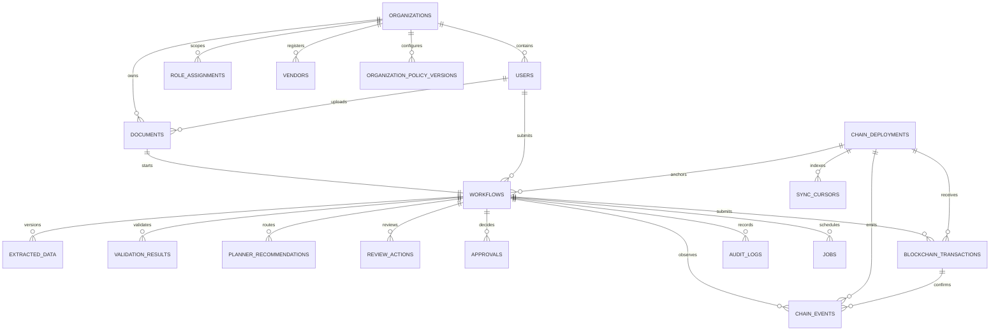

# ActionLoop — Database Schema Specification

| Field | Value |
|---|---|
| Document version | 0.1 — Draft for team review |
| Date | October 31, 2026 |
| Product | ActionLoop — AI-assisted document processing with blockchain-backed approval and verification |
| Buildathon | MST Blockchain Buildathon 2.0 |
| Source documents | ActionLoop PRD v0.1; System Architecture v0.2; Smart Contract Specification v0.1; MST Blockchain Buildathon 2.0 Guide |
| Database | PostgreSQL through Supabase |
| Migration tool | Alembic |
| Status | Proposed schema; implementation-ready after team review and MST contract interface freeze |

> **Purpose.** This document defines the persistent application data model, PostgreSQL constraints, indexes, append-only evidence records, transaction outbox, event indexer storage, access-control rules and migration sequence for ActionLoop. It is the database contract consumed by the backend/API, workflow worker, relayer integration and frontend read models.
>
> **Authority rule.** PostgreSQL is the application database and read model. The `WorkflowRegistry` contract on MST Blockchain is authoritative for blockchain-backed case state and final approval/rejection. A database row must never be treated as proof of an on-chain approval.
>
> **Implementation note.** The SQL below is a canonical design reference, not a substitute for testing against the selected Supabase/PostgreSQL version. Use versioned Alembic migrations; review every migration and test it against a clean database before merging.

---

## 1. Database design principles

1. **Off-chain data:** original invoices, vendor details, GSTINs, amounts, extracted fields, reasons and personal information stay in private storage or PostgreSQL. None of these are written to public chain storage or event payloads.
2. **On-chain evidence:** PostgreSQL stores the corresponding hashes, case identifiers, wallet addresses, transaction references and indexed public events.
3. **Chain-authoritative state:** `workflows.chain_state` is an indexed projection of the contract. Confirmed contract state controls the displayed blockchain-backed approval status.
4. **Application state is separate:** operational states such as `EXTRACTING`, `FAILED` and `DECISION_PENDING` describe the application process, not the contract state machine.
5. **Append-only evidence:** extraction versions, validation results, review actions, planner recommendations and audit entries are inserted as new records. Corrections never overwrite earlier evidence.
6. **Immutable policy versions:** validation thresholds and routing policies are versioned. A new policy creates a new row; it does not rewrite the policy used by an earlier case.
7. **Idempotent operations:** jobs and blockchain submissions have stable idempotency keys. Repeated requests return or resume the original operation rather than creating duplicate cases or transactions.
8. **Organization scoping:** all organization-owned records include `organization_id`, even though the MVP initially supports one organization.
9. **No client database access:** the browser calls FastAPI. It must not receive database credentials or access PostgreSQL tables directly.
10. **No secrets in rows or logs:** private keys, LLM API keys, Supabase service credentials and relayer service tokens are not database business data. A signed approval payload/signature may be persisted for dispatch, but must be access-restricted and never logged.

## 2. PostgreSQL conventions

### 2.1 Identifiers and types

| Data | PostgreSQL representation | Rule |
|---|---|---|
| Internal entity ID | `UUID` | Generate with `gen_random_uuid()`; never expose it as a secret |
| On-chain case ID | `BYTEA` | Exactly 32 bytes; displayed externally as `0x`-prefixed hex |
| EVM address | `VARCHAR(42)` | Validate as `0x` plus 40 hex characters; normalize to lowercase before storage |
| Transaction/block hash | `BYTEA` | Exactly 32 bytes; format to hex at API boundary |
| Money | `NUMERIC(18,2)` | Never use floating-point types for currency |
| Confidence | `NUMERIC(5,4)` | Range `0.0000` to `1.0000` |
| Dates and times | `TIMESTAMPTZ` | Store UTC; render in the user's local timezone |
| Flexible structured data | `JSONB` | Store schema-versioned application payloads; do not use it to avoid modeling relational relationships |
| Hash salt | encrypted `BYTEA` | Encrypt with an application-managed key/KMS; never expose in ordinary API responses |

### 2.2 Naming

- Tables and columns use `snake_case`.
- Primary keys use `id`; foreign keys use `<entity>_id`.
- All timestamps are `TIMESTAMPTZ` and end in `_at`.
- Hash columns are named by evidence type and stored as 32-byte `BYTEA` values.
- Status values use explicit PostgreSQL enums or constrained text. This document uses enums for stable state vocabularies.

### 2.3 State families — do not merge them

| Field | Values | Meaning |
|---|---|---|
| `workflows.application_state` | `UPLOADED`, `REGISTERING`, `EXTRACTING`, `VALIDATING`, `PLANNING`, `NEEDS_REVIEW`, `READY_FOR_APPROVAL`, `DECISION_PENDING`, `APPROVED`, `REJECTED`, `FAILED` | Current application/process projection |
| `workflows.chain_state` | `NOT_REGISTERED`, `SUBMITTED`, `EXTRACTED`, `VALIDATED`, `NEEDS_REVIEW`, `READY_FOR_APPROVAL`, `APPROVED`, `REJECTED` | Latest confirmed state reconstructed from contract storage/events |
| `workflows.sync_status` | `IN_SYNC`, `PENDING_CHAIN`, `DISCREPANCY` | Agreement between local projection and chain |
| `blockchain_transactions.status` | `PREPARED`, `SUBMITTED`, `PENDING`, `CONFIRMED`, `FAILED`, `REPLACED` | Lifecycle of one transaction submission |
| `documents.scan_status` | `PENDING`, `CLEAN`, `REJECTED`, `ERROR` | File safety-processing status |

`FAILED` is an operational failure, **not** an on-chain rejection. Do not map it to `REJECTED`.

---

## 3. Entity relationship overview



The LangGraph PostgreSQL checkpointer may create its own tables/schema according to the pinned LangGraph checkpointer version. Those implementation-managed tables are not manually duplicated in the application schema; configure and migrate them separately.

---

## 4. Table catalogue

| Table | Purpose | Mutation model |
|---|---|---|
| `organizations` | MVP organization and active policy pointer | Admin-managed |
| `users` | Supabase Auth identity and linked wallet | User/admin-managed |
| `role_assignments` | App role mapping and on-chain role-grant status | Append grant/revoke history |
| `vendors` | Registered vendor reference data | Versioned updates |
| `organization_policy_versions` | Immutable thresholds and routing policy versions | Insert new version only |
| `chain_deployments` | MST Testnet/Mainnet contract configuration metadata | Admin/deployment-managed |
| `documents` | Private file metadata and original file hash | Metadata lifecycle; file bytes remain in storage |
| `workflows` | Case aggregate and application/chain projections | Mutable projection; chain fields indexer-owned |
| `extracted_data` | Append-only extraction/manual/correction versions | Insert only |
| `validation_results` | Deterministic validation result per data version | Insert only |
| `planner_recommendations` | Versioned routing output and optional explanation | Insert only |
| `review_actions` | Attributed reviewer confirmation/correction/manual entry | Insert only |
| `approvals` | Signed decision intents and final chain-linked decision metadata | Intent lifecycle; signed evidence immutable |
| `blockchain_transactions` | Transaction outbox and lifecycle | Status updates only; do not delete |
| `chain_events` | Indexed contract events | Event payload immutable; canonicality metadata may change on reorg |
| `sync_cursors` | Indexer checkpoint per deployment/stream | Indexer-managed |
| `jobs` | PostgreSQL-backed worker queue | Queue lifecycle |
| `wallet_challenges` | Single-use wallet-link challenge | Consume once, then retain/reap under retention policy |
| `audit_logs` | Append-only application audit trail | Insert only |

---

## 5. Canonical schema DDL

The following DDL defines the core MVP tables. Apply it through Alembic migrations. If the target PostgreSQL instance already has any of these types/tables, reconcile the migration rather than running this script blindly.

### 5.1 Extensions and enums

```sql
-- gen_random_uuid() is available in current PostgreSQL releases.
-- Enable extensions only through reviewed migrations and only when needed.

CREATE TYPE user_status AS ENUM ('ACTIVE', 'INVITED', 'SUSPENDED', 'DISABLED');
CREATE TYPE app_role AS ENUM (
  'SUBMITTER', 'REVIEWER', 'APPROVER', 'SENIOR_APPROVER', 'ADMIN', 'AUDITOR'
);
CREATE TYPE role_chain_status AS ENUM ('PENDING', 'CONFIRMED', 'FAILED', 'REVOKED');
CREATE TYPE file_scan_status AS ENUM ('PENDING', 'CLEAN', 'REJECTED', 'ERROR');
CREATE TYPE application_state AS ENUM (
  'UPLOADED', 'REGISTERING', 'EXTRACTING', 'VALIDATING', 'PLANNING',
  'NEEDS_REVIEW', 'READY_FOR_APPROVAL', 'DECISION_PENDING',
  'APPROVED', 'REJECTED', 'FAILED'
);
CREATE TYPE chain_case_state AS ENUM (
  'NOT_REGISTERED', 'SUBMITTED', 'EXTRACTED', 'VALIDATED',
  'NEEDS_REVIEW', 'READY_FOR_APPROVAL', 'APPROVED', 'REJECTED'
);
CREATE TYPE sync_status AS ENUM ('IN_SYNC', 'PENDING_CHAIN', 'DISCREPANCY');
CREATE TYPE data_author_kind AS ENUM ('EXTRACTOR', 'REVIEWER_CORRECTION', 'MANUAL_ENTRY');
CREATE TYPE validation_disposition AS ENUM (
  'NONE', 'PASS', 'REVIEWABLE_WARNING', 'CORRECTION_REQUIRED', 'HARD_BLOCK'
);
CREATE TYPE approval_tier AS ENUM ('NONE', 'STANDARD', 'SENIOR');
CREATE TYPE planner_route AS ENUM (
  'REQUEST_APPROVAL', 'HUMAN_REVIEW', 'MANUAL_VERIFICATION',
  'FLAG_FOR_INVESTIGATION', 'RETURN_FOR_CORRECTION', 'REJECT_RECOMMENDED'
);
CREATE TYPE review_action_type AS ENUM (
  'CONFIRM_WARNING', 'CORRECT_DATA', 'MANUAL_ENTRY', 'RETURN_FOR_CORRECTION', 'COMMENT'
);
CREATE TYPE decision_type AS ENUM ('APPROVE', 'REJECT');
CREATE TYPE approval_intent_status AS ENUM (
  'PREPARED', 'SIGNED', 'QUEUED', 'SUBMITTED', 'PENDING',
  'CONFIRMED', 'FAILED', 'EXPIRED', 'SUPERSEDED'
);
CREATE TYPE chain_tx_action AS ENUM (
  'CREATE_CASE', 'RECORD_EXTRACTION', 'RECORD_EXTRACTION_FAILURE',
  'RECORD_MANUAL_ENTRY', 'RECORD_VALIDATION', 'ROUTE_VALIDATED_CASE',
  'MARK_REVIEWED', 'RECORD_CORRECTION', 'APPROVE_CASE', 'REJECT_CASE',
  'GRANT_ROLE', 'REVOKE_ROLE', 'PAUSE_CONTRACT', 'UNPAUSE_CONTRACT'
);
CREATE TYPE chain_tx_status AS ENUM (
  'PREPARED', 'SUBMITTED', 'PENDING', 'CONFIRMED', 'FAILED', 'REPLACED'
);
CREATE TYPE job_status AS ENUM ('QUEUED', 'RUNNING', 'RETRY_WAIT', 'SUCCEEDED', 'FAILED', 'CANCELLED');
CREATE TYPE audit_actor_type AS ENUM ('USER', 'SERVICE', 'SYSTEM', 'CHAIN');
CREATE TYPE wallet_challenge_status AS ENUM ('ISSUED', 'CONSUMED', 'EXPIRED', 'REVOKED');
```

### 5.2 Organizations and users

```sql
CREATE TABLE organizations (
  id UUID PRIMARY KEY DEFAULT gen_random_uuid(),
  name TEXT NOT NULL,
  slug TEXT NOT NULL UNIQUE,
  status TEXT NOT NULL DEFAULT 'ACTIVE' CHECK (status IN ('ACTIVE', 'SUSPENDED')),
  active_policy_version INTEGER,
  created_at TIMESTAMPTZ NOT NULL DEFAULT now(),
  updated_at TIMESTAMPTZ NOT NULL DEFAULT now()
);

-- id is the Supabase Auth user UUID. Do not duplicate passwords or auth credentials.
CREATE TABLE users (
  id UUID PRIMARY KEY REFERENCES auth.users(id) ON DELETE RESTRICT,
  organization_id UUID NOT NULL REFERENCES organizations(id) ON DELETE RESTRICT,
  email TEXT NOT NULL,
  display_name TEXT NOT NULL,
  wallet_address VARCHAR(42),
  wallet_linked_at TIMESTAMPTZ,
  status user_status NOT NULL DEFAULT 'INVITED',
  created_at TIMESTAMPTZ NOT NULL DEFAULT now(),
  updated_at TIMESTAMPTZ NOT NULL DEFAULT now(),
  CONSTRAINT users_wallet_format CHECK (
    wallet_address IS NULL OR wallet_address ~ '^0x[0-9a-f]{40}$'
  ),
  CONSTRAINT users_wallet_link_consistency CHECK (
    (wallet_address IS NULL AND wallet_linked_at IS NULL) OR
    (wallet_address IS NOT NULL AND wallet_linked_at IS NOT NULL)
  )
);
CREATE UNIQUE INDEX users_wallet_unique_idx ON users (wallet_address) WHERE wallet_address IS NOT NULL;
CREATE INDEX users_org_status_idx ON users (organization_id, status);

CREATE TABLE role_assignments (
  id UUID PRIMARY KEY DEFAULT gen_random_uuid(),
  organization_id UUID NOT NULL REFERENCES organizations(id) ON DELETE RESTRICT,
  user_id UUID NOT NULL REFERENCES users(id) ON DELETE RESTRICT,
  role app_role NOT NULL,
  wallet_address_snapshot VARCHAR(42) NOT NULL,
  granted_by_user_id UUID REFERENCES users(id) ON DELETE RESTRICT,
  granted_at TIMESTAMPTZ NOT NULL DEFAULT now(),
  revoked_by_user_id UUID REFERENCES users(id) ON DELETE RESTRICT,
  revoked_at TIMESTAMPTZ,
  chain_status role_chain_status NOT NULL DEFAULT 'PENDING',
  grant_tx_hash BYTEA,
  revoke_tx_hash BYTEA,
  created_at TIMESTAMPTZ NOT NULL DEFAULT now(),
  CONSTRAINT role_wallet_format CHECK (wallet_address_snapshot ~ '^0x[0-9a-f]{40}$'),
  CONSTRAINT role_grant_hash_len CHECK (grant_tx_hash IS NULL OR octet_length(grant_tx_hash) = 32),
  CONSTRAINT role_revoke_hash_len CHECK (revoke_tx_hash IS NULL OR octet_length(revoke_tx_hash) = 32),
  CONSTRAINT role_revocation_consistency CHECK (
    (revoked_at IS NULL AND revoked_by_user_id IS NULL) OR
    (revoked_at IS NOT NULL AND revoked_by_user_id IS NOT NULL)
  )
);
CREATE UNIQUE INDEX role_assignments_active_unique_idx
  ON role_assignments (organization_id, user_id, role)
  WHERE revoked_at IS NULL;
CREATE INDEX role_assignments_wallet_idx ON role_assignments (wallet_address_snapshot, chain_status);
CREATE INDEX role_assignments_org_role_idx ON role_assignments (organization_id, role) WHERE revoked_at IS NULL;
```

**Identity rules:** wallet addresses are lower-case normalized before insert. Wallet linking uses a single-use challenge (Section 5.15). A user may have only one currently linked wallet in the MVP, and a wallet may belong to only one user. Re-linking requires the old on-chain roles to be revoked and the new wallet's roles to be granted and confirmed.

### 5.3 Versioned policy and vendors

```sql
CREATE TABLE organization_policy_versions (
  id UUID PRIMARY KEY DEFAULT gen_random_uuid(),
  organization_id UUID NOT NULL REFERENCES organizations(id) ON DELETE RESTRICT,
  version INTEGER NOT NULL CHECK (version > 0),
  currency CHAR(3) NOT NULL DEFAULT 'INR',
  standard_approval_limit NUMERIC(18,2) NOT NULL CHECK (standard_approval_limit >= 0),
  minimum_overall_confidence NUMERIC(5,4) NOT NULL CHECK (minimum_overall_confidence BETWEEN 0 AND 1),
  minimum_field_confidence NUMERIC(5,4) NOT NULL CHECK (minimum_field_confidence BETWEEN 0 AND 1),
  max_data_versions INTEGER NOT NULL DEFAULT 5 CHECK (max_data_versions BETWEEN 1 AND 20),
  rule_set_version INTEGER NOT NULL CHECK (rule_set_version > 0),
  planner_policy JSONB NOT NULL DEFAULT '{}'::jsonb,
  validator_thresholds JSONB NOT NULL DEFAULT '{}'::jsonb,
  effective_from TIMESTAMPTZ NOT NULL DEFAULT now(),
  created_by_user_id UUID REFERENCES users(id) ON DELETE RESTRICT,
  created_at TIMESTAMPTZ NOT NULL DEFAULT now(),
  UNIQUE (organization_id, version),
  UNIQUE (organization_id, id)
);
ALTER TABLE organizations
  ADD CONSTRAINT organizations_active_policy_fk
  FOREIGN KEY (id, active_policy_version)
  REFERENCES organization_policy_versions (organization_id, version)
  DEFERRABLE INITIALLY DEFERRED;

CREATE TABLE vendors (
  id UUID PRIMARY KEY DEFAULT gen_random_uuid(),
  organization_id UUID NOT NULL REFERENCES organizations(id) ON DELETE RESTRICT,
  vendor_code TEXT NOT NULL,
  legal_name TEXT NOT NULL,
  gstin VARCHAR(15),
  status TEXT NOT NULL DEFAULT 'ACTIVE' CHECK (status IN ('ACTIVE', 'INACTIVE', 'BLOCKED')),
  record_version INTEGER NOT NULL DEFAULT 1 CHECK (record_version > 0),
  created_at TIMESTAMPTZ NOT NULL DEFAULT now(),
  updated_at TIMESTAMPTZ NOT NULL DEFAULT now(),
  UNIQUE (organization_id, vendor_code),
  CONSTRAINT vendors_gstin_format CHECK (gstin IS NULL OR gstin ~ '^[0-9]{2}[A-Z]{5}[0-9]{4}[A-Z][1-9A-Z]Z[0-9A-Z]$')
);
CREATE INDEX vendors_org_name_idx ON vendors (organization_id, legal_name);
CREATE INDEX vendors_org_gstin_idx ON vendors (organization_id, gstin) WHERE gstin IS NOT NULL;
```

**Policy note:** `standard_approval_limit` is a demonstration policy input, not an asserted college financial rule. The Validator selects `STANDARD` or `SENIOR` using the policy version active for the case. The selected tier, policy version and validation hash are committed on-chain by the validator identity. The contract enforces the attested tier; it cannot independently recalculate invoice amount because amounts stay off-chain.

Policy rows become immutable once used by a workflow. Changing a threshold or rule creates a new version and updates `organizations.active_policy_version`.

### 5.4 Chain deployments

```sql
CREATE TABLE chain_deployments (
  id UUID PRIMARY KEY DEFAULT gen_random_uuid(),
  environment TEXT NOT NULL CHECK (environment IN ('LOCAL', 'TESTNET', 'MAINNET')),
  network_name TEXT NOT NULL,
  chain_id BIGINT NOT NULL CHECK (chain_id > 0),
  native_symbol TEXT NOT NULL,
  rpc_config_key TEXT NOT NULL,
  explorer_base_url TEXT NOT NULL,
  contract_address VARCHAR(42),
  deployment_tx_hash BYTEA,
  deployment_block_number BIGINT,
  deployed_at TIMESTAMPTZ,
  confirmation_depth INTEGER NOT NULL DEFAULT 1 CHECK (confirmation_depth >= 1),
  contract_abi_version TEXT,
  is_active BOOLEAN NOT NULL DEFAULT false,
  created_at TIMESTAMPTZ NOT NULL DEFAULT now(),
  CONSTRAINT deployment_address_format CHECK (
    contract_address IS NULL OR contract_address ~ '^0x[0-9a-f]{40}$'
  ),
  CONSTRAINT deployment_tx_hash_len CHECK (
    deployment_tx_hash IS NULL OR octet_length(deployment_tx_hash) = 32
  ),
  UNIQUE (environment, chain_id, contract_address)
);
CREATE UNIQUE INDEX one_active_deployment_per_environment_idx
  ON chain_deployments (environment) WHERE is_active;
```

Seed configuration from the supplied MST guide through a migration or deployment script:

| Environment | Chain ID | RPC configuration key | Explorer base URL | Native symbol |
|---|---:|---|---|---|
| TESTNET | `91562037` | `MST_TESTNET_RPC_URL` | `https://testnet.mstscan.com` | `tMSTC` |
| MAINNET | `4646` | `MST_MAINNET_RPC_URL` | `https://mstscan.com` | `MSTC` |

The RPC URL may be stored in environment configuration; `rpc_config_key` stores the variable name, not a secret credential. Never store a private key or relayer secret in this table. The contract address is populated only after deployment. Verify the precise MSTScan transaction/contract URL pattern rather than assuming one.

### 5.5 Documents and workflow aggregate

```sql
CREATE TABLE documents (
  id UUID PRIMARY KEY DEFAULT gen_random_uuid(),
  organization_id UUID NOT NULL REFERENCES organizations(id) ON DELETE RESTRICT,
  uploaded_by_user_id UUID NOT NULL REFERENCES users(id) ON DELETE RESTRICT,
  original_filename TEXT NOT NULL,
  storage_bucket TEXT NOT NULL,
  storage_path TEXT NOT NULL,
  mime_type TEXT NOT NULL,
  file_size_bytes BIGINT NOT NULL CHECK (file_size_bytes > 0),
  document_sha256 BYTEA NOT NULL CHECK (octet_length(document_sha256) = 32),
  scan_status file_scan_status NOT NULL DEFAULT 'PENDING',
  scan_engine TEXT,
  scan_completed_at TIMESTAMPTZ,
  retention_until TIMESTAMPTZ,
  deleted_at TIMESTAMPTZ,
  created_at TIMESTAMPTZ NOT NULL DEFAULT now(),
  UNIQUE (storage_bucket, storage_path)
);
CREATE INDEX documents_org_uploaded_idx ON documents (organization_id, created_at DESC);
CREATE INDEX documents_hash_idx ON documents (organization_id, document_sha256);

CREATE TABLE workflows (
  id UUID PRIMARY KEY DEFAULT gen_random_uuid(),
  organization_id UUID NOT NULL REFERENCES organizations(id) ON DELETE RESTRICT,
  document_id UUID NOT NULL UNIQUE REFERENCES documents(id) ON DELETE RESTRICT,
  case_id BYTEA NOT NULL CHECK (octet_length(case_id) = 32),
  chain_deployment_id UUID REFERENCES chain_deployments(id) ON DELETE RESTRICT,
  submitter_user_id UUID NOT NULL REFERENCES users(id) ON DELETE RESTRICT,
  submitter_wallet VARCHAR(42) NOT NULL,
  application_state application_state NOT NULL DEFAULT 'UPLOADED',
  chain_state chain_case_state NOT NULL DEFAULT 'NOT_REGISTERED',
  sync_status sync_status NOT NULL DEFAULT 'PENDING_CHAIN',
  current_data_version INTEGER NOT NULL DEFAULT 0 CHECK (current_data_version >= 0),
  validation_disposition validation_disposition NOT NULL DEFAULT 'NONE',
  approval_tier approval_tier NOT NULL DEFAULT 'NONE',
  policy_version INTEGER,
  assigned_reviewer_user_id UUID REFERENCES users(id) ON DELETE RESTRICT,
  assigned_approver_user_id UUID REFERENCES users(id) ON DELETE RESTRICT,
  last_chain_block_number BIGINT,
  last_chain_block_hash BYTEA CHECK (last_chain_block_hash IS NULL OR octet_length(last_chain_block_hash) = 32),
  submitted_to_chain_at TIMESTAMPTZ,
  decided_at TIMESTAMPTZ,
  operational_error_code TEXT,
  operational_error_message TEXT,
  created_at TIMESTAMPTZ NOT NULL DEFAULT now(),
  updated_at TIMESTAMPTZ NOT NULL DEFAULT now(),
  UNIQUE (organization_id, case_id),
  CONSTRAINT workflows_submitter_wallet_format CHECK (submitter_wallet ~ '^0x[0-9a-f]{40}$'),
  CONSTRAINT workflows_policy_fk FOREIGN KEY (organization_id, policy_version)
    REFERENCES organization_policy_versions (organization_id, version),
  CONSTRAINT workflows_chain_deployment_required CHECK (
    chain_state = 'NOT_REGISTERED' OR chain_deployment_id IS NOT NULL
  )
);
CREATE INDEX workflows_org_app_state_idx ON workflows (organization_id, application_state, updated_at DESC);
CREATE INDEX workflows_org_chain_state_idx ON workflows (organization_id, chain_state, sync_status);
CREATE INDEX workflows_reviewer_queue_idx ON workflows (assigned_reviewer_user_id, updated_at DESC)
  WHERE application_state = 'NEEDS_REVIEW';
CREATE INDEX workflows_approver_queue_idx ON workflows (assigned_approver_user_id, updated_at DESC)
  WHERE application_state IN ('READY_FOR_APPROVAL', 'DECISION_PENDING');
CREATE INDEX workflows_created_idx ON workflows (created_at DESC);
```

`case_id` derivation must be identical in the backend, tests and deployment tooling. Proposed derivation: a domain-separated hash over organization UUID and workflow UUID, producing exactly 32 bytes. The exact formula must be shared in a test vector and frozen with the contract interface; do not independently derive IDs in multiple services.

`chain_deployment_id` may be assigned as soon as the target deployment is selected, including while registration is pending and `chain_state` is still `NOT_REGISTERED`. Once a registration transaction is submitted, the deployment reference must not change for that case. The constraint therefore requires a deployment for every non-`NOT_REGISTERED` chain state but permits a preselected deployment while registration is pending.

### 5.6 Extracted data versions

```sql
CREATE TABLE extracted_data (
  id UUID PRIMARY KEY DEFAULT gen_random_uuid(),
  organization_id UUID NOT NULL REFERENCES organizations(id) ON DELETE RESTRICT,
  workflow_id UUID NOT NULL REFERENCES workflows(id) ON DELETE RESTRICT,
  data_version INTEGER NOT NULL CHECK (data_version > 0),
  author_kind data_author_kind NOT NULL,
  author_user_id UUID REFERENCES users(id) ON DELETE RESTRICT,
  author_wallet VARCHAR(42),
  fields JSONB NOT NULL,
  field_confidence JSONB NOT NULL DEFAULT '{}'::jsonb,
  source_evidence JSONB NOT NULL DEFAULT '{}'::jsonb,
  canonicalization_version TEXT NOT NULL DEFAULT 'RFC8785-v1',
  schema_version TEXT NOT NULL,
  data_hash BYTEA NOT NULL CHECK (octet_length(data_hash) = 32),
  hash_salt_ciphertext BYTEA,
  salt_key_version TEXT,
  model_provider TEXT,
  model_name TEXT,
  model_version TEXT,
  prompt_version TEXT,
  created_at TIMESTAMPTZ NOT NULL DEFAULT now(),
  UNIQUE (workflow_id, data_version),
  CONSTRAINT extracted_data_author_wallet_format CHECK (
    author_wallet IS NULL OR author_wallet ~ '^0x[0-9a-f]{40}$'
  ),
  CONSTRAINT extracted_data_salt_pair CHECK (
    (hash_salt_ciphertext IS NULL AND salt_key_version IS NULL) OR
    (hash_salt_ciphertext IS NOT NULL AND salt_key_version IS NOT NULL)
  )
);
CREATE INDEX extracted_data_workflow_version_idx ON extracted_data (workflow_id, data_version DESC);
```

Rules:
- Version 1 is normally `EXTRACTOR`; it may be `MANUAL_ENTRY` after extraction failure.
- Later human corrections use `REVIEWER_CORRECTION`.
- `fields` stores normalized invoice fields (document type, vendor name/GSTIN, invoice number/date, line items, subtotal, tax, total and currency) under a versioned schema.
- `field_confidence` stores per-field values in `[0,1]`; `source_evidence` stores page/region or quoted source references, not arbitrary model instructions.
- `hash_salt_ciphertext` contains encrypted salt material only. The plaintext salt must exist only transiently in the hashing/verification service or an approved KMS workflow.
- Never update a prior version. A correction creates a new row and a new hash.

### 5.7 Validation results

```sql
CREATE TABLE validation_results (
  id UUID PRIMARY KEY DEFAULT gen_random_uuid(),
  organization_id UUID NOT NULL REFERENCES organizations(id) ON DELETE RESTRICT,
  workflow_id UUID NOT NULL REFERENCES workflows(id) ON DELETE RESTRICT,
  data_version INTEGER NOT NULL,
  disposition validation_disposition NOT NULL CHECK (disposition <> 'NONE'),
  approval_tier approval_tier NOT NULL,
  passed BOOLEAN NOT NULL,
  rule_set_version INTEGER NOT NULL CHECK (rule_set_version > 0),
  policy_version INTEGER NOT NULL CHECK (policy_version > 0),
  thresholds_used JSONB NOT NULL,
  rule_results JSONB NOT NULL,
  error_codes JSONB NOT NULL DEFAULT '[]'::jsonb,
  reference_snapshot JSONB NOT NULL DEFAULT '{}'::jsonb,
  reference_snapshot_hash BYTEA CHECK (reference_snapshot_hash IS NULL OR octet_length(reference_snapshot_hash) = 32),
  canonicalization_version TEXT NOT NULL DEFAULT 'RFC8785-v1',
  validation_hash BYTEA NOT NULL CHECK (octet_length(validation_hash) = 32),
  hash_salt_ciphertext BYTEA,
  salt_key_version TEXT,
  validator_wallet VARCHAR(42),
  created_at TIMESTAMPTZ NOT NULL DEFAULT now(),
  UNIQUE (workflow_id, data_version),
  FOREIGN KEY (workflow_id, data_version)
    REFERENCES extracted_data (workflow_id, data_version) ON DELETE RESTRICT,
  CONSTRAINT validation_tier_rule CHECK (
    (disposition = 'HARD_BLOCK' AND approval_tier = 'NONE') OR
    (disposition <> 'HARD_BLOCK' AND approval_tier IN ('STANDARD', 'SENIOR'))
  ),
  CONSTRAINT validation_pass_rule CHECK (
    (disposition = 'PASS' AND passed = true) OR
    (disposition <> 'PASS' AND passed = false)
  ),
  CONSTRAINT validation_wallet_format CHECK (
    validator_wallet IS NULL OR validator_wallet ~ '^0x[0-9a-f]{40}$'
  ),
  CONSTRAINT validation_salt_pair CHECK (
    (hash_salt_ciphertext IS NULL AND salt_key_version IS NULL) OR
    (hash_salt_ciphertext IS NOT NULL AND salt_key_version IS NOT NULL)
  )
);
CREATE INDEX validation_results_workflow_idx ON validation_results (workflow_id, created_at DESC);
CREATE INDEX validation_results_policy_idx ON validation_results (organization_id, policy_version, rule_set_version);
```

`validation_results` must reference the exact data version it validated. Validation is deterministic Python logic, not LLM judgment. It records the actual rule-set version, thresholds and reference-data snapshot identifiers so the historical result can be explained later.

### 5.8 Planner recommendations

```sql
CREATE TABLE planner_recommendations (
  id UUID PRIMARY KEY DEFAULT gen_random_uuid(),
  organization_id UUID NOT NULL REFERENCES organizations(id) ON DELETE RESTRICT,
  workflow_id UUID NOT NULL REFERENCES workflows(id) ON DELETE RESTRICT,
  data_version INTEGER NOT NULL,
  validation_result_id UUID NOT NULL REFERENCES validation_results(id) ON DELETE RESTRICT,
  route planner_route NOT NULL,
  policy_version INTEGER NOT NULL CHECK (policy_version > 0),
  explanation TEXT,
  explanation_provider TEXT,
  explanation_model TEXT,
  explanation_prompt_version TEXT,
  created_at TIMESTAMPTZ NOT NULL DEFAULT now(),
  FOREIGN KEY (workflow_id, data_version)
    REFERENCES extracted_data (workflow_id, data_version) ON DELETE RESTRICT
);
CREATE INDEX planner_recommendations_workflow_idx ON planner_recommendations (workflow_id, created_at DESC);
```

The `route` is the authoritative deterministic output of the policy table. `explanation` is optional generated prose and cannot change the selected route. The explanation is off-chain only.

### 5.9 Reviewer actions

```sql
CREATE TABLE review_actions (
  id UUID PRIMARY KEY DEFAULT gen_random_uuid(),
  organization_id UUID NOT NULL REFERENCES organizations(id) ON DELETE RESTRICT,
  workflow_id UUID NOT NULL REFERENCES workflows(id) ON DELETE RESTRICT,
  reviewer_user_id UUID NOT NULL REFERENCES users(id) ON DELETE RESTRICT,
  reviewer_wallet VARCHAR(42) NOT NULL,
  action review_action_type NOT NULL,
  from_data_version INTEGER,
  to_data_version INTEGER,
  reason_text TEXT,
  reason_hash BYTEA CHECK (reason_hash IS NULL OR octet_length(reason_hash) = 32),
  review_evidence_hash BYTEA CHECK (review_evidence_hash IS NULL OR octet_length(review_evidence_hash) = 32),
  blockchain_transaction_id UUID,
  created_at TIMESTAMPTZ NOT NULL DEFAULT now(),
  CONSTRAINT review_wallet_format CHECK (reviewer_wallet ~ '^0x[0-9a-f]{40}$'),
  CONSTRAINT review_version_order CHECK (
    to_data_version IS NULL OR from_data_version IS NULL OR to_data_version >= from_data_version
  )
);
CREATE INDEX review_actions_workflow_idx ON review_actions (workflow_id, created_at);
CREATE INDEX review_actions_reviewer_idx ON review_actions (reviewer_user_id, created_at DESC);
```

This table preserves the identity of anyone who confirmed a warning, corrected data or entered data manually. The contract stores the reviewer wallet and the associated evidence commitment needed to enforce the reviewer/approver separation rule. `reason_text` stays off-chain; only its hash may be committed on-chain.

### 5.10 Blockchain transactions — transactional outbox

```sql
CREATE TABLE blockchain_transactions (
  id UUID PRIMARY KEY DEFAULT gen_random_uuid(),
  organization_id UUID NOT NULL REFERENCES organizations(id) ON DELETE RESTRICT,
  workflow_id UUID REFERENCES workflows(id) ON DELETE RESTRICT,
  chain_deployment_id UUID NOT NULL REFERENCES chain_deployments(id) ON DELETE RESTRICT,
  action chain_tx_action NOT NULL,
  idempotency_key TEXT NOT NULL UNIQUE,
  signer_wallet VARCHAR(42),
  transaction_sender VARCHAR(42),
  relayer_wallet VARCHAR(42),
  target_contract VARCHAR(42) NOT NULL,
  tx_hash BYTEA,
  replaces_transaction_id UUID REFERENCES blockchain_transactions(id) ON DELETE RESTRICT,
  transaction_nonce NUMERIC(78,0),
  block_number BIGINT,
  block_hash BYTEA,
  confirmations INTEGER NOT NULL DEFAULT 0 CHECK (confirmations >= 0),
  status chain_tx_status NOT NULL DEFAULT 'PREPARED',
  attempt_count INTEGER NOT NULL DEFAULT 0 CHECK (attempt_count >= 0),
  next_attempt_at TIMESTAMPTZ,
  submitted_at TIMESTAMPTZ,
  confirmed_at TIMESTAMPTZ,
  failed_at TIMESTAMPTZ,
  error_code TEXT,
  safe_error_message TEXT,
  request_correlation_id UUID,
  created_at TIMESTAMPTZ NOT NULL DEFAULT now(),
  updated_at TIMESTAMPTZ NOT NULL DEFAULT now(),
  CONSTRAINT tx_signer_wallet_format CHECK (signer_wallet IS NULL OR signer_wallet ~ '^0x[0-9a-f]{40}$'),
  CONSTRAINT tx_sender_wallet_format CHECK (transaction_sender IS NULL OR transaction_sender ~ '^0x[0-9a-f]{40}$'),
  CONSTRAINT tx_relayer_wallet_format CHECK (relayer_wallet IS NULL OR relayer_wallet ~ '^0x[0-9a-f]{40}$'),
  CONSTRAINT tx_target_wallet_format CHECK (target_contract ~ '^0x[0-9a-f]{40}$'),
  CONSTRAINT tx_hash_len CHECK (tx_hash IS NULL OR octet_length(tx_hash) = 32),
  CONSTRAINT tx_block_hash_len CHECK (block_hash IS NULL OR octet_length(block_hash) = 32),
  CONSTRAINT tx_confirmed_fields CHECK (
    status <> 'CONFIRMED' OR (tx_hash IS NOT NULL AND block_number IS NOT NULL AND confirmed_at IS NOT NULL)
  )
);
CREATE UNIQUE INDEX blockchain_tx_hash_unique_idx
  ON blockchain_transactions (chain_deployment_id, tx_hash) WHERE tx_hash IS NOT NULL;
CREATE INDEX blockchain_transactions_outbox_idx
  ON blockchain_transactions (status, next_attempt_at, created_at)
  WHERE status IN ('PREPARED', 'SUBMITTED', 'PENDING', 'REPLACED');
CREATE INDEX blockchain_transactions_workflow_idx
  ON blockchain_transactions (workflow_id, created_at DESC);
CREATE INDEX blockchain_transactions_deployment_status_idx
  ON blockchain_transactions (chain_deployment_id, status, created_at DESC);
```

Outbox rules:
- Create the outbox row in the same PostgreSQL transaction as the application record that requires the chain action.
- A dispatcher claims eligible rows with `FOR UPDATE SKIP LOCKED`, then submits to the correct writer/relayer adapter.
- Do not perform network RPC calls while holding a database row lock.
- Update the row to `SUBMITTED`/`PENDING` and record the returned transaction hash.
- The indexer, not the API response, sets `CONFIRMED` after the configured confirmation depth.
- A deterministic contract revert is terminal `FAILED`; do not blindly retry it.
- A fee replacement is a new linked row or a tracked replacement using `replaces_transaction_id`; preserve the original hash and status history.
- Never store a private key, raw secret or unrestricted calldata in this table. For relayed decisions, the signed typed intent belongs in the restricted `approvals` record.

### 5.11 Approval intents and decisions

```sql
CREATE TABLE approvals (
  id UUID PRIMARY KEY DEFAULT gen_random_uuid(),
  organization_id UUID NOT NULL REFERENCES organizations(id) ON DELETE RESTRICT,
  workflow_id UUID NOT NULL REFERENCES workflows(id) ON DELETE RESTRICT,
  decision decision_type NOT NULL,
  approver_user_id UUID NOT NULL REFERENCES users(id) ON DELETE RESTRICT,
  approver_wallet VARCHAR(42) NOT NULL,
  data_version INTEGER NOT NULL CHECK (data_version > 0),
  evidence_hash BYTEA NOT NULL CHECK (octet_length(evidence_hash) = 32),
  reason_text TEXT,
  reason_hash BYTEA CHECK (reason_hash IS NULL OR octet_length(reason_hash) = 32),
  signer_nonce NUMERIC(78,0) NOT NULL CHECK (signer_nonce >= 0),
  signature_deadline TIMESTAMPTZ NOT NULL,
  typed_data_domain JSONB NOT NULL,
  typed_data_message JSONB NOT NULL,
  signature BYTEA,
  status approval_intent_status NOT NULL DEFAULT 'PREPARED',
  blockchain_transaction_id UUID REFERENCES blockchain_transactions(id) ON DELETE RESTRICT,
  decision_event_id UUID,
  signed_at TIMESTAMPTZ,
  chain_confirmed_at TIMESTAMPTZ,
  created_at TIMESTAMPTZ NOT NULL DEFAULT now(),
  updated_at TIMESTAMPTZ NOT NULL DEFAULT now(),
  CONSTRAINT approval_wallet_format CHECK (approver_wallet ~ '^0x[0-9a-f]{40}$'),
  CONSTRAINT approval_signature_pair CHECK (
    (signature IS NULL AND signed_at IS NULL) OR
    (signature IS NOT NULL AND signed_at IS NOT NULL)
  ),
  UNIQUE (workflow_id, approver_wallet, signer_nonce)
);
CREATE INDEX approvals_workflow_idx ON approvals (workflow_id, created_at DESC);
CREATE INDEX approvals_approver_idx ON approvals (approver_user_id, status, created_at DESC);
CREATE INDEX approvals_status_idx ON approvals (status, created_at DESC);
```

Approval intent rules:
- The API prepares typed data from the current on-chain state, evidence hash, wallet nonce and deadline.
- The frontend asks BridgeKey/the connected wallet to sign; the backend does not manufacture a user signature.
- Store the exact domain, message, signature and signer address needed for relayer submission and later audit.
- Treat signature bytes as sensitive operational data until expired/consumed. Restrict reads, never log them, and do not expose them in normal case-detail responses.
- `CONFIRMED` is set only after the indexer observes the matching `CaseApproved` or `CaseRejected` event at the configured depth.
- A signed intent for stale evidence must fail; a new version requires a newly prepared and signed intent.
- `decision_event_id` is populated after the matching event is indexed (foreign key added after `chain_events` creation).

### 5.12 Chain events and indexer cursors

```sql
CREATE TABLE chain_events (
  id UUID PRIMARY KEY DEFAULT gen_random_uuid(),
  chain_deployment_id UUID NOT NULL REFERENCES chain_deployments(id) ON DELETE RESTRICT,
  workflow_id UUID REFERENCES workflows(id) ON DELETE RESTRICT,
  transaction_id UUID REFERENCES blockchain_transactions(id) ON DELETE RESTRICT,
  transaction_hash BYTEA NOT NULL CHECK (octet_length(transaction_hash) = 32),
  log_index INTEGER NOT NULL CHECK (log_index >= 0),
  block_number BIGINT NOT NULL CHECK (block_number >= 0),
  block_hash BYTEA NOT NULL CHECK (octet_length(block_hash) = 32),
  transaction_index INTEGER,
  event_name TEXT NOT NULL,
  event_signature TEXT,
  case_id BYTEA CHECK (case_id IS NULL OR octet_length(case_id) = 32),
  event_payload JSONB NOT NULL,
  event_timestamp TIMESTAMPTZ,
  is_canonical BOOLEAN NOT NULL DEFAULT true,
  is_confirmed BOOLEAN NOT NULL DEFAULT false,
  observed_at TIMESTAMPTZ NOT NULL DEFAULT now(),
  UNIQUE (chain_deployment_id, transaction_hash, log_index)
);
CREATE INDEX chain_events_case_order_idx
  ON chain_events (chain_deployment_id, case_id, block_number, log_index);
CREATE INDEX chain_events_block_idx ON chain_events (chain_deployment_id, block_number);
CREATE INDEX chain_events_name_idx ON chain_events (event_name, observed_at DESC);

CREATE TABLE sync_cursors (
  id UUID PRIMARY KEY DEFAULT gen_random_uuid(),
  chain_deployment_id UUID NOT NULL REFERENCES chain_deployments(id) ON DELETE RESTRICT,
  stream_name TEXT NOT NULL DEFAULT 'workflow_registry',
  last_processed_block BIGINT NOT NULL DEFAULT 0 CHECK (last_processed_block >= 0),
  last_processed_block_hash BYTEA CHECK (
    last_processed_block_hash IS NULL OR octet_length(last_processed_block_hash) = 32
  ),
  updated_at TIMESTAMPTZ NOT NULL DEFAULT now(),
  UNIQUE (chain_deployment_id, stream_name)
);

ALTER TABLE review_actions
  ADD CONSTRAINT review_actions_tx_fk
  FOREIGN KEY (blockchain_transaction_id) REFERENCES blockchain_transactions(id) ON DELETE RESTRICT;

ALTER TABLE approvals
  ADD CONSTRAINT approvals_event_fk
  FOREIGN KEY (decision_event_id) REFERENCES chain_events(id) ON DELETE RESTRICT;
```

Event ingestion rules:
- Unique identity is `(chain_deployment_id, transaction_hash, log_index)`; repeated polling must not duplicate an event.
- Store only decoded public event arguments emitted by the contract. Contract events must not contain invoice content or personal information.
- `event_payload` must preserve the original typed values in a deterministic representation. Use separate columns for commonly queried values such as `case_id`, `event_name`, block and transaction identifiers.
- On a detected reorganization, mark affected events `is_canonical = false`, rewind the cursor using the stored block hash, and reprocess. Do not silently delete event history.
- An event is `is_confirmed = true` only after it reaches the configured confirmation depth/finality policy.
- The indexer applies confirmed events to `workflows.chain_state` and transaction statuses in an idempotent transaction.

### 5.13 Jobs and workflow execution

```sql
CREATE TABLE jobs (
  id UUID PRIMARY KEY DEFAULT gen_random_uuid(),
  organization_id UUID NOT NULL REFERENCES organizations(id) ON DELETE RESTRICT,
  workflow_id UUID REFERENCES workflows(id) ON DELETE RESTRICT,
  job_type TEXT NOT NULL,
  payload JSONB NOT NULL DEFAULT '{}'::jsonb,
  idempotency_key TEXT NOT NULL UNIQUE,
  status job_status NOT NULL DEFAULT 'QUEUED',
  attempts INTEGER NOT NULL DEFAULT 0 CHECK (attempts >= 0),
  max_attempts INTEGER NOT NULL DEFAULT 3 CHECK (max_attempts BETWEEN 1 AND 20),
  run_after TIMESTAMPTZ NOT NULL DEFAULT now(),
  locked_by TEXT,
  locked_until TIMESTAMPTZ,
  last_error_code TEXT,
  last_error_message TEXT,
  created_at TIMESTAMPTZ NOT NULL DEFAULT now(),
  updated_at TIMESTAMPTZ NOT NULL DEFAULT now(),
  CONSTRAINT jobs_lock_pair CHECK (
    (locked_by IS NULL AND locked_until IS NULL) OR
    (locked_by IS NOT NULL AND locked_until IS NOT NULL)
  )
);
CREATE INDEX jobs_claim_idx ON jobs (status, run_after, created_at)
  WHERE status IN ('QUEUED', 'RETRY_WAIT');
CREATE INDEX jobs_expired_lock_idx ON jobs (locked_until)
  WHERE status = 'RUNNING';
CREATE INDEX jobs_workflow_idx ON jobs (workflow_id, created_at DESC);
```

Job payloads should contain IDs and small routing metadata, not document bytes, secrets, full LLM prompts or invoice contents. The worker loads authorized inputs from storage/database. Use `FOR UPDATE SKIP LOCKED` to claim jobs and lease them with `locked_until`. A worker crash allows a later worker to reclaim an expired lease. LangGraph checkpoint persistence is separate and keyed by a stable workflow/thread identifier.

### 5.14 Wallet-link challenges

```sql
CREATE TABLE wallet_challenges (
  id UUID PRIMARY KEY DEFAULT gen_random_uuid(),
  user_id UUID NOT NULL REFERENCES users(id) ON DELETE RESTRICT,
  wallet_address VARCHAR(42) NOT NULL,
  nonce TEXT NOT NULL UNIQUE,
  message TEXT NOT NULL,
  status wallet_challenge_status NOT NULL DEFAULT 'ISSUED',
  expires_at TIMESTAMPTZ NOT NULL,
  consumed_at TIMESTAMPTZ,
  created_at TIMESTAMPTZ NOT NULL DEFAULT now(),
  CONSTRAINT wallet_challenge_wallet_format CHECK (wallet_address ~ '^0x[0-9a-f]{40}$'),
  CONSTRAINT wallet_challenge_expiry CHECK (expires_at > created_at),
  CONSTRAINT wallet_challenge_consumption CHECK (
    (status = 'CONSUMED' AND consumed_at IS NOT NULL) OR
    (status <> 'CONSUMED' AND consumed_at IS NULL)
  )
);
CREATE INDEX wallet_challenges_user_idx ON wallet_challenges (user_id, created_at DESC);
CREATE INDEX wallet_challenges_expiry_idx ON wallet_challenges (expires_at)
  WHERE status = 'ISSUED';
```

A challenge is one-time and expires quickly (recommended 5 minutes). The API verifies the wallet signature, domain, nonce and expiry before linking. A consumed challenge cannot be reused. Store the signed challenge only if a documented audit need requires it; never log it.

### 5.15 Audit logs

```sql
CREATE TABLE audit_logs (
  id UUID PRIMARY KEY DEFAULT gen_random_uuid(),
  organization_id UUID NOT NULL REFERENCES organizations(id) ON DELETE RESTRICT,
  workflow_id UUID REFERENCES workflows(id) ON DELETE RESTRICT,
  actor_type audit_actor_type NOT NULL,
  actor_user_id UUID REFERENCES users(id) ON DELETE RESTRICT,
  actor_wallet VARCHAR(42),
  actor_service TEXT,
  event_type TEXT NOT NULL,
  correlation_id UUID,
  details JSONB NOT NULL DEFAULT '{}'::jsonb,
  previous_entry_hash BYTEA CHECK (
    previous_entry_hash IS NULL OR octet_length(previous_entry_hash) = 32
  ),
  entry_hash BYTEA CHECK (entry_hash IS NULL OR octet_length(entry_hash) = 32),
  created_at TIMESTAMPTZ NOT NULL DEFAULT now(),
  CONSTRAINT audit_actor_wallet_format CHECK (
    actor_wallet IS NULL OR actor_wallet ~ '^0x[0-9a-f]{40}$'
  )
);
CREATE INDEX audit_logs_workflow_order_idx ON audit_logs (workflow_id, created_at, id);
CREATE INDEX audit_logs_org_type_idx ON audit_logs (organization_id, event_type, created_at DESC);
CREATE INDEX audit_logs_correlation_idx ON audit_logs (correlation_id) WHERE correlation_id IS NOT NULL;
```

Audit log details must be allow-listed and sanitized. Do not include raw document contents, full extracted invoice JSON, private keys, access tokens, raw signatures, or signed URLs. Hash chaining (`previous_entry_hash`/`entry_hash`) is optional for the MVP; if enabled, define concurrency-safe serialization per organization before implementation. The on-chain events remain authoritative evidence for contract transitions.

---

## 6. Cross-table integrity rules

The following invariants are enforced in service logic and, where practical, SQL constraints/triggers:

1. A workflow has exactly one original document in the MVP (`documents` ↔ `workflows` one-to-one).
2. A workflow's `case_id` is unique within the organization and exactly 32 bytes.
3. The submitter wallet is a snapshot of the wallet linked at registration time; changing a user's wallet must not rewrite historical cases.
4. `extracted_data.data_version` is unique per workflow and strictly increasing.
5. A validation result references an existing `(workflow_id, data_version)` and there is at most one canonical validation result per version.
6. A correction creates a new `extracted_data` row; it never updates the earlier row.
7. A planner recommendation references the exact data version and validation result that produced the route.
8. An approval intent binds to the current data version, evidence hash, signer nonce and deadline. A changed data/validation version invalidates the old intent.
9. The backend rejects a submitter approving their own case and rejects reviewers deciding cases they reviewed; the contract repeats the critical checks using wallet attribution.
10. `workflows.chain_state` and `workflows.decided_at` are updated by the chain indexer/reconciler, not by arbitrary frontend requests.
11. `APPROVED` or `REJECTED` must not be displayed as blockchain-verified unless the matching event is canonical and confirmed to the configured depth.
12. An application `FAILED` state must retain the last known chain state and a recoverable error; it does not create a terminal contract state.
13. A workflow with `sync_status = 'DISCREPANCY'` cannot accept new review/approval actions until reconciled.
14. A blockchain transaction's idempotency key is unique and stable across retries.
15. An event is uniquely identified by deployment, transaction hash and log index.
16. A revoked user role does not erase historical actions; it only prevents future actions after the revocation is confirmed on-chain.
17. Policy versions used by a workflow and validations are immutable historical references.
18. Document hashes are SHA-256 of exact original bytes; structured data and validation hashes use the agreed canonicalization version and salt procedure.

### 6.1 Proposed application-state transition ownership

| Application state change | Writer |
|---|---|
| `UPLOADED` → `REGISTERING` | Document/workflow service after file validation and signed registration intent preparation |
| `REGISTERING` → `EXTRACTING` | Indexer/worker after confirmed `CaseCreated` |
| `EXTRACTING` → `VALIDATING` | Workflow worker after extraction data is stored and extraction evidence is confirmed on-chain |
| `VALIDATING` → `PLANNING` | Workflow worker after deterministic validation result is persisted/recorded |
| `PLANNING` → `NEEDS_REVIEW` | Policy/workflow service based on confirmed route and review assignment |
| `PLANNING` → `READY_FOR_APPROVAL` | Workflow service only after matching chain state reaches `READY_FOR_APPROVAL` |
| `READY_FOR_APPROVAL` → `DECISION_PENDING` | Approval service after signed decision is accepted into outbox/relayer dispatch |
| `DECISION_PENDING` → `APPROVED`/`REJECTED` | Indexer after matching confirmed chain event |
| Any non-terminal operational state → `FAILED` | Worker/API when unrecoverable operational failure is recorded; preserve chain projection |

The exact ordering of off-chain processing and on-chain evidence writes is controlled by the workflow graph and chain-confirmation checkpoints. The database cannot bypass the contract transition sequence.

---

## 7. Append-only enforcement

Evidence and audit records must not be overwritten by ordinary application operations. Use a trigger for immutable tables, and restrict table privileges so only the intended backend role can insert.

```sql
CREATE OR REPLACE FUNCTION reject_row_mutation()
RETURNS trigger LANGUAGE plpgsql AS $$
BEGIN
  RAISE EXCEPTION 'table % is append-only; % is not permitted', TG_TABLE_NAME, TG_OP;
END;
$$;

-- Apply to the evidence/audit tables whose rows must never be updated or deleted.
CREATE TRIGGER extracted_data_append_only
  BEFORE UPDATE OR DELETE ON extracted_data
  FOR EACH ROW EXECUTE FUNCTION reject_row_mutation();

CREATE TRIGGER validation_results_append_only
  BEFORE UPDATE OR DELETE ON validation_results
  FOR EACH ROW EXECUTE FUNCTION reject_row_mutation();

CREATE TRIGGER planner_recommendations_append_only
  BEFORE UPDATE OR DELETE ON planner_recommendations
  FOR EACH ROW EXECUTE FUNCTION reject_row_mutation();

CREATE TRIGGER review_actions_append_only
  BEFORE UPDATE OR DELETE ON review_actions
  FOR EACH ROW EXECUTE FUNCTION reject_row_mutation();

CREATE TRIGGER audit_logs_append_only
  BEFORE UPDATE OR DELETE ON audit_logs
  FOR EACH ROW EXECUTE FUNCTION reject_row_mutation();
```

Do **not** apply this generic trigger to `workflows`, `jobs`, `blockchain_transactions`, `approvals` or `chain_events`: those tables contain operational projections/lifecycle fields. Protect immutable portions of those rows using column-level privileges or targeted triggers. For `chain_events`, event identity/payload should be immutable while canonicality/confirmation metadata may change during reorganization handling.

---

## 8. Data access, RLS and permissions

### 8.1 Access model

- The frontend receives only a Supabase Auth session and public Supabase client configuration; it does not receive a database password or service-role key.
- All business-data reads and writes go through FastAPI, which verifies the JWT, resolves user and organization, applies role/assignment checks, and uses parameterized queries.
- Enable Row Level Security on organization-owned tables as defense in depth.
- Use a backend database role with the minimum required privileges. If a Supabase `service_role`/service key is used, remember that it bypasses RLS; do not claim RLS protects queries executed with that credential. Restrict the key to server-side secret storage and enforce authorization in the API. Prefer a dedicated `NOBYPASSRLS` database role or user-scoped database access if the deployment permits it.
- Revoke direct table access from browser-facing roles unless a specific read path is explicitly approved and tested.

### 8.2 Table access matrix

| Table | Submitter | Reviewer | Approver | Senior approver | Admin | Auditor | Backend service |
|---|---|---|---|---|---|---|---|
| `organizations` | Read limited | Read limited | Read limited | Read limited | Read/update | Read | Read/write |
| `users` | Self | Self/assigned org | Self/assigned org | Self/assigned org | Org read/update | Minimal identity view | Read/write |
| `role_assignments` | Own status | Own status | Own status | Own status | Org manage | Read-only as authorized | Read/write |
| `vendors` | Read for own workflow | Read | Read | Read | Manage | Read-only if authorized | Read/write |
| `documents` | Own uploads | Assigned cases | Assigned cases | Assigned cases | Org oversight | Short-lived verification access | Read/write |
| `workflows` | Own cases | Assigned cases | Assigned cases | Assigned tier | Org-wide | Read-only | Read/write |
| `extracted_data` | Own case view | Assigned cases | Assigned cases | Assigned tier | Org oversight | Authorized verification only | Read/write insert |
| `validation_results` | Own case view | Assigned cases | Assigned cases | Assigned tier | Org oversight | Authorized verification only | Read/write insert |
| `planner_recommendations` | Own case view | Assigned cases | Assigned cases | Assigned tier | Org oversight | Authorized view | Read/write insert |
| `review_actions` | Own case timeline | Own actions/assigned cases | Assigned case timeline | Assigned tier | Org-wide | Read-only | Read/write insert |
| `approvals` | Own case timeline (no signature) | Assigned case timeline | Own/assigned actions | Own/assigned actions | Org oversight metadata | Read-only result, not signature | Read/write |
| `blockchain_transactions` | Own case status | Assigned case status | Assigned case status | Assigned tier | Org-wide | Read-only | Read/write |
| `chain_events` | Authorized case events | Authorized case events | Authorized case events | Authorized case events | Org-wide | Read-only | Read/write |
| `sync_cursors` | None | None | None | None | Operational read | None | Read/write |
| `jobs` | None | None | None | None | Operational read | None | Read/write |
| `wallet_challenges` | Own challenge status | Own challenge status | Own challenge status | Own challenge status | Limited support | None | Read/write |
| `audit_logs` | Own case timeline projection | Assigned case projection | Assigned case projection | Assigned case projection | Org oversight | Read-only | Insert/read |

This matrix is a backend authorization specification, not a recommendation to expose all tables directly through Supabase's browser Data API.

### 8.3 RLS policy approach

The exact SQL policies depend on whether the backend accesses PostgreSQL using Supabase JWT context, a dedicated connection role or a service credential. Do not add permissive `USING (true)` policies to make development convenient. The minimum acceptance tests are:

- A user from another organization cannot read or mutate a case.
- A submitter cannot read another submitter's private document unless explicitly granted access.
- A reviewer can access only assigned cases (or cases in the configured review queue).
- An approver can access only cases assigned to their tier/approval queue.
- An auditor gets read-only case and verification access, never document mutation or decision endpoints.
- Browser credentials cannot read private evidence, signatures, job rows, outbox rows or service logs directly.

Every FastAPI route must enforce the same role and case-assignment rules even when database RLS is enabled. Because several foreign keys are represented as single-entity references for readability, repository methods must additionally enforce that each referenced user, document, workflow, policy and vendor belongs to the same `organization_id`; add composite tenant foreign keys in the production migration wherever practical. Cross-organization reference attempts are a release-blocking test.

---

## 9. Hashing, canonicalization and evidence storage contract

The database schema must support one shared implementation of evidence hashing across Python, TypeScript and Solidity verification.

| Evidence | Canonical source | Database storage | Chain storage |
|---|---|---|---|
| Original document | Exact uploaded bytes | `documents.document_sha256` | `CaseRecord.documentHash` |
| Extracted data version | RFC 8785 canonical JSON UTF-8 plus per-case salt | `extracted_data.data_hash`, encrypted salt | `DataVersionRecord.dataHash` |
| Validation result | Canonical validation output, thresholds, rule-set/policy versions and reference snapshot IDs plus salt | `validation_results.validation_hash`, encrypted salt | `ValidationRecord.validationHash` |
| Review/correction reason | Canonicalized reason string, SHA-256/domain-separated commitment | `review_actions.reason_hash` | Event/function reason hash |
| Approval/rejection reason | Canonicalized reason string | `approvals.reason_hash`; original text off-chain | `CaseRecord.decisionReasonHash` / decision event |

Requirements:
1. Hash values are stored in `BYTEA` with exactly 32 bytes; API serializes them as lowercase `0x`-prefixed hex.
2. The canonicalization algorithm/version and schema version are stored alongside every evidence version.
3. Use RFC 8785/JCS for JSON canonicalization; normalize dates, decimal strings, null handling and Unicode before canonicalization.
4. Monetary values are serialized as decimal strings with an explicit currency, not binary floating-point JSON numbers.
5. Salt generation uses a cryptographically secure random generator; salts are encrypted at rest and access is audited.
6. File SHA-256 remains unsalted so an auditor holding the exact original file can recompute it.
7. Do not return the salt through ordinary case-detail or dashboard API responses. Provide it only through an authorized verification flow.
8. Share known test vectors across backend, frontend and contract repositories before mainnet deployment.

**Important privacy boundary:** a hash provides integrity evidence, not truth. It does not prove the invoice is legitimate, the extraction is correct or the validator's policy is appropriate.

---

## 10. Transactional consistency and reconciliation

### 10.1 Outbox transaction pattern

When an application action requires an on-chain write:

1. Start a PostgreSQL transaction.
2. Insert/update the application record required for the operation (for example, a signed approval intent).
3. Insert one `blockchain_transactions` row with a deterministic idempotency key and status `PREPARED`.
4. Commit both rows together.
5. A separate dispatcher claims the outbox row using `FOR UPDATE SKIP LOCKED`, commits the claim/lease, and then calls the chain adapter or relayer outside the database lock.
6. Persist the transaction hash and move status to `SUBMITTED`/`PENDING`.
7. The chain indexer observes the contract event and waits for the configured confirmation depth.
8. In one database transaction, store the event, update the transaction to `CONFIRMED`, update the chain projection, and resume any workflow waiting for that event.

The API response saying `accepted` or `pending` is not proof that the contract state changed.

### 10.2 Idempotency key format

Use a deterministic value, for example:

```text
{chain_id}:{contract_address}:{case_id_hex}:{action}:{data_version}:{intent_id}
```

The exact format must be implemented once in the backend transaction/outbox service. For operations that have no data version, use `0`. A retry reuses the same idempotency key. A newly signed intent with a fresh nonce/deadline is a new `intent_id` and therefore a new record.

### 10.3 Chain-authoritative projection

| Observed condition | Database action | UI result |
|---|---|---|
| Transaction prepared, not submitted | `PREPARED`; workflow sync `PENDING_CHAIN` | Awaiting submission |
| Transaction submitted, no receipt/event yet | `PENDING`; workflow sync `PENDING_CHAIN` | Pending |
| Matching event observed but not at confirmation depth | Event is unconfirmed; transaction pending | Confirming |
| Matching canonical event reaches confirmation depth | Store confirmed event; update `chain_state`; sync `IN_SYNC` if projections agree | Confirmed / verified |
| Deterministic contract revert | Transaction `FAILED`; do not mutate `chain_state` | Failed with mapped error |
| Database and direct contract read disagree | Set `DISCREPANCY`; alert; block new actions | Discrepancy — verification required |
| Reorganization invalidates a previously observed event | Mark event non-canonical; rewind indexer; transaction returns to pending/unconfirmed | Pending / reconciling |

For final decisions, a confirmed `CaseApproved` or `CaseRejected` event is the source for `workflows.chain_state`, `workflows.application_state`, `approvals.status` and `decided_at`.

---

## 11. Query patterns and API read models

The backend should expose purpose-built DTOs rather than returning raw database rows.

| User flow | Main tables | Expected query/index |
|---|---|---|
| Dashboard counts | `workflows`, `blockchain_transactions` | organization + application/chain state; recent created/updated index |
| Submitter's cases | `workflows`, `documents` | `organization_id`, `submitter_user_id`, date order |
| Reviewer queue | `workflows`, `documents`, latest `extracted_data`, `validation_results` | `assigned_reviewer_user_id` and `NEEDS_REVIEW` partial index |
| Approver queue | `workflows`, `approvals`, latest validation | `assigned_approver_user_id` and ready/pending partial index |
| Case detail | `workflows`, `documents`, latest version/result/recommendation | workflow ID and version indexes |
| Version history | `extracted_data`, `validation_results`, `review_actions` | workflow ID + version/time |
| Case timeline | `chain_events`, `audit_logs`, `blockchain_transactions`, `review_actions` | case ID ordered by block/log or timestamp |
| Verify on chain | `chain_deployments`, `workflows`, `extracted_data`, `validation_results`, `chain_events` | case ID and exact on-chain evidence version |
| Relayer dispatch | `blockchain_transactions`, `approvals` | outbox partial index; approval intent ID |
| Worker claim | `jobs` | status/run_after partial index with row locking |
| Indexer resume | `sync_cursors`, `chain_events` | deployment/stream cursor and block index |

For list endpoints, use cursor pagination with a stable compound sort key (for example `created_at, id`). Avoid offset pagination for rapidly changing queues.

---

## 12. Data retention and privacy

1. Use only synthetic or consented invoices in the hackathon demo.
2. Keep the storage bucket private. Generate signed document URLs that expire in minutes and check case authorization before issuing them.
3. Set a maximum upload size and supported file formats in the API; store MIME type and file size for audit.
4. Keep original files off-chain. Never include their bytes or extracted personal/tax data in chain calldata or public event payloads.
5. Define a retention period for documents and extracted personal/business data before any real institutional pilot. `retention_until` and `deleted_at` are metadata, not proof of deletion from backups.
6. Deletion/pseudonymization must not rewrite the immutable on-chain evidence. Retain only the minimum metadata needed to verify the historical chain commitment under the approved retention policy.
7. Do not use production invoices with an LLM provider until its data-retention and processing terms are reviewed.
8. Do not log document contents, signed URLs, private salts, wallet challenge secrets, signatures or credentials.

---

## 13. Migration and implementation sequence

| Migration | Tables / work | Depends on |
|---|---|---|
| `0001_core_identity` | Enums, `organizations`, `users`, `role_assignments`, `wallet_challenges` | Supabase Auth project |
| `0002_reference_data` | `organization_policy_versions`, `vendors`, `chain_deployments` | Core identity |
| `0003_document_workflow` | `documents`, `workflows` | Reference data |
| `0004_evidence` | `extracted_data`, `validation_results`, `planner_recommendations`, `review_actions` | Workflow |
| `0005_chain_outbox` | `blockchain_transactions`, `approvals` | Workflow and evidence |
| `0006_indexer_jobs_audit` | `chain_events`, `sync_cursors`, `jobs`, `audit_logs`, deferred foreign keys | Chain outbox |
| `0007_security_indexes_triggers` | Append-only triggers, RLS, grants, performance indexes | All tables |
| `0008_langgraph_checkpointer` | Install/configure the pinned LangGraph PostgreSQL checkpointer schema | Database connectivity and pinned LangGraph version |

### 13.1 Required seed/configuration data

- One ActionLoop organization row.
- One initial policy version with team-approved confidence thresholds and approval threshold; do not hard-code assumed real college finance policy.
- Approved test vendors using synthetic data.
- MST Testnet deployment row with chain ID `91562037`; contract address remains null until deployment.
- MST Mainnet deployment row with chain ID `4646`; contract address remains null until approved Mainnet deployment.
- Admin, submitter, reviewer, validator and approver assignments only after wallet identities and contract roles are configured.

### 13.2 Migration rules

- Migrations are forward-only in shared environments; use a corrective migration rather than editing an already-applied migration.
- Add indexes concurrently only where the migration runner and deployment process support it safely; otherwise schedule the lock impact.
- Use `ON DELETE RESTRICT` for business/audit relationships. Do not cascade-delete workflows, evidence or chain references.
- Keep schema changes coordinated with the OpenAPI and contract ABI changes.
- Test migrations both from an empty database and from the previous released schema.

---

## 14. Database acceptance tests

The Database Schema deliverable is accepted only when the following tests pass:

### 14.1 Identity and authorization

- Supabase Auth user can be represented by one `users` row.
- A wallet cannot be linked to two users.
- Wallet challenge is single-use and expires.
- Role assignment history is retained after revocation.
- A user from a different organization cannot access the case through backend query paths.
- Reviewer/approver queues return only the permitted cases.

### 14.2 Workflow and evidence

- A document has a unique storage path and a 32-byte SHA-256 digest.
- A workflow is uniquely identified by organization and `case_id`.
- Extracted data version numbers cannot repeat for a workflow.
- Validation cannot exist for a nonexistent data version.
- Two validation records cannot exist for the same workflow/data version.
- Hard-block and pass dispositions obey the database check constraints.
- Prior extraction and validation versions cannot be updated or deleted by the application role.
- A new correction version does not alter earlier evidence.

### 14.3 Outbox and indexer

- A repeated idempotency key cannot create a second chain transaction.
- A transaction cannot be marked confirmed without transaction hash, block and confirmation timestamp.
- A repeated chain event cannot be inserted twice for the same deployment/transaction/log index.
- Indexer can rewind/replay after a simulated block reorganization without duplicate canonical events.
- `APPROVED` in the UI read model is set only after a confirmed on-chain decision event.
- Database/chain mismatch sets `DISCREPANCY` and blocks action preparation.

### 14.4 Privacy and operations

- Browser cannot query private tables directly.
- No document bytes, GSTIN, vendor name, invoice number, amount, reason text or personal data enters chain event payloads.
- Logs omit secrets, signed URLs, signatures and salts.
- Retention metadata supports a documented deletion workflow for off-chain files.
- Worker crashes and expired job leases can be recovered without duplicate side effects.

---

## 15. Open decisions before implementation freeze

| ID | Decision | Recommendation | Owner / when |
|---|---|---|---|
| DB-01 | Exact PostgreSQL/Supabase version and available extensions | Confirm in the Supabase project before first migration | Backend, Phase 0 |
| DB-02 | RLS execution model | Use a restricted `NOBYPASSRLS` DB role where practical; if server service-role is used, enforce API RBAC and protect the key because it bypasses RLS | Backend, before deployment |
| DB-03 | Exact case ID derivation | Publish one shared Python/TypeScript test vector and freeze it with the contract ABI | Backend + Blockchain, before ABI freeze |
| DB-04 | Exact RFC 8785 + salt encoding | Agree JSON normalization, decimal/date handling, salt construction, encryption and verifier disclosure flow | Backend + Blockchain + Frontend |
| DB-05 | Policy schema and initial senior threshold | Confirm with team; label all demo thresholds as synthetic policy | Product/Backend, before demo seed |
| DB-06 | Data retention period and deletion process | Use synthetic data for hackathon; document demo retention and post-demo cleanup | Product/Admin |
| DB-07 | LangGraph checkpoint schema | Pin the checkpointer package and let its migration/setup create managed tables | Backend/AI |
| DB-08 | Event payload versioning | Store ABI/contract version with deployment and indexer decoding configuration | Blockchain |
| DB-09 | Whether to retain approval signatures after terminal outcome | Retain only as long as required for audit/relayer recovery; restrict access and define cleanup | Security/Backend |
| DB-10 | Reviewer assignment and approver assignment model | MVP can use explicit user assignment plus role queue; freeze the rule with API spec | Product/Backend/Frontend |

---

## 16. Companion interface contracts

The following shapes must be shared across workstreams and generated/validated from one source wherever possible:

- **API/OpenAPI:** DTOs for workflow detail, extraction version, validation result, review action, approval intent, transaction status, timeline and verification response.
- **Contract ABI:** function/event definitions from the approved `WorkflowRegistry` build; do not hand-copy ABI fragments.
- **Typed data:** one EIP-712 JSON schema for the decision intent, generated or tested consistently in Solidity, TypeScript and Python.
- **Hash test vectors:** original file bytes, canonical extracted JSON, salt fixture, validation JSON, expected SHA-256 hashes, evidence-hash fixture.
- **State mapping:** contract enum ↔ database `chain_state` and event name ↔ state projection mapping.

### 16.1 Required API read DTOs

At minimum, the API should return these typed read models (not raw table rows):

1. `WorkflowSummary`: internal workflow ID, case ID, masked document name, submitter, application state, chain state, sync status, approval tier, created/updated timestamps.
2. `WorkflowDetail`: summary plus extracted versions, latest validation, planner route, assignments and document access link (short-lived).
3. `ApprovalIntent`: intent ID, decision, case ID, data version, evidence hash, EIP-712 domain/message, nonce, deadline and human-readable summary. No server private key is ever exposed.
4. `TransactionStatus`: action, status, tx hash, block number, confirmations, explorer link and safe error code.
5. `AuditTimelineEvent`: timestamp, event name, actor label/wallet, data version, chain verification state and transaction reference.
6. `VerificationReport`: individual document/data/validation hash checks, state-transition check, signer-role/decision check, confirmation status and overall pass/fail.

---

## 17. Version history

| Version | Date | Changes |
|---|---|---|
| 0.1 | October 31, 2026 | Initial database schema specification aligned with PRD v0.1, System Architecture v0.2, Smart Contract Specification v0.1 and confirmed MST network values. |

---

## 18. Sign-off

| Workstream | Reviewer | Status |
|---|---|---|
| Product / Architecture | Aditya Shelke | Pending team review |
| Blockchain | Tejas Bankar | Pending team review |
| Frontend | Siddhika Hanumante | Pending team review |
| Backend / AI | Assigned team owner | Pending team review |

**Do not begin API implementation against a changing schema.** Review the table/DTO boundaries with all three workstreams, resolve DB-01 through DB-10 that affect the MVP, and commit the approved migration baseline. The next companion deliverable is `ActionLoop_API_Specification.md`.
