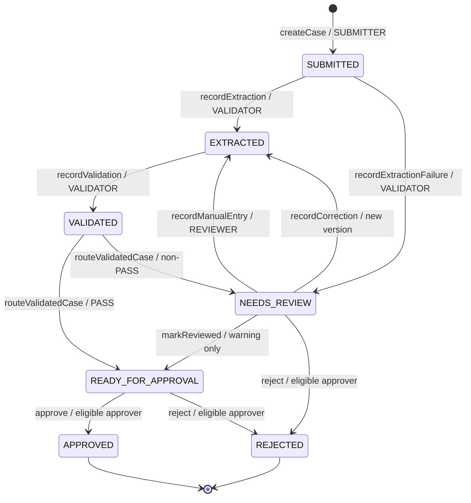

# ActionLoop — Smart Contract Specification

| Field | Value |
|---|---|
| Document version | 0.1 — Draft for team review |
| Date | October 31, 2026 |
| Product | ActionLoop — AI-assisted document processing with blockchain-backed approval and verification |
| Buildathon | MST Blockchain Buildathon 2.0 |
| Source documents | ActionLoop PRD; ActionLoop System Architecture v0.2; MST Blockchain Buildathon 2.0 Guide |
| Contract | `WorkflowRegistry` |
| Status | Proposed interface; **not ABI-frozen until MST Testnet POC passes** |

> **Purpose.** This document defines the responsibilities, roles, state machine, on-chain data, functions, events, signature scheme, authorization rules, deployment process and tests for ActionLoop's `WorkflowRegistry` smart contract. It is the contract-level interface for the blockchain, backend and frontend workstreams.
>
> **Implementation gate.** The MST guide confirms the Testnet and Mainnet network configuration, but it does not by itself prove the exact compiler/EVM target, OpenZeppelin compatibility, BridgeKey EIP-712 behavior or relayer integration. The MST Testnet POC in the System Architecture must pass before the ABI and compiler configuration are frozen.

---

## 1. Contract Overview

### 1.1 Purpose

`WorkflowRegistry` is the authoritative on-chain state machine for each college invoice/reimbursement case handled by ActionLoop. It registers a case against the original document hash, stores versioned evidence commitments, enforces role-based transitions, prevents submitter self-approval, and records an authorized human approval or rejection.

The contract makes important workflow transitions independently verifiable. It does **not** decide whether an invoice is factually true, perform AI extraction, run arithmetic checks, store invoice contents, or execute payments.

### 1.2 Responsibilities

The contract MUST:

1. Register a unique case with a document hash and submitter wallet.
2. Record extraction evidence and extraction-failure evidence.
3. Record manual-entry and reviewer-correction versions without overwriting earlier versions.
4. Record deterministic validation evidence and the validation disposition.
5. Enforce the permitted lifecycle transitions.
6. Enforce `ADMIN`, `SUBMITTER`, `VALIDATOR`, `REVIEWER`, `APPROVER` and `SENIOR_APPROVER` roles.
7. Enforce the approval tier attested by the validator.
8. Prevent submitter self-approval and reviewer/approver self-review conflicts.
9. Record approval/rejection and the deciding wallet.
10. Support signed approve/reject intents for relayer submission, if EIP-712 support passes the MST compatibility gate.
11. Emit sufficient events for an indexer to reconstruct the case timeline.
12. Expose read methods for independent verification.

The contract MUST NOT:

- Store PDF/image content, vendor names, GSTINs, invoice amounts, personal data or free-text reasons.
- Trust an LLM output as an approval or validation decision.
- Allow a reviewer to clear a hard validation failure by a generic confirmation.
- Give the relayer any business role or approval authority.
- Provide an owner-only override that can silently change a decision or bypass the state machine.
- Execute reimbursement payments or interact with banking systems in the MVP.

### 1.3 Trust model

The contract enforces what it can verify: caller/signature authority, current state, evidence version, approval tier, nonce, deadline and transition legality.

The backend `VALIDATOR` wallet is a trusted system identity for attesting that extraction/validation evidence was produced by the ActionLoop pipeline. The contract cannot independently inspect the off-chain invoice or reproduce the Python validation rules. Human approval remains mandatory for the final sensitive decision.

### 1.4 Deployment model

- One `WorkflowRegistry` deployment for the MVP organization.
- No proxy or upgradeability for the MVP.
- An emergency pause is supported for workflow-changing operations.
- A corrected contract is redeployed; existing contract history remains at the old address and the new deployment is configured explicitly.
- Testnet acceptance must pass before Mainnet deployment.

---

## 2. Network Configuration

The following values are copied from the supplied MST Buildathon guide. They must be environment configuration, not hard-coded into contract/business logic.

| Setting | MST Testnet | MST Mainnet |
|---|---|---|
| Network name | MST Testnet | MST Mainnet |
| Chain ID | `91562037` | `4646` |
| RPC URL | `https://testnetrpc.mstblockchain.com` | `https://mariorpc.mstblockchain.com/` |
| Native symbol | `tMSTC` | `MSTC` |
| Explorer | `https://testnet.mstscan.com` | `https://mstscan.com` |
| Faucet | `https://faucet.mstblockchain.com` | Not applicable |

**Official resources supplied by coordinators:**

- Documentation: https://docs.mstblockchain.com
- BridgeKey: https://bridgekey.io
- TypeScript SDK: https://www.npmjs.com/package/@mstblockchain/mst-sdk
- Python SDK: https://pypi.org/project/mst-sdk-python/
- VibeKit: https://www.npmjs.com/package/@mstblockchain/mst-vibe-kit
- Testnet faucet: https://faucet.mstblockchain.com

The official SDKs should be evaluated in the POC. The contract interface must remain independent of a specific SDK. Do not assume that EIP-712, a particular EVM fork, compiler target or hosted relayer is supported until tested.

---

## 3. Roles and Permissions

### 3.1 Role catalogue

| Role | Intended holder | Contract permissions |
|---|---|---|
| `DEFAULT_ADMIN_ROLE` | Initial deployer/security administrator; transfer or revoke after setup | Administers `ADMIN_ROLE`; emergency governance only |
| `ADMIN_ROLE` | Organization administrator wallet | Grant/revoke operational roles; pause/unpause; no case approval authority unless separately assigned an approver role |
| `SUBMITTER_ROLE` | Department staff wallet | Register a new case |
| `VALIDATOR_ROLE` | Dedicated backend validator service wallet | Record extraction, extraction failure, validation and validation routing |
| `REVIEWER_ROLE` | Individual reviewer wallet | Confirm reviewable warnings; submit correction or manual-entry evidence |
| `APPROVER_ROLE` | Standard approver wallet | Approve/reject standard-tier cases; reject review cases when policy permits |
| `SENIOR_APPROVER_ROLE` | Senior approver wallet | Approve/reject senior-tier cases; may also be granted `APPROVER_ROLE` for standard-tier cases |
| No role | Relayer wallet | Submit signed intents and pay gas only; no case-transition permission |

### 3.2 Role administration

Proposed OpenZeppelin `AccessControl` administration model:

- `DEFAULT_ADMIN_ROLE` administers `ADMIN_ROLE` and itself.
- `ADMIN_ROLE` administers `SUBMITTER_ROLE`, `VALIDATOR_ROLE`, `REVIEWER_ROLE`, `APPROVER_ROLE` and `SENIOR_APPROVER_ROLE`.
- The deployer receives `DEFAULT_ADMIN_ROLE` and `ADMIN_ROLE` at construction.
- After deployment and role setup, the team should transfer or revoke deployer privileges according to the agreed key-custody plan.
- The relayer address MUST NOT receive any role.

This role-admin arrangement is proposed and must be validated with the selected OpenZeppelin version and MST compiler/EVM compatibility during the POC.

### 3.3 Separation of duties

The following rules are contract-enforced:

1. The wallet that submitted a case cannot approve or reject that same case.
2. A wallet that recorded a human review or correction for a case cannot approve or reject that same case.
3. A wallet must hold the role required by the case's approval tier.
4. The relayer is never treated as the signer/decider; the recovered EIP-712 signer is the approver.
5. A backend validator wallet cannot approve/reject unless separately and explicitly granted an approver role. For the MVP, the validator service wallet MUST NOT be granted an approver role.

The reviewer-to-approver restriction is the MVP default from the architecture. Any change requires team approval and a corresponding PRD/architecture update.

### 3.4 Approval tier rules

`ApprovalTier` is recorded by the validator as a policy attestation. Invoice amounts remain off-chain.

- `NONE`: no tier has been assigned yet; used for extraction-failure/manual-entry cases before validation.
- `STANDARD`: standard approver or senior approver may decide (the deployment role setup should grant senior approvers both roles if this behavior is desired).
- `SENIOR`: only a wallet holding `SENIOR_APPROVER_ROLE` may approve/reject.

The contract enforces the recorded tier and signer role. It does **not** independently prove the invoice amount or recompute the organization's monetary threshold. The threshold, policy version and validation outcome are produced by the deterministic backend validator and their evidence hash is committed on-chain.

For rejection from `NEEDS_REVIEW` before a tier has been assigned (`NONE`), either `APPROVER_ROLE` or `SENIOR_APPROVER_ROLE` may reject. Once a tier exists, the same tier rule applies.

---

## 4. State Machine

### 4.1 State enum

```solidity
enum CaseState {
    NONE,
    SUBMITTED,
    EXTRACTED,
    VALIDATED,
    NEEDS_REVIEW,
    READY_FOR_APPROVAL,
    APPROVED,
    REJECTED
}
```

`NONE` means the case ID has not been registered. `APPROVED` and `REJECTED` are terminal states.

### 4.2 Validation disposition enum

```solidity
enum ValidationDisposition {
    NONE,
    PASS,
    REVIEWABLE_WARNING,
    CORRECTION_REQUIRED,
    HARD_BLOCK
}
```

- `PASS`: all mandatory checks pass.
- `REVIEWABLE_WARNING`: a reviewer may confirm after checking source evidence; no hard failure or correction requirement exists.
- `CORRECTION_REQUIRED`: the data needs correction and must be revalidated as a new version.
- `HARD_BLOCK`: a confirmed duplicate, prohibited case or other hard policy failure. A generic reviewer confirmation or correction cannot clear it in the MVP; an authorized approver may reject it from `NEEDS_REVIEW`.

### 4.3 Data author enum

```solidity
enum DataAuthorKind {
    NONE,
    EXTRACTOR,
    REVIEWER_CORRECTION,
    MANUAL_ENTRY
}
```

### 4.4 Approval tier enum

```solidity
enum ApprovalTier {
    NONE,
    STANDARD,
    SENIOR
}
```

### 4.5 State transitions

| From | To | Function | Authorized caller | Required guard |
|---|---|---|---|---|
| `NONE` | `SUBMITTED` | `createCase` | `SUBMITTER_ROLE` | Unique non-zero case ID; non-zero document hash |
| `SUBMITTED` | `EXTRACTED` | `recordExtraction` | `VALIDATOR_ROLE` | First extractor data version; non-zero data hash |
| `SUBMITTED` | `NEEDS_REVIEW` | `recordExtractionFailure` | `VALIDATOR_ROLE` | Bounded extraction retries exhausted; non-zero failure hash |
| `NEEDS_REVIEW` | `EXTRACTED` | `recordManualEntry` | `REVIEWER_ROLE` | No existing data version; non-zero manual data hash; author attributed to reviewer |
| `EXTRACTED` | `VALIDATED` | `recordValidation` | `VALIDATOR_ROLE` | Validation references current data version; one validation record for that version |
| `VALIDATED` | `READY_FOR_APPROVAL` | `routeValidatedCase` | `VALIDATOR_ROLE` | Current disposition is `PASS` |
| `VALIDATED` | `NEEDS_REVIEW` | `routeValidatedCase` | `VALIDATOR_ROLE` | Current disposition is warning, correction-required or hard-block |
| `NEEDS_REVIEW` | `READY_FOR_APPROVAL` | `markReviewed` | `REVIEWER_ROLE` | Current disposition is `REVIEWABLE_WARNING`; no hard failure; review evidence hash provided |
| `NEEDS_REVIEW` | `EXTRACTED` | `recordCorrection` | `REVIEWER_ROLE` | Current disposition is `CORRECTION_REQUIRED` (or reviewable warning being corrected); new version appended; revalidation required |
| `NEEDS_REVIEW` | `REJECTED` | `rejectCase` / `rejectWithSignature` | Eligible approver | Tier rule, non-submitter, not a reviewer on this case; reason/evidence bound |
| `READY_FOR_APPROVAL` | `APPROVED` | `approveCase` / `approveWithSignature` | Eligible approver | Correct tier role; non-submitter; not a reviewer on this case; current evidence bound |
| `READY_FOR_APPROVAL` | `REJECTED` | `rejectCase` / `rejectWithSignature` | Eligible approver | Same authorization and evidence guards as approval |

`routeValidatedCase` is an explicit second transition after `recordValidation`. It preserves the `VALIDATED` state as an observable contract state and makes the validator's routing decision an auditable action. It MUST derive the destination from the stored disposition; callers cannot supply an arbitrary destination state.

### 4.6 Transition diagram



### 4.7 Non-transitions

The contract MUST reject all unlisted transitions, including:

- `SUBMITTED` directly to `READY_FOR_APPROVAL`, `APPROVED` or `REJECTED` (except extraction failure to `NEEDS_REVIEW`).
- `EXTRACTED` directly to approval.
- `VALIDATED` directly to approval/rejection without routing.
- `HARD_BLOCK` from `NEEDS_REVIEW` to `READY_FOR_APPROVAL`.
- `APPROVED` or `REJECTED` to any other state.
- Duplicate registration of a `caseId`.

---

## 5. On-Chain Data Model

### 5.1 Case record

Conceptual Solidity structure:

```solidity
struct CaseRecord {
    bytes32 documentHash;           // SHA-256 of the original file
    address submitter;
    CaseState state;
    uint32 currentDataVersion;
    ApprovalTier approvalTier;
    uint32 policyVersion;
    ValidationDisposition disposition;
    bytes32 extractionFailureHash;  // zero unless extraction failed
    address decider;
    bytes32 decisionReasonHash;     // zero if no reason was supplied
    uint64 createdAt;
    uint64 updatedAt;
    uint64 decidedAt;
}
```

The mapping key is `bytes32 caseId`. The contract also maintains a `caseExists[caseId]` check or uses `state != NONE` as the existence test.

### 5.2 Append-only data version

```solidity
struct DataVersionRecord {
    bytes32 dataHash;
    bytes32 reasonHash;       // correction/manual-entry reason commitment; zero if not applicable
    address author;
    DataAuthorKind authorKind;
    uint64 createdAt;
    bool exists;
}
```

Store each version under `dataVersions[caseId][version]`. A correction MUST increment the version and MUST NOT overwrite a previous record.

### 5.3 Validation evidence

```solidity
struct ValidationRecord {
    bytes32 validationHash;
    ValidationDisposition disposition;
    ApprovalTier approvalTier;
    uint32 ruleSetVersion;
    uint32 policyVersion;
    uint64 recordedAt;
    bool exists;
}
```

Store validation records under `validations[caseId][dataVersion]`. A validation record is immutable once written. If the data is corrected, a new data version receives a new validation record.

### 5.4 Review attribution

Maintain a per-case reviewer mapping:

```solidity
mapping(bytes32 => mapping(address => bool)) reviewedBy;
```

Set it when `markReviewed`, `recordCorrection` or `recordManualEntry` succeeds. An address recorded as having performed a review action on a case cannot approve or reject that case.

### 5.5 Nonces

```solidity
mapping(address => uint256) nonces;
```

The nonce is per signer, monotonically increasing, and consumed only after a valid signed decision passes all contract checks.

### 5.6 Storage minimization

Only the following may be written on-chain:

- Case IDs and document/data/validation/evidence hashes.
- State enums and approval-tier/disposition enums.
- Wallet addresses for submitter, reviewer/author, validator, and decider where needed.
- Data version, rule-set version and policy version.
- Nonces and timestamps.
- Reason hashes and extraction-failure hashes.

Never write invoice PDF/image bytes, vendor names, GSTIN, invoice numbers, invoice amounts, email addresses, personal information or free-text reasons to the public chain.

---

## 6. Hashing and Evidence Commitment

### 6.1 Hashing responsibilities

The backend is responsible for canonicalization and hashing. The contract stores and compares the resulting 32-byte commitments; it does not parse JSON or compute SHA-256 over files.

| Evidence | Off-chain preparation | On-chain representation |
|---|---|---|
| Original document | SHA-256 of exact uploaded file bytes | `documentHash` (`bytes32`) |
| Extracted data version | RFC 8785 canonical JSON, UTF-8, per-case random salt, SHA-256 | `dataHash` (`bytes32`) |
| Validation result | Canonical JSON including rule results, thresholds, rule-set/policy versions and reference snapshot identifiers; salted SHA-256 | `validationHash` (`bytes32`) |
| Review/correction reason | Canonicalized reason text, SHA-256 or agreed domain-separated commitment | `reasonHash` (`bytes32`) |
| Extraction failure details | Canonicalized failure category and pipeline metadata; no sensitive raw text | `extractionFailureHash` (`bytes32`) |

The file hash remains unsalted so an auditor with the original file can recompute it. Structured-data and validation salts remain off-chain and are disclosed only to an authorized verifier as needed. The team must document the exact canonicalization and salt format in the Database Schema/API specifications.

### 6.2 Evidence hash

The contract exposes a deterministic `computeEvidenceHash(caseId)` view. It returns a `bytes32` commitment over the current state-relevant evidence. Proposed conceptual formula:

```solidity
keccak256(
    abi.encode(
        EVIDENCE_TYPEHASH,
        caseId,
        caseRecord.documentHash,
        caseRecord.currentDataVersion,
        currentDataHash,
        currentValidationHash,
        caseRecord.disposition,
        caseRecord.approvalTier,
        caseRecord.policyVersion,
        caseRecord.extractionFailureHash
    )
)
```

Where `currentDataHash` and `currentValidationHash` are zero when no corresponding record exists. `EVIDENCE_TYPEHASH` is a fixed domain/type constant. The final exact type string and ABI encoding must be implemented identically in Solidity, Python and TypeScript and covered by shared test vectors.

### 6.3 Meaning of verification

A matching hash proves that the evidence presented to the verifier matches the evidence commitment registered on-chain. It does not prove that the invoice is genuine, the LLM extraction is correct, the vendor exists, or the validation policy is appropriate. Those remain off-chain source/policy and human-review questions.

---

## 7. Contract Interface — Proposed ABI

The signatures below are the proposed logical interface for the Solidity implementation. Parameter order and exact integer widths may be changed only through a reviewed interface update before ABI freeze.

### 7.1 Case registration

```solidity
function createCase(
    bytes32 caseId,
    bytes32 documentHash
) external;
```

**Caller:** `SUBMITTER_ROLE`.

**Preconditions:** `caseId != bytes32(0)`, `documentHash != bytes32(0)`, case ID unused, contract not paused.

**Effects:** creates `CaseRecord`; sets submitter to `msg.sender`; sets state `SUBMITTED`; initializes version to `0`, tier to `NONE`, and timestamps.

**Event:** `CaseCreated(caseId, documentHash, submitter, createdAt)`.

MVP transaction path: direct BridgeKey transaction from the submitter. Gas sponsorship for case registration is stretch scope.

### 7.2 Extraction and extraction failure

```solidity
function recordExtraction(
    bytes32 caseId,
    bytes32 dataHash
) external;

function recordExtractionFailure(
    bytes32 caseId,
    bytes32 failureHash
) external;
```

**Caller:** `VALIDATOR_ROLE`.

`recordExtraction` is allowed only from `SUBMITTED`. It creates data version `1` with `authorKind = EXTRACTOR`, author `msg.sender`, and moves to `EXTRACTED`.

`recordExtractionFailure` is allowed only from `SUBMITTED`. It stores the failure hash and moves to `NEEDS_REVIEW`. A reviewer must use `recordManualEntry` to create the first data version; manual entry does not bypass validation.

**Events:** `ExtractionRecorded`, `ExtractionFailed`.

### 7.3 Manual entry

```solidity
function recordManualEntry(
    bytes32 caseId,
    bytes32 dataHash,
    bytes32 reasonHash
) external;
```

**Caller:** `REVIEWER_ROLE`.

**Preconditions:** state is `NEEDS_REVIEW`; `currentDataVersion == 0`; extraction failure is recorded; hashes are valid.

**Effects:** appends version `1` with `authorKind = MANUAL_ENTRY`, author `msg.sender`, records reviewer attribution, updates `currentDataVersion = 1`, moves to `EXTRACTED`. The validator must subsequently call `recordValidation` and `routeValidatedCase`.

**Event:** `ManualEntryRecorded(caseId, dataVersion, dataHash, reviewer, reasonHash, timestamp)`.

MVP transaction path: direct BridgeKey transaction. Gasless reviewer actions are stretch scope.

### 7.4 Validation and routing

```solidity
function recordValidation(
    bytes32 caseId,
    uint32 dataVersion,
    bytes32 validationHash,
    ValidationDisposition disposition,
    ApprovalTier approvalTier,
    uint32 ruleSetVersion,
    uint32 policyVersion
) external;

function routeValidatedCase(
    bytes32 caseId,
    uint32 dataVersion
) external;
```

**Caller:** `VALIDATOR_ROLE` for both functions.

`recordValidation` is allowed only when state is `EXTRACTED`, `dataVersion` equals the current version, validation has not already been recorded for this version, `validationHash` is non-zero, and the disposition is not `NONE`. It stores an immutable validation record and sets state to `VALIDATED`.

Tier requirements:

- `PASS`, `REVIEWABLE_WARNING` and `CORRECTION_REQUIRED` must include a valid `STANDARD` or `SENIOR` tier according to the configured policy.
- `HARD_BLOCK` may use `NONE` if no approval is eligible; it must never be routable to approval.
- The validator also records the policy and rule-set versions.

`routeValidatedCase` reads the stored disposition; it does not accept a caller-supplied destination:

- `PASS` → `READY_FOR_APPROVAL`.
- `REVIEWABLE_WARNING`, `CORRECTION_REQUIRED` or `HARD_BLOCK` → `NEEDS_REVIEW`.

The route transaction emits `CaseReadyForApproval` or `CaseNeedsReview` with the validation disposition. The `HARD_BLOCK` path cannot be cleared by `markReviewed` or `recordCorrection` in the MVP; it can be rejected from `NEEDS_REVIEW`.

**Events:** `ValidationRecorded`, `CaseReadyForApproval`, `CaseNeedsReview`.

### 7.5 Human review confirmation

```solidity
function markReviewed(
    bytes32 caseId,
    uint32 dataVersion,
    bytes32 reviewEvidenceHash
) external;
```

**Caller:** `REVIEWER_ROLE`.

**Preconditions:** state is `NEEDS_REVIEW`; `dataVersion` is current; current validation disposition is exactly `REVIEWABLE_WARNING`; review evidence hash is non-zero; no correction-required or hard-block condition remains.

**Effects:** marks `reviewedBy[caseId][msg.sender] = true`; moves case to `READY_FOR_APPROVAL`; updates timestamp.

**Event:** `CaseReviewed(caseId, dataVersion, reviewer, reviewEvidenceHash, timestamp)`.

A reviewer confirmation is not a generic override. It is only available for a warning disposition that the validator has explicitly recorded.

### 7.6 Correction

```solidity
function recordCorrection(
    bytes32 caseId,
    uint32 baseVersion,
    bytes32 newDataHash,
    bytes32 reasonHash
) external;
```

**Caller:** `REVIEWER_ROLE`.

**Preconditions:** state is `NEEDS_REVIEW`; `baseVersion` equals current version; new data and reason hashes are non-zero; disposition is `CORRECTION_REQUIRED` or `REVIEWABLE_WARNING`; disposition is not `HARD_BLOCK`; version limit has not been reached.

**Effects:** appends `baseVersion + 1` with `authorKind = REVIEWER_CORRECTION`; records reviewer attribution; updates current version; clears current validation reference/disposition/tier until the new version is validated; moves state to `EXTRACTED`.

The old data and validation records remain unchanged. The validator must run all deterministic rules again for the new version.

**Event:** `CorrectionRecorded(caseId, previousVersion, newVersion, newDataHash, reviewer, reasonHash, timestamp)`.

The maximum number of data versions must be a deployment configuration or immutable constructor value chosen before deployment. Proposed MVP default: `5` total data versions (initial extraction/manual entry plus up to four corrections). Confirm with the team before code generation.

### 7.7 Approval and rejection — direct wallet path

```solidity
function approveCase(
    bytes32 caseId,
    uint32 dataVersion,
    bytes32 reasonHash
) external;

function rejectCase(
    bytes32 caseId,
    uint32 dataVersion,
    bytes32 reasonHash
) external;
```

**Caller:** eligible `APPROVER_ROLE` or `SENIOR_APPROVER_ROLE` wallet.

The direct path is a user-signed blockchain transaction through BridgeKey. It is the secure fallback if relayer signing is unavailable; it is not a server-originated approval.

### 7.8 Approval and rejection — relayed signature path

```solidity
function approveWithSignature(
    bytes32 caseId,
    uint32 dataVersion,
    bytes32 evidenceHash,
    bytes32 reasonHash,
    uint256 nonce,
    uint256 deadline,
    bytes calldata signature
) external;

function rejectWithSignature(
    bytes32 caseId,
    uint32 dataVersion,
    bytes32 evidenceHash,
    bytes32 reasonHash,
    uint256 nonce,
    uint256 deadline,
    bytes calldata signature
) external;
```

**Caller:** any address may submit a valid signed intent; in the MVP, the configured relayer submits it. The caller is never treated as the approver.

The contract MUST:

1. Recover the signer from the EIP-712 typed-data signature.
2. Verify the signer has the appropriate approval role for the case tier.
3. Verify signer is not the submitter and has not reviewed/corrected the case.
4. Verify current state is eligible for the requested decision.
5. Verify data version equals the current version.
6. Recompute `computeEvidenceHash(caseId)` and require it equals the signed `evidenceHash`.
7. Verify supplied nonce equals `nonces[signer]`.
8. Verify `block.timestamp <= deadline`.
9. Consume the nonce exactly once.
10. Record the decision and emit the appropriate event.

The `approveWithSignature` entry point MUST reject a typed decision of `REJECT`; `rejectWithSignature` MUST reject a typed decision of `APPROVE`. The signed message includes a decision enum, so the two entry points cannot be interchanged.

The relayer address receives no role. It can submit an unchanged valid signature, but cannot alter the decision, signer, case, data version, evidence hash, reason hash, nonce or deadline.

### 7.9 Read functions

```solidity
function getCase(bytes32 caseId) external view returns (CaseRecord memory);

function getDataVersion(
    bytes32 caseId,
    uint32 version
) external view returns (DataVersionRecord memory);

function getValidation(
    bytes32 caseId,
    uint32 dataVersion
) external view returns (ValidationRecord memory);

function getNonce(address signer) external view returns (uint256);

function computeEvidenceHash(bytes32 caseId) external view returns (bytes32);
```

These methods support the API, event indexer and independent browser verification. Exact ABI encoding is frozen after the MST Testnet POC.

### 7.10 Administration and emergency pause

Role administration uses the selected OpenZeppelin `AccessControl` implementation:

```solidity
// Inherited role administration methods, subject to role-admin configuration:
grantRole(bytes32 role, address account)
revokeRole(bytes32 role, address account)
renounceRole(bytes32 role, address callerConfirmation)

function pause() external;   // ADMIN_ROLE
function unpause() external; // ADMIN_ROLE
```

All workflow-changing functions are blocked while paused. Read-only methods remain available. Role administration may remain available while paused so compromised operational roles can be revoked; this behavior must be explicitly tested.

---

## 8. EIP-712 Typed-Data Specification

### 8.1 Purpose

EIP-712 binds a human approver's intent to one specific case, decision and evidence version. The relayer pays gas but does not acquire the authority to decide.

### 8.2 Domain

Proposed domain:

| Field | Value |
|---|---|
| `name` | `ActionLoop Workflow Registry` |
| `version` | `1` |
| `chainId` | `91562037` on MST Testnet; `4646` on MST Mainnet |
| `verifyingContract` | Deployed `WorkflowRegistry` address |

Domain values are generated from the active deployment configuration. Never reuse a Testnet signature on Mainnet or across contract deployments.

### 8.3 Typed message

Proposed EIP-712 type:

```text
Decision(
  bytes32 caseId,
  uint8 decision,
  uint32 dataVersion,
  bytes32 evidenceHash,
  bytes32 reasonHash,
  uint256 nonce,
  uint256 deadline
)
```

Decision enum values:

- `1` = `APPROVE`
- `2` = `REJECT`

The team must generate Solidity, TypeScript and test-vector definitions from this one agreed schema. Do not hand-maintain three different typed-data shapes.

### 8.4 Signing sequence

1. Approver opens a case and inspects the invoice, current extraction, validation and review history.
2. Frontend requests a prepare-intent response from FastAPI.
3. Backend reads current on-chain state, approval tier, current version, evidence hash and signer nonce.
4. Backend returns the typed-data domain, message, deadline and a human-readable decision summary.
5. Frontend displays case ID, vendor, amount, decision and version beside the wallet prompt. Vendor/amount are presentation details and are not sent to the contract.
6. Approver signs typed data using BridgeKey if the wallet POC confirms support.
7. Frontend sends the signed payload to FastAPI.
8. API validates the linked wallet and persists the signed intent/outbox row.
9. Relayer performs pre-flight checks and submits the same intent.
10. Contract recovers the approver, validates role/state/evidence/nonce/deadline, records the decision and emits the event.
11. Indexer waits for the configured confirmation depth and updates the application projection.

### 8.5 Replay, expiry and stale-evidence protection

- Per-signer nonce increments after a valid decision.
- Expired signatures revert.
- Chain ID and contract address are part of EIP-712 domain separation.
- The message binds `caseId`, decision, current data version, evidence hash and reason hash.
- If a correction or revalidation changes the current evidence after the approver signed, the contract's recomputed evidence hash no longer matches and the old signature reverts.

### 8.6 Wallet compatibility gate

BridgeKey's ability to connect to the MST network does not automatically establish EIP-712 `eth_signTypedData_v4` compatibility. The POC must verify the exact BridgeKey provider method and signature format, and the contract must successfully recover the same address on MST Testnet.

If this fails, use the direct BridgeKey transaction path for approvals while the team asks coordinators for a supported signed-message method. Do not replace the signer with a backend key or pretend the relayer path is gasless.

---

## 9. Events

Events are the durable timeline inputs for the indexer. `caseId` should be indexed in every case-specific event.

```solidity
event CaseCreated(
    bytes32 indexed caseId,
    bytes32 documentHash,
    address indexed submitter,
    uint64 createdAt
);

event ExtractionRecorded(
    bytes32 indexed caseId,
    uint32 indexed dataVersion,
    bytes32 dataHash,
    DataAuthorKind authorKind,
    address indexed author,
    uint64 timestamp
);

event ExtractionFailed(
    bytes32 indexed caseId,
    bytes32 failureHash,
    address indexed validator,
    uint64 timestamp
);

event ManualEntryRecorded(
    bytes32 indexed caseId,
    uint32 indexed dataVersion,
    bytes32 dataHash,
    address indexed reviewer,
    bytes32 reasonHash,
    uint64 timestamp
);

event ValidationRecorded(
    bytes32 indexed caseId,
    uint32 indexed dataVersion,
    bytes32 validationHash,
    ValidationDisposition disposition,
    ApprovalTier approvalTier,
    uint32 ruleSetVersion,
    uint32 policyVersion,
    address indexed validator,
    uint64 timestamp
);

event CaseReadyForApproval(
    bytes32 indexed caseId,
    uint32 indexed dataVersion,
    ApprovalTier approvalTier,
    uint64 timestamp
);

event CaseNeedsReview(
    bytes32 indexed caseId,
    uint32 indexed dataVersion,
    ValidationDisposition disposition,
    uint64 timestamp
);

event CaseReviewed(
    bytes32 indexed caseId,
    uint32 indexed dataVersion,
    address indexed reviewer,
    bytes32 reviewEvidenceHash,
    uint64 timestamp
);

event CorrectionRecorded(
    bytes32 indexed caseId,
    uint32 previousVersion,
    uint32 newVersion,
    bytes32 newDataHash,
    address indexed reviewer,
    bytes32 reasonHash,
    uint64 timestamp
);

event CaseApproved(
    bytes32 indexed caseId,
    address indexed approver,
    uint32 dataVersion,
    bytes32 evidenceHash,
    bytes32 reasonHash,
    ApprovalTier approvalTier,
    uint64 timestamp
);

event CaseRejected(
    bytes32 indexed caseId,
    address indexed approver,
    uint32 dataVersion,
    bytes32 evidenceHash,
    bytes32 reasonHash,
    ApprovalTier approvalTier,
    uint64 timestamp
);
```

The actual Solidity event definitions must be checked for indexed-topic limits and ABI compatibility during implementation. Events must not contain document content or personal information. Inherited `RoleGranted`, `RoleRevoked`, `Paused` and `Unpaused` events should also be indexed by the backend where useful.

---

## 10. Custom Errors

Use custom errors rather than long revert strings. The backend and frontend map these errors to stable user-facing messages.

Proposed catalogue:

```solidity
error ZeroCaseId();
error ZeroHash();
error CaseAlreadyExists(bytes32 caseId);
error CaseNotFound(bytes32 caseId);
error InvalidState(bytes32 caseId, CaseState expected, CaseState actual);
error UnauthorizedRole(address account, bytes32 role);
error SubmitterCannotDecide(bytes32 caseId, address submitter);
error ReviewerCannotDecide(bytes32 caseId, address reviewer);
error WrongApprovalTier(ApprovalTier requiredTier, address signer);
error InvalidDataVersion(uint32 expected, uint32 supplied);
error DataVersionAlreadyValidated(bytes32 caseId, uint32 version);
error InvalidDisposition(ValidationDisposition disposition);
error HardBlockCannotBeCleared(bytes32 caseId);
error CorrectionLimitReached(bytes32 caseId);
error InvalidEvidenceHash(bytes32 expected, bytes32 supplied);
error InvalidSignature();
error InvalidNonce(uint256 expected, uint256 supplied);
error SignatureExpired(uint256 deadline);
error InvalidDecisionEntryPoint();
error ContractIsPaused();
```

Additional errors may be added for implementation-specific cases, but should have stable names and be documented in the ABI package.

---

## 11. Key Contract Invariants

These MUST be covered by unit and integration tests.

1. A case ID can be registered only once.
2. A zero case ID or zero required hash is rejected.
3. Only a submitter can create a case.
4. Only a validator can record extraction, extraction failure, validation and validation routing.
5. Only a reviewer can submit manual entry, confirm a reviewable warning or record a correction.
6. A hard-block disposition cannot reach `READY_FOR_APPROVAL` through reviewer confirmation or correction.
7. Every correction creates a new monotonically increasing data version.
8. A data version's validation evidence cannot be overwritten.
9. A case cannot reach `READY_FOR_APPROVAL` without a recorded validation and permitted route.
10. Only an eligible approver tier can approve/reject.
11. A submitter cannot decide their own case.
12. A reviewer/corrector cannot decide a case they reviewed.
13. The decision must bind to the current data version and current evidence hash.
14. An expired, replayed or stale signature is rejected.
15. A relayer address without a role cannot perform direct role-gated workflow transitions.
16. A relayer can submit a valid approver signature but cannot alter its contents or become the decider.
17. Approved and rejected cases are terminal.
18. The contract stores no invoice or personal data.
19. Paused contract rejects workflow mutations.
20. No admin function can rewrite case state, replace evidence or reverse an approval/rejection.

---

## 12. Test Specification

### 12.1 Role tests

- Deployer receives initial admin roles.
- Admin can grant/revoke each operational role.
- Non-admin cannot grant/revoke roles.
- Validator cannot approve/reject.
- Relayer has no role and cannot call role-gated functions directly.
- A revoked role holder cannot perform new actions.

### 12.2 Registration and extraction tests

- Authorized submitter creates a case.
- Non-submitter cannot create a case.
- Duplicate case ID reverts.
- Zero case ID/document hash reverts.
- Validator records extraction from `SUBMITTED`.
- Extraction from the wrong state reverts.
- Extraction failure moves case to `NEEDS_REVIEW`.
- Manual entry after extraction failure creates version 1 and moves to `EXTRACTED`.
- Manual entry on a case that already has a data version reverts.

### 12.3 Validation and review tests

- Validator can record validation only for the current data version.
- Validation cannot be recorded twice for the same version.
- `PASS` routes to `READY_FOR_APPROVAL`.
- `REVIEWABLE_WARNING` routes to `NEEDS_REVIEW`.
- `CORRECTION_REQUIRED` routes to `NEEDS_REVIEW`.
- `HARD_BLOCK` routes to `NEEDS_REVIEW` and cannot be cleared.
- Reviewer can confirm only `REVIEWABLE_WARNING`.
- Reviewer cannot confirm `CORRECTION_REQUIRED` or `HARD_BLOCK`.
- Correction appends a version and moves to `EXTRACTED`.
- Old data/validation version remains readable and unchanged.
- New version must be validated before approval-ready.
- Correction version limit is enforced.

### 12.4 Approval tests

- Standard approver can decide a standard-tier case.
- Senior approver can decide a senior-tier case.
- Standard approver cannot decide a senior-tier case.
- Submitter self-approval and self-rejection revert.
- Reviewer/corrector approval and rejection revert.
- Approval from any state other than `READY_FOR_APPROVAL` reverts.
- Rejection from `NEEDS_REVIEW` is allowed only under the specified tier rule.
- Double approval, approve-after-reject and reject-after-approve revert.
- Decision stores correct approver, timestamp, tier, current version and reason hash.

### 12.5 EIP-712 and relayer tests

- Valid typed-data signature succeeds.
- Signature from a wallet without the required role reverts.
- Signature with wrong chain ID/domain reverts.
- Signature for another contract address reverts.
- Expired signature reverts.
- Replayed nonce reverts.
- Stale data version reverts.
- Stale evidence hash reverts after correction/revalidation.
- `approveWithSignature` cannot execute a reject intent and vice versa.
- Relayer pays gas but is not emitted/stored as approver.
- Relayer itself cannot approve without an approver signature.
- Signature recovery matches the BridgeKey account on MST Testnet.

### 12.6 Pause and terminal-state tests

- Admin can pause/unpause.
- Non-admin cannot pause/unpause.
- Workflow mutations revert while paused.
- Reads remain available while paused.
- Terminal cases cannot be reopened or modified.

### 12.7 Test strategy

- Use Hardhat local network for fast unit tests and property/state-transition tests.
- Use MST Testnet for deployment, actual transactions, wallet signature compatibility, event retrieval, confirmation behavior and relayer acceptance.
- Do not claim MST compatibility based only on local Hardhat tests.

---

## 13. Deployment and Role Setup

### 13.1 Deployment order

1. Complete the MST Testnet POC.
2. Confirm EVM/compiler target, OpenZeppelin version and supported opcodes.
3. Confirm BridgeKey EIP-712 typed-data signing and on-chain recovery.
4. Freeze the contract ABI, event catalogue and typed-data schema.
5. Run all local Hardhat tests and static analysis.
6. Deploy `WorkflowRegistry` to MST Testnet.
7. Verify contract source on MSTScan if explorer verification is supported.
8. Grant roles to controlled test wallets and the dedicated validator wallet.
9. Confirm the relayer address has no role.
10. Execute the complete test workflow and preserve transaction hashes.
11. Only after Testnet acceptance, deploy a separately configured contract to MST Mainnet.
12. Publish contract addresses, network configuration and verified transaction references in README and deployment documentation.

### 13.2 Role setup checklist

| Role | Address source | Setup requirement |
|---|---|---|
| `DEFAULT_ADMIN_ROLE` | Controlled deployer/admin wallet | Keep offline/secure; transfer/revoke deployer after setup as appropriate |
| `ADMIN_ROLE` | Organization admin wallet | Grant after deployment |
| `SUBMITTER_ROLE` | Staff test wallet(s) | Grant to demo submitter |
| `VALIDATOR_ROLE` | Dedicated backend validator wallet | Store key server-side only; never grant approver role |
| `REVIEWER_ROLE` | Reviewer BridgeKey wallet | Grant to demo reviewer |
| `APPROVER_ROLE` | Standard approver BridgeKey wallet | Grant to demo approver |
| `SENIOR_APPROVER_ROLE` | Senior approver BridgeKey wallet | Grant if senior tier is demonstrated |
| Relayer | Dedicated gas wallet | Confirm it has no roles |

### 13.3 Environment variables

```dotenv
MST_CHAIN_ID=
MST_RPC_URL=
MST_EXPLORER_URL=
WORKFLOW_REGISTRY_ADDRESS=
MST_CONFIRMATION_DEPTH=

# Backend/worker secrets — server-side only
VALIDATOR_PRIVATE_KEY=

# Relayer secrets — relayer service only
RELAYER_PRIVATE_KEY=
RELAYER_SERVICE_TOKEN=

# Deployment-only; never required by running application services
DEPLOYER_PRIVATE_KEY=
```

Use separate Testnet and Mainnet secret sets. Never commit `.env` files or private keys. Mainnet deployment keys must not be copied into normal application service environments.

---

## 14. Indexer and Backend Integration Contract

### 14.1 Event handling

The indexer listens for the events in Section 9, stores `(transactionHash, logIndex)` as a unique key, and updates the PostgreSQL projection only after the configured confirmation depth is reached.

### 14.2 Source-of-truth rule

The contract is authoritative for on-chain case state, role assignments and decisions. PostgreSQL is a searchable projection and off-chain evidence store. A discrepancy must be surfaced; the application must not silently overwrite chain state with a database value.

### 14.3 Required ABI package outputs

The blockchain workstream must publish:

- Compiled `WorkflowRegistry` ABI JSON.
- Contract bytecode and compiler metadata for reproducible deployment.
- TypeScript ABI exports for viem/wagmi and the relayer.
- Deployment addresses per environment.
- Event catalogue and typed-data schema JSON.
- A generated/shared evidence-hash test-vector file.
- A deployment/role-grant script and a read-only verification script.

### 14.4 Required backend adapter operations

The backend `ChainGateway` should expose these logical operations without leaking SDK-specific objects into business logic:

- `get_case(case_id)`
- `get_data_version(case_id, version)`
- `get_validation(case_id, version)`
- `get_current_nonce(wallet)`
- `create_case(case_id, document_hash)`
- `record_extraction(...)`
- `record_extraction_failure(...)`
- `record_manual_entry(...)`
- `record_validation(...)`
- `route_validated_case(...)`
- `mark_reviewed(...)`
- `record_correction(...)`
- `submit_signed_decision(...)`
- `get_events(case_id, from_block, to_block)`
- `get_block_hash(block_number)`
- `wait_for_confirmation(tx_hash)`

These are adapter-level names; they need not exactly match Solidity function names.

---

## 15. Relayer Requirements

The relayer is a separate TypeScript service in the proposed architecture. The first release sponsors only `approveWithSignature` and `rejectWithSignature`.

Before submission it MUST:

1. Allow-list the configured MST chain ID and deployed WorkflowRegistry address.
2. Allow-list only the two decision entry points for the MVP relayer.
3. Validate payload shape and signature format.
4. Check deadline and contract nonce.
5. Simulate the call where MST RPC supports it.
6. Enforce per-signer rate limits, gas ceiling, daily spend ceiling and minimum balance.
7. Submit the signed intent unchanged.
8. Track transaction lifecycle as `SUBMITTED`, `PENDING`, `CONFIRMED`, `FAILED` or `REPLACED`.
9. Return tx hash and status; confirmation is established by the indexer, not by a relayer HTTP response alone.

The relayer MUST NOT accept arbitrary target addresses or arbitrary calldata from the frontend. It MUST NOT possess `APPROVER_ROLE` or `SENIOR_APPROVER_ROLE`.

If BridgeKey/EIP-712 fails compatibility testing, the direct wallet transaction path remains available. Do not claim gasless functionality until an end-to-end signed approval is confirmed on MST Testnet.

---

## 16. Security Requirements

- Use the selected, POC-compatible OpenZeppelin access-control and EIP-712/signature primitives rather than custom cryptography.
- Keep role-admin authority minimal; do not add an admin override for case decisions.
- Keep validator and relayer keys separate.
- Keep the relayer unprivileged and restrict its destination/function allow-list.
- Use EIP-712 domain separation, per-signer nonce and deadline.
- Bind decisions to the current data version and computed evidence hash.
- Never store invoice content or personal data on-chain.
- Use custom errors and exhaustive negative-path tests.
- Review pause behavior and key recovery/rotation before Mainnet deployment.
- Pin Solidity compiler, OpenZeppelin and Hardhat dependencies after the MST POC; commit lock files.
- Run static analysis (for example, Slither if toolchain compatibility allows) and inspect all findings before deployment.
- Do not deploy Mainnet until Testnet acceptance, access-control tests, signature tests and operational role setup pass.

---

## 17. Known Limitations and Trust Assumptions

1. The contract cannot prove that an invoice is genuine or that extracted fields are true.
2. The validator service is trusted to attest to extraction and deterministic validation results. A compromised validator could record false evidence, but it still cannot approve/reject without an authorized human approver.
3. The approval tier is an on-chain attestation from the validator. The contract does not see invoice amounts and cannot independently calculate a monetary threshold.
4. Hash comparison proves evidence integrity relative to the committed hash, not factual correctness.
5. The contract is not upgradeable in the MVP. A bug fix requires a new deployment and an explicit application configuration change.
6. Public chain data is visible permanently. Only hashes, case identifiers, states, wallet addresses and timestamps may be stored.
7. EIP-712 and BridgeKey compatibility remain unproven until the MST Testnet POC succeeds.
8. Network finality/confirmation depth must be measured and configured; it must not be guessed.

---

## 18. Open Decisions Before ABI Freeze

| ID | Decision | Required evidence/owner | Blocks |
|---|---|---|---|
| SC-01 | Solidity compiler and EVM target | Blockchain lead; deploy/call POC on MST Testnet | Compiler config and deploy |
| SC-02 | OpenZeppelin version and required components | Local + MST Testnet compatibility test | Dependency lock and inheritance |
| SC-03 | BridgeKey typed-data signing method and signature recovery | Browser POC + contract recovery test | Relayer approval path |
| SC-04 | MST SDK vs standard JSON-RPC adapter | SDK feature tests for deploy/read/write/events | Chain adapter implementation |
| SC-05 | Confirmation depth/finality and reorg behavior | MST docs/coordinator confirmation + test observation | Verified UI/indexer behavior |
| SC-06 | Standard/senior monetary threshold and policy version | Team decision; synthetic demo policy | Tier policy demonstration |
| SC-07 | Maximum data versions | Team approval; proposed default is five total versions | Correction guard |
| SC-08 | Role bootstrap and admin custody | Team security decision | Testnet/Mainnet role setup |
| SC-09 | Direct decision fallback behavior | Confirm in UX and testing plan | Approval screen |
| SC-10 | Whether contract verification is supported by MSTScan | Explorer deployment test | Published source verification |

**ABI freeze rule:** Do not treat this document as a frozen ABI until SC-01 through SC-05 are recorded as passed, the team approves SC-06 through SC-09, and a minimal WorkflowRegistry build compiles and deploys on MST Testnet.

---

## 19. Implementation Order for Blockchain Workstream

### Milestone B0 — MST Testnet POC

- Configure Hardhat with MST Testnet values.
- Compile and deploy a minimal state-changing contract.
- Execute a real state-changing transaction.
- Read the transaction receipt and verify it through MSTScan.
- Test BridgeKey connection and chain switching.
- Test EIP-712 typed data signing and Solidity address recovery.
- Test event querying and confirmation behavior.

**Exit evidence:** contract address, deployment tx hash, state-change tx hash, receipt, explorer links, compiler/EVM target, BridgeKey signing result and SDK decision.

### Milestone B1 — WorkflowRegistry skeleton

- Add roles and role-admin configuration.
- Add case struct and state enum.
- Implement createCase and read methods.
- Add state/role/duplicate tests.

### Milestone B2 — Evidence lifecycle

- Implement extraction, extraction failure and manual entry.
- Implement validation and route functions.
- Implement review confirmation and correction versions.
- Add all hard-block and version immutability tests.

### Milestone B3 — Decision enforcement

- Implement approval tier checks.
- Implement direct approve/reject.
- Implement submitter and reviewer separation-of-duties guards.
- Add terminal-state tests.

### Milestone B4 — Gasless decision path

- Implement EIP-712 domain and typed `Decision` schema.
- Implement approve/reject signature entry points.
- Test nonce, deadline, wrong domain, wrong signer, stale version and stale evidence.
- Integrate the dedicated relayer service.

### Milestone B5 — MST Testnet deployment and integration

- Deploy WorkflowRegistry.
- Grant roles to demo wallets and validator.
- Confirm relayer has no role.
- Run a complete test invoice workflow.
- Export ABI/address/event/type artifacts to shared packages.

### Milestone B6 — Mainnet deployment

- Review Testnet acceptance report and security findings.
- Use separately controlled Mainnet deployer/admin credentials.
- Deploy and grant production/demo roles.
- Publish the Mainnet address and verified Testnet transaction evidence in repository documentation.

---

## 20. Team Handoff and Definition of Done

### 20.1 Blockchain lead deliverables

- `WorkflowRegistry.sol` source.
- Hardhat configuration and lock file.
- Complete unit and integration tests.
- MST Testnet POC report.
- MST Testnet and Mainnet deployment scripts.
- Contract ABI and deployment addresses.
- Event and typed-data schemas.
- Role setup scripts and role address manifest (addresses only; no keys).
- Relayer service and tests for signed approve/reject.
- README section documenting network details, contract addresses and real tx hashes.

### 20.2 Interface consumers

| Consumer | Requires from blockchain workstream |
|---|---|
| Backend/AI | ABI, role/state definitions, ChainGateway behavior, validator transaction methods, events and typed-data schema |
| Frontend | ABI, chain config, BridgeKey integration outcome, typed-data schema, contract reads, verification helpers and explorer links |
| Relayer | ABI, decision entry points, EIP-712 schema, target contract/chain allow-list |

### 20.3 Definition of done

The smart-contract workstream is complete only when:

- [ ] MST Testnet POC is documented with real transaction hashes.
- [ ] WorkflowRegistry compiles with the pinned toolchain.
- [ ] All role/state/signature tests pass locally.
- [ ] Contract is deployed to MST Testnet and address is recorded.
- [ ] Real test transactions are visible on MSTScan.
- [ ] Contract enforces role, state, tier, submitter and reviewer restrictions.
- [ ] Data versions and validation evidence are append-only.
- [ ] Hard blocks cannot be cleared by reviewer confirmation.
- [ ] EIP-712 gasless decision works end-to-end, or the exact incompatibility is documented and direct wallet signing is used without false gasless claims.
- [ ] Relayer has no contract role.
- [ ] ABI, event catalogue, typed-data schema and address are exported to shared packages.
- [ ] Mainnet deployment occurs only after Testnet acceptance and controlled key review.

---

## Appendix A — Interface Freeze Checklist

Before implementation branches are built against this ABI, the team must approve:

- [ ] Enum names and numeric values.
- [ ] Struct fields and integer widths.
- [ ] Every function name, parameter order and mutability.
- [ ] Every event name, indexed field and payload.
- [ ] Custom error catalogue.
- [ ] Role hashes and role-admin relationships.
- [ ] State-transition table and all guards.
- [ ] Evidence-hash formula and test vectors.
- [ ] EIP-712 domain and typed-data schema.
- [ ] Relayer entry points and direct-wallet fallback.
- [ ] Compiler/EVM target and dependency versions.
- [ ] Testnet deployment acceptance.

## Appendix B — Source Traceability

| Source requirement | Where specified here |
|---|---|
| PRD: smart contract records case creation, validation, approval and rejection | Sections 1, 4, 7 and 9 |
| PRD: role checks and strict state machine | Sections 3, 4 and 11 |
| PRD: no submitter self-approval | Sections 3, 7 and 11 |
| PRD: signed relayer approval with nonce/deadline | Section 8 |
| PRD: hash-only on-chain storage | Sections 5 and 6 |
| Architecture v0.2: reviewer separation and hard-block handling | Sections 3, 4 and 11 |
| Architecture v0.2: append-only correction versions | Sections 5 and 7 |
| Architecture v0.2: MST network values and compatibility gate | Sections 2 and 18 |
| MST guide: Testnet/Mainnet deployment and real on-chain proof | Sections 2, 13 and 19 |
