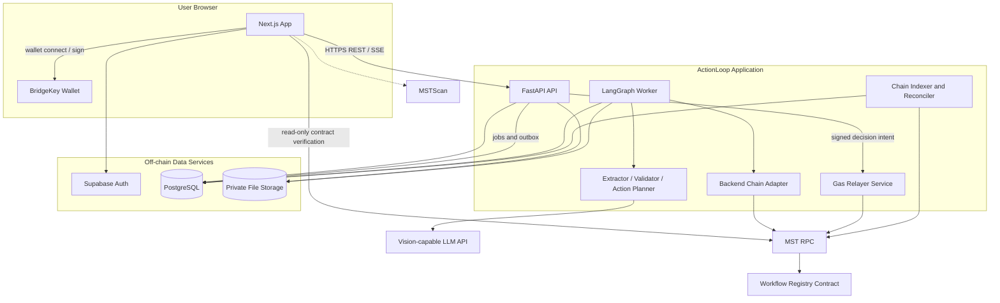
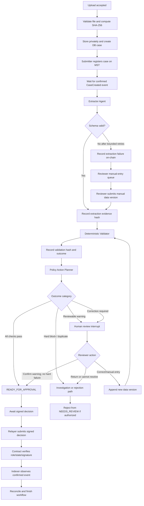
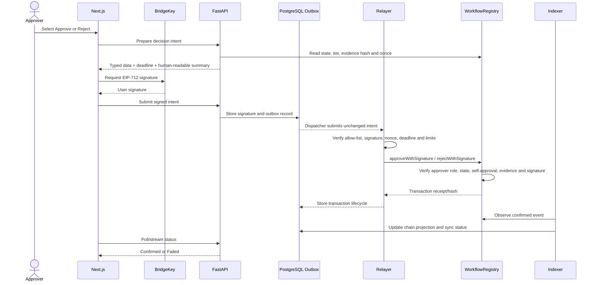
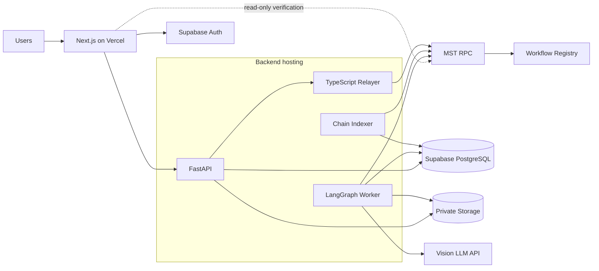

# ActionLoop — System Architecture

| Field | Value |
|---|---|
| Document version | 0.2 — updated for MST Blockchain Buildathon 2.0 |
| Date | October 31, 2026 |
| Source of truth | ActionLoop PRD v0.1 supplied by the team; MST Blockchain Buildathon 2.0 Guide |
| Status | Draft for team approval; network parameters supplied, compatibility POC still required |
| Product | ActionLoop — AI-assisted document processing with blockchain-backed approval and verification |
| Team | Granted — Aditya Shelke, Tejas Bankar, Siddhika Hanumante |
| Institution | NMIET, Pune |

> **Purpose.** This document defines the implementable system architecture for the ActionLoop MVP. It updates the prior architecture draft with the MST network information and buildathon requirements supplied by the coordinators. It also resolves the key review/approval and relayer-scope questions that would otherwise block parallel development.
>
> **Important implementation gate.** The MST guide supplies network endpoints, chain IDs, wallet guidance and SDK references. It does not, by itself, prove that every required EVM feature, EIP-712 signature path, SDK operation or relayer approach works exactly as assumed. Those capabilities must pass the MST Testnet proof of concept in Section 18 before the contract interface is frozen.

---

## 1. Executive Summary

ActionLoop is a college invoice and reimbursement approval platform. It combines:

- **AI extraction** to turn uploaded invoice PDFs or images into structured data.
- **Deterministic validation** to check required fields, arithmetic, duplicates, vendor records and confidence thresholds.
- **Policy-based routing** to decide whether a case is ready for approval or requires human attention.
- **Human review and approval** so that uncertain or financially sensitive decisions remain under human authority.
- **MST Blockchain smart contracts** to enforce case state transitions, authorize approvals and record tamper-evident evidence hashes.
- **BridgeKey wallet integration** for user identity, network access and transaction signing.
- **A relayer** to sponsor gas for signed approve/reject decisions, subject to successful MST Testnet compatibility testing.

The blockchain is not an optional audit add-on. The Workflow Registry contract owns the authoritative on-chain case state. The database is an application read model and cannot independently declare a case approved or rejected.

### 1.1 Product boundary for the MVP

The MVP supports one organization and one workflow: college invoice and reimbursement approval. It does not execute bank payments, integrate with an ERP, or support multiple sectors in the first release.

### 1.2 Core system principle

| Responsibility | Authority |
|---|---|
| Read invoice and extract fields | Vision-capable LLM through the Extractor component |
| Decide whether extracted data passes checks | Deterministic Python Validator |
| Recommend workflow route | Versioned policy table / Action Planner |
| Correct uncertain or incorrect data | Authorized human Reviewer |
| Approve or reject a case | Authorized human Approver, with contract-enforced authorization |
| Enforce blockchain workflow state | Workflow Registry smart contract on MST Blockchain |
| Pay gas for signed approve/reject decision | Relayer; it receives no approval role |
| Store files and searchable application details | Private storage and PostgreSQL |

AI does not authorize sensitive actions. The blockchain proves that a specified hash and authorized decision were recorded; it does not prove that an invoice is factually true.

---

## 2. Source Documents, Constraints and Buildathon Requirements

### 2.1 Source of truth

1. The team's supplied ActionLoop PRD defines product scope, user journeys and acceptance criteria.
2. The MST Blockchain Buildathon 2.0 Guide defines network settings, buildathon deployment requirements, official developer resources and wallet recommendation.
3. This architecture defines component ownership and technical boundaries. If a product requirement changes, update the PRD first and then update this document and its companion specifications.

**Version note:** The supplied PRD file identifies itself as version 0.1. The prior architecture draft referenced PRD v0.2. This version corrects the reference to PRD v0.1 unless the team formally supplies and approves a newer PRD.

### 2.2 Mandatory buildathon requirements

| Requirement | Architectural response |
|---|---|
| MST Blockchain must be meaningful and integral | Contract state transitions and approval authorization control the workflow lifecycle; this is not a wallet-only integration |
| MST Testnet deployment | Deploy and test the Workflow Registry on MST Testnet before final deployment |
| Verifiable Testnet transaction | Keep transaction hashes and provide MSTScan-verifiable proof of core functionality |
| MST Mainnet deployment before submission | Deploy the approved contract release to MST Mainnet after Testnet acceptance tests pass; publish the Mainnet contract address |
| Public GitHub repository | Publish contract, frontend, backend, relayer, deployment scripts and documentation; remove secrets and private data |
| Working application / demo | Provide a public app link and an end-to-end demo, not only screenshots or simulated transactions |
| BridgeKey integration | Use BridgeKey as the preferred non-custodial wallet for connection, network access and signing, subject to integration POC |
| Relayer recommendation | Implement a gas-sponsored signed approve/reject path; this also satisfies the team's PRD requirement, subject to Testnet signature compatibility |

The guide states that Mainnet deployment is required before submission and asks for a verifiable Testnet transaction hash. It also expects Testnet and Mainnet deployment during Round 2. The team's release checklist must satisfy both environments.

### 2.3 Confirmed network configuration from the MST guide

| Setting | MST Testnet | MST Mainnet |
|---|---|---|
| Network name | MST Testnet | MST Mainnet |
| Chain ID | `91562037` | `4646` |
| RPC URL | `https://testnetrpc.mstblockchain.com` | `https://mariorpc.mstblockchain.com/` |
| Native currency symbol | `tMSTC` | `MSTC` |
| Explorer base URL | `https://testnet.mstscan.com` | `https://mstscan.com` |
| Faucet | `https://faucet.mstblockchain.com` | Not applicable; buildathon funding is stated in the guide |

These values are configuration inputs, not hard-coded application constants. The exact explorer URL pattern for a transaction or contract must be confirmed from MSTScan or its documentation; do not construct a guessed path.

### 2.4 Official MST developer resources supplied by the coordinators

| Resource | Supplied reference | Intended evaluation |
|---|---|---|
| MST developer documentation | `https://docs.mstblockchain.com` | Network, contract, SDK and deployment documentation |
| BridgeKey wallet | `https://bridgekey.io` | Preferred wallet for user connection and signing |
| TypeScript SDK | `@mstblockchain/mst-sdk` | Evaluate for TypeScript chain operations |
| Python SDK | `mst-sdk-python` | Evaluate for Python backend chain operations |
| VibeKit | `@mstblockchain/mst-vibe-kit` | Optional development/scaffolding aid; not a required runtime dependency |
| MST MCP | `https://mcp.mstblockchain.com/sse` | Optional AI developer tooling; not required by the running product |
| Testnet faucet | `https://faucet.mstblockchain.com` | Obtain test funds |

Use official documentation and package APIs. Do not invent SDK methods or copy examples without checking the installed package version. VibeKit and MCP are optional development tools; ActionLoop must continue to run without them.

### 2.5 Compatibility items that remain to be proven

The guide supplies network values and developer resources, but the team must test the following on MST Testnet:

- Solidity contract compilation and deployment to the supplied RPC.
- EVM opcode/compiler target compatibility with the selected Solidity and OpenZeppelin versions.
- Contract read/write and event-log retrieval.
- BridgeKey connection and network switching in the target browser environment.
- EIP-712 typed-data signing and on-chain signature recovery for the approval relayer path.
- Confirmation/finality behavior and an appropriate confirmation depth.
- Compatibility of the official TypeScript/Python SDKs with the operations we need.

No EIP-712, ERC-2771 or specific relayer product is considered confirmed until these tests pass. The proposed relayer uses ordinary contract calls carrying a user signature; it does not require a hosted relayer product or a trusted-forwarder standard if the target network supports the required EVM signature operations.

---

## 3. Goals, Non-Goals and Quality Priorities

### 3.1 Goals

- Reduce manual invoice entry and repetitive verification.
- Preserve a clear human review and approval process.
- Make the contract enforce who may perform each state transition.
- Make approvals and rejections attributable to an authorized wallet.
- Let an approver sign an approval/rejection while the relayer pays gas.
- Provide independent evidence verification using hashes, contract state and event history.
- Deploy a functional application and contracts on MST Testnet and MST Mainnet.
- Deliver a public source repository and a demo that judges can interact with.

### 3.2 Non-goals for the MVP

- Multi-organization tenancy or multiple sector-specific workflows.
- Actual bank transfer or payment execution.
- ERP/accounting system integrations.
- Bulk upload, mobile native apps or token economics.
- Autonomous AI decisions that approve or reject invoices.
- Storing original invoices, vendor names, GSTINs, amounts or personal information on-chain.
- A custom generic workflow builder.

### 3.3 Quality priority order

1. Integrity and attributable authority.
2. Correct authorization and state-transition behavior.
3. Honest pending/confirmed/failed transaction presentation.
4. Security and privacy of documents and keys.
5. Reliable recovery from service/chain failures.
6. Clear integration boundaries for three parallel developers.
7. Performance suitable for a hackathon demonstration.

---

## 4. System Context and High-Level Architecture

### 4.1 Actors

| Actor | Main interaction |
|---|---|
| Department Staff / SUBMITTER | Uploads an invoice and registers a case |
| REVIEWER | Inspects flagged extraction, confirms reviewable warnings or submits corrected data |
| APPROVER | Approves or rejects an eligible case |
| SENIOR_APPROVER | Handles cases assigned to the senior approval tier |
| ADMIN | Configures users, role assignments, vendors, threshold and pause controls |
| Auditor | Read-only verification of case evidence against MST Blockchain |
| Vision LLM provider | Processes document content for extraction only |
| Supabase | Provides authentication, PostgreSQL and private file storage |
| MST Blockchain | Hosts Workflow Registry and immutable event history |
| BridgeKey | User-controlled wallet and transaction signing interface |

### 4.2 High-level architecture diagram



### 4.3 Component responsibilities

| Component | Owns | Must not do |
|---|---|---|
| Next.js frontend | Screens, session presentation, wallet connection, signatures, status and verification UI | Hold private keys, access DB directly, decide authoritative workflow state |
| FastAPI API | Authentication, authorization, upload, read models, intent preparation, API contracts | Run long LLM calls inside request handlers; independently set on-chain state |
| Workflow worker | LangGraph execution, extraction/validation/planning, workflow checkpointing | Approve or reject cases |
| Extractor | Structured fields, confidence and source evidence | Invoke tools, write to chain, execute business actions |
| Validator | Deterministic rule outcomes | Call LLM or alter extracted values |
| Action Planner | Choose a route from versioned policy | Authorize approvals or bypass hard validation failures |
| Chain adapter | Typed chain reads/writes, evidence hash submission, transaction tracking | Accept raw document content or free-text business data as contract input |
| Indexer/reconciler | Event ingestion, chain-state projection, reorg handling and discrepancy detection | Write state transitions to chain |
| Relayer | Preflight and submit unchanged signed approval/rejection intents; pay gas | Hold contract approval role, choose a decision or alter the user's signed intent |
| PostgreSQL | Searchable application state, jobs, checkpoints, audit data and transaction outbox | Be the authority for final approval/rejection |
| Workflow Registry | Roles, state machine, evidence hashes, signed decision checks and events | Store files or sensitive invoice data |

### 4.4 Trust boundaries

| Boundary | Threat | Control |
|---|---|---|
| Browser → API | Forged requests, invalid user input | JWT verification, server-side RBAC, schema validation and rate limits |
| Document → LLM | Prompt injection or malicious file content | Treat all document text as untrusted data; fixed schema; no model tools; safe rendering and bounded parsing |
| LLM → Validator | Incorrect or malformed extraction | Pydantic schema validation, confidence thresholds and deterministic rules |
| API → Relayer | Forged or altered relayer request | Signed payload verification, authenticated service channel, idempotency and intent allow-list |
| Relayer → Contract | Relayer attempts unauthorized approval | Contract verifies original approver signature, role, state, nonce and deadline; relayer has no role |
| Database → UI | Stale or tampered status | Chain indexer/reconciler; approval status rendered only from confirmed chain state |
| Server secrets | Key or API credential leakage | Secret manager/server environment; never commit secrets or expose them to browser bundles |

---

## 5. Network and Blockchain Integration Architecture

### 5.1 Environment configuration

Use explicit per-environment configuration. No chain details are hard-coded in application logic.

```dotenv
# Testnet example values supplied in the MST guide
MST_TESTNET_CHAIN_ID=91562037
MST_TESTNET_RPC_URL=https://testnetrpc.mstblockchain.com
MST_TESTNET_CURRENCY_SYMBOL=tMSTC
MST_TESTNET_EXPLORER_URL=https://testnet.mstscan.com

# Mainnet example values supplied in the MST guide
MST_MAINNET_CHAIN_ID=4646
MST_MAINNET_RPC_URL=https://mariorpc.mstblockchain.com/
MST_MAINNET_CURRENCY_SYMBOL=MSTC
MST_MAINNET_EXPLORER_URL=https://mstscan.com

# Set only after deployment
MST_CHAIN_ID=
MST_RPC_URL=
MST_EXPLORER_URL=
WORKFLOW_REGISTRY_ADDRESS=
MST_CONFIRMATION_DEPTH=
```

The exact confirmation depth must be selected after testing MST Testnet finality and reorganization behavior. Do not assume a block count from another network.

### 5.2 Chain adapter interface

All backend blockchain operations must pass through a single `ChainGateway` interface. The implementation can use the MST Python SDK if it supports the necessary RPC, ABI and event operations. If it does not, use a standards-compatible adapter such as `web3.py` after the POC proves compatibility. The TypeScript relayer may use the MST TypeScript SDK if it supports the needed transaction operations; otherwise use a tested JSON-RPC library.

The application must not mix SDK-specific calls throughout business logic.

**Conceptual methods:**

- `get_case(case_id)`
- `get_current_nonce(wallet)`
- `create_case(...)`
- `record_extraction(...)`
- `record_validation(...)`
- `record_review(...)`
- `record_correction(...)`
- `submit_signed_decision(...)`
- `get_events(case_id, from_block, to_block)`
- `get_block_hash(block_number)`
- `wait_for_confirmation(tx_hash)`

The final method signatures belong in the Smart Contract Specification and API Specification after the POC.

### 5.3 Meaningful on-chain functionality

The Workflow Registry is integral because it:

1. Registers each case against a document hash and a unique case identifier.
2. Records versioned extraction and validation evidence hashes.
3. Enforces the allowed lifecycle and required roles.
4. Prevents submitter self-approval.
5. Enforces approval tier requirements as attested by the validator workflow.
6. Verifies the actual approver's signature on relayed approve/reject transactions.
7. Emits events that the indexer uses to build and verify the case timeline.
8. Provides contract reads that auditors can independently compare with off-chain evidence.

This is more than a single isolated transaction or a wallet connection.

---

## 6. Frontend Architecture

### 6.1 Technology

- Next.js App Router and TypeScript.
- Tailwind CSS and a reusable component library.
- BridgeKey as the preferred wallet integration.
- wagmi/viem only if the BridgeKey browser integration exposes a compatible provider and the POC confirms operation on MST.
- TanStack Query for server state, caching and polling.
- API client generated from FastAPI OpenAPI.

### 6.2 Wallet integration boundary

Create a wallet adapter interface so UI components do not depend directly on one provider implementation.

The adapter must support, where BridgeKey exposes them:

- Connect and disconnect.
- Read the connected account.
- Request/switch to the MST Testnet or Mainnet chain.
- Sign a typed EIP-712 decision payload.
- Submit direct wallet transactions for case creation and reviewer actions if those actions are not relayed.

**Do not assume a particular BridgeKey JavaScript API.** Inspect official BridgeKey/MST developer documentation and test the browser extension. If the wallet does not expose the required injected provider or typed-data method, use the official supported dApp connection flow or obtain clarification from the coordinators. Never ask users for their seed phrase or private key.

### 6.3 Routes and screens

| Route | Screen | Main content | Roles |
|---|---|---|---|
| `/` | Dashboard | Workflow counts, pending review/approval, recent activity | All authenticated users |
| `/upload` | Document Upload | PDF/image selection, upload progress and wallet registration | SUBMITTER |
| `/cases/[id]/processing` | Processing | Extraction, validation, routing and chain status | SUBMITTER, REVIEWER |
| `/cases/[id]/review` | Document Review | Original document, extracted fields, confidence, source evidence and versions | REVIEWER |
| `/approvals` | Approval Queue | Cases assigned to current approval tier | APPROVER, SENIOR_APPROVER |
| `/cases/[id]` | Case Details | Data, validation results, current state and event timeline | Permitted users |
| `/cases/[id]/verify` | Blockchain Verification | On-chain case, event order, hashes, approver and proof result | All permitted users, Auditor |
| `/settings` | Administration | Users, wallets, roles, policy threshold and vendors | ADMIN |

### 6.4 UI state rules

Every chain-backed action uses one of these visible states:

- `AWAITING_SIGNATURE`
- `PENDING`
- `CONFIRMED`
- `FAILED`
- `REPLACED` (where relevant)

The UI must not optimistically show an approval as complete. It displays **Approved — blockchain confirmed** only after the indexer or a direct chain read confirms the matching event/state at the configured confirmation depth.

### 6.5 Signing UX

Before a wallet prompt, display a plain-language summary that includes:

- Case identifier.
- Vendor and amount (from the off-chain case view).
- Decision: approve or reject.
- Data version and evidence version being approved.
- Optional reason.
- Expiration time of the signature.

The signed typed-data payload must cryptographically bind the case, decision, evidence version/hash, nonce and deadline. If the data version changes, an old signature must fail.

---

## 7. Backend Architecture

### 7.1 Deployment style

Use a modular monolith in one backend codebase with independently runnable entry points:

1. **API process** — FastAPI routes and request/response handling.
2. **Worker process** — PostgreSQL job queue and LangGraph execution.
3. **Indexer process** — MST contract event polling and reconciliation.
4. **Relayer process** — separate TypeScript service with its own limited gas key.

The API must not wait for LLM completion or chain confirmation inside a synchronous HTTP request.

### 7.2 Backend modules

| Module | Responsibility |
|---|---|
| `auth` | Supabase JWT verification, wallet linking and application role resolution |
| `documents` | File validation, hashing, private storage and metadata |
| `workflows` | Case lifecycle projection, workflow status and orchestration entry points |
| `extraction` | Extractor wrapper, Pydantic validation and extraction versions |
| `validation` | Deterministic rules, reference-data snapshot and rule-set version |
| `planning` | Policy table and optional explanation text |
| `review` | Review queue, correction history and reviewer actions |
| `approvals` | Decision preparation, signature validation preflight and result tracking |
| `chain` | Chain adapter, event indexer, outbox sender and reconciler |
| `relayer_client` | Authenticated API client for TypeScript relayer |
| `audit` | Append-only application audit logs |
| `admin` | Users, role assignments, vendor list and threshold configuration |
| `shared` | Canonicalization, hashing, settings, error codes and structured logging |

### 7.3 Asynchronous processing

- Use PostgreSQL as the MVP job queue, with row-level locking and `SKIP LOCKED` semantics.
- Use LangGraph PostgreSQL checkpointing so worker restarts can resume at a safe boundary.
- Use a transactional outbox for system-initiated chain writes and relayer submissions. Persist an outbox item in the same database transaction as the application operation that requires it.
- Give every job and transaction an idempotency key derived from case ID, action and evidence version.
- A worker must check whether an equivalent confirmed chain event already exists before submitting a write again.

### 7.4 Backend API behavior

- REST under `/api/v1`.
- Supabase JWT in the `Authorization` header.
- JSON request/response schemas documented in OpenAPI.
- Mutating requests accept an idempotency key.
- Long operations return `202 Accepted` with a case/job resource and progress stream/polling URL.
- Stable error envelope: `code`, `message`, `correlation_id`, optional field errors and contract error mapping.
- Cursor pagination for case and event lists.

---

## 8. AI and LangGraph Workflow Architecture

### 8.1 Component authority

| Component | Implementation | May do | May not do |
|---|---|---|---|
| Extractor | Vision-capable LLM with Pydantic output | Extract invoice fields, per-field confidence and source evidence | Use tools, authorize, call chain or relayer |
| Validator | Deterministic Python functions | Validate required fields, arithmetic, duplicate/vendor checks and confidence | Call an LLM or silently edit extracted data |
| Action Planner | Versioned deterministic policy table; optional LLM explanation | Select the defined route and explain it | Approve, reject or execute a sensitive action |
| Orchestrator | LangGraph | Sequence nodes, checkpoint, interrupt and resume | Become authority for contract state or approval |

### 8.2 End-to-end workflow



### 8.3 Review semantics — resolved behavior

The previous architecture conflated reviewable warnings, data corrections and hard failures. Version 0.2 separates them.

| Validation result category | Example | Permitted route |
|---|---|---|
| PASS | Required fields present, arithmetic matches, no duplicate, thresholds met | `READY_FOR_APPROVAL` |
| REVIEWABLE_WARNING | Low confidence but source is legible; non-critical field needs human confirmation | `NEEDS_REVIEW`; reviewer may confirm after inspecting source; confirmation is recorded |
| CORRECTION_REQUIRED | Missing field, incorrect extracted amount, invalid date, arithmetic mismatch that may be corrected from source | `NEEDS_REVIEW`; reviewer must submit a new data version; run Validator again |
| HARD_BLOCK | Confirmed duplicate, suspicious or disallowed case, policy prohibition | Cannot be cleared by a simple reviewer confirmation; it must be rejected or escalated to an explicitly authorized administrative exception process if such a process is later added |

**Invariant:** a hard validation failure cannot be bypassed by clicking Confirm. A correction always creates a new append-only data version and must pass deterministic revalidation before it can become `READY_FOR_APPROVAL`.

### 8.4 Manual entry after extraction failure

If the LLM is unavailable or its output remains schema-invalid after bounded retries:

1. The validator service records an extraction-failure hash; the contract moves the case from `SUBMITTED` to `NEEDS_REVIEW` through a dedicated `recordExtractionFailure(...)` transition.
2. Reviewer enters the fields from the original document.
3. Store this as a new data version with `author_kind = MANUAL_ENTRY` and the reviewer identity.
4. The reviewer records the version hash through `recordManualEntry(...)` (direct wallet transaction in the MVP; gas sponsorship is stretch scope). The contract moves the case to `EXTRACTED`.
5. Run the same deterministic validator used for LLM-extracted data.
6. Route according to the validation result; manual entry does not bypass validation.

### 8.5 Extractor schema

The exact Pydantic schema is defined in the AI Workflow companion document. It must include, at minimum:

- Document type.
- Vendor name and GSTIN when present.
- Invoice number and invoice date.
- Line items when present.
- Subtotal, tax, total and currency.
- Per-field confidence.
- Source evidence (page and quoted text or region reference where available).
- Model, prompt and schema version metadata.

The original file remains private and off-chain. Document text is untrusted input. The model has no tools or authority.

### 8.6 Validator rules

The initial rule catalogue:

- Required fields present.
- `subtotal + tax` equals total within a defined currency tolerance.
- Duplicate detection using normalized vendor identity plus invoice number, and optionally file hash.
- GSTIN format check where applicable.
- Vendor exists in the registered vendor list.
- Field-level and overall extraction confidence meet thresholds.
- Approval tier determined by versioned organization policy.

Every validation record stores rule-set version, threshold values, reference-data snapshot identifiers, rule-by-rule output and canonical result hash. A later change in vendor data must not silently change the historical validation explanation.

### 8.7 Action Planner

The Action Planner is a deterministic mapping from validation result to next action. An optional LLM may generate a human-readable explanation, but the explanation is non-authoritative and cannot alter the route.

---

## 9. Workflow Registry Smart Contract Architecture

### 9.1 Contract purpose

A single `WorkflowRegistry` contract owns the on-chain lifecycle of each invoice case. It stores only identifiers, hashes, role/state information, approval tier, wallet addresses and timestamps. It does not store invoice content or personal data.

### 9.2 Contract roles

| Role | Holder | Permissions |
|---|---|---|
| `ADMIN` | Organization administrator wallet | Grant/revoke roles; configure approved policy settings if implemented; pause contract |
| `SUBMITTER` | Department staff wallet | Register a new case |
| `VALIDATOR` | Dedicated backend validator wallet | Record extraction and validation evidence/outcomes |
| `REVIEWER` | Individual reviewer wallet | Confirm a reviewable warning; record correction/manual-entry evidence |
| `APPROVER` | Authorized standard approver wallet | Approve/reject cases assigned to standard tier |
| `SENIOR_APPROVER` | Authorized senior approver wallet | Approve/reject cases assigned to senior tier; may also be granted standard role if the policy allows |
| No role | Relayer wallet | Submit signed actions and pay gas only |

Use OpenZeppelin role-based access control if the MST Testnet POC confirms compatibility with the selected compiler target and dependency version.

### 9.3 Approval tier and threshold trust boundary

The MVP keeps invoice amounts off-chain. Therefore, the contract cannot independently calculate whether an amount exceeds a monetary threshold without putting the amount on-chain.

For the MVP:

1. The deterministic Validator applies the organization's versioned threshold policy.
2. The validator records the resulting `approvalTier` and `policyVersion` on-chain with the validation evidence hash.
3. The contract requires a wallet with the corresponding role (`APPROVER` or `SENIOR_APPROVER`) for the final decision.
4. The contract binds the approval signature to the current data version and evidence hash.

This means the contract enforces the tier attestation and signer role, but it does not independently prove the invoice amount. The validator service key is a trusted system component and remains a documented trust assumption. Its key must be isolated, monitored and unable to approve/reject a case.

### 9.4 State machine

```mermaid
stateDiagram-v2
  [*] --> SUBMITTED: createCase (SUBMITTER)
  SUBMITTED --> EXTRACTED: recordExtraction (VALIDATOR)
  SUBMITTED --> NEEDS_REVIEW: recordExtractionFailure (VALIDATOR)
  NEEDS_REVIEW --> EXTRACTED: recordManualEntry (REVIEWER)
  EXTRACTED --> VALIDATED: recordValidation (VALIDATOR)
  VALIDATED --> READY_FOR_APPROVAL: all required checks pass
  VALIDATED --> NEEDS_REVIEW: warning or correction needed
  NEEDS_REVIEW --> READY_FOR_APPROVAL: reviewer confirms reviewable warning only
  NEEDS_REVIEW --> EXTRACTED: reviewer correction / manual entry; new version
  NEEDS_REVIEW --> REJECTED: authorized approver rejects
  READY_FOR_APPROVAL --> APPROVED: authorized approver decision
  READY_FOR_APPROVAL --> REJECTED: authorized approver decision
  APPROVED --> [*]
  REJECTED --> [*]
```



### 9.5 Allowed transitions and guards

| From | To | Caller | Guard |
|---|---|---|---|
| None | `SUBMITTED` | `SUBMITTER` | Unique case ID; valid document hash |
| `SUBMITTED` | `EXTRACTED` | `VALIDATOR` | Case exists; first extracted data version; data hash valid |
| `SUBMITTED` | `NEEDS_REVIEW` | `VALIDATOR` | Extraction failed after bounded retries; failure reason hash recorded; manual entry required |
| `NEEDS_REVIEW` | `EXTRACTED` | `REVIEWER` | Manual-entry data version recorded with reviewer identity; deterministic validation required next |
| `EXTRACTED` | `VALIDATED` | `VALIDATOR` | Validation references current data version and records rule/policy versions |
| `VALIDATED` | `READY_FOR_APPROVAL` | `VALIDATOR` | All mandatory checks pass; tier and policy version recorded |
| `VALIDATED` | `NEEDS_REVIEW` | `VALIDATOR` | Review or correction required; review disposition recorded |
| `NEEDS_REVIEW` | `READY_FOR_APPROVAL` | `REVIEWER` | Only if current validation marks the case as confirmable-warning; no hard failure or correction-required flag remains |
| `NEEDS_REVIEW` | `EXTRACTED` | `REVIEWER` | Correction/manual-entry submitted as a new version; previous evidence preserved; revalidation required |
| `NEEDS_REVIEW` | `REJECTED` | `APPROVER` or `SENIOR_APPROVER` as policy requires | Authorized rejection; reason hash recorded |
| `READY_FOR_APPROVAL` | `APPROVED` | `APPROVER` or `SENIOR_APPROVER` | Correct tier role; not the submitter; current data/evidence version; valid signature if relayed |
| `READY_FOR_APPROVAL` | `REJECTED` | `APPROVER` or `SENIOR_APPROVER` | Same authorization and evidence checks as approval |

No terminal state can be reopened. A case ID cannot be registered twice. Invalid transitions revert.

### 9.6 Contract invariants

- Unauthorized wallets cannot register, validate, review, approve or reject.
- Submitter cannot approve or reject their own case.
- A case cannot be approved without a confirmed validation path and `READY_FOR_APPROVAL` state.
- A reviewer cannot bypass a hard failure by confirming it.
- Corrections append a new version; they never overwrite an older version.
- Approval/rejection signatures bind to the current case ID, decision, data version, evidence hash, reason hash, nonce and deadline.
- A stale or replayed signature is rejected.
- Approved/rejected cases are terminal.
- Relayer wallet has no contract role.
- Contract writes accept hashes/enums/identifiers, not free-text invoice content.

### 9.7 Conceptual on-chain data

| Structure | Fields |
|---|---|
| `Case` | `caseId`, `documentHash`, `submitter`, `state`, `currentDataVersion`, `approvalTier`, `policyVersion`, `decider`, `decisionReasonHash`, timestamps |
| `DataVersion` | version, data hash, author kind, author address, validation hash, review/correction reason hash, timestamp |
| `ValidationEvidence` | result hash, pass/fail/review disposition, approval tier, rule-set/policy version |
| `SignerNonce` | per-signer nonce for signed intents |

The final Solidity layout and packing belong in the Smart Contract Specification after the POC.

### 9.8 Contract functions and events — proposed interface

**Functions:**

- `createCase(...)`
- `recordExtraction(...)`
- `recordExtractionFailure(...)`
- `recordManualEntry(...)`
- `recordValidation(...)`
- `markReviewed(...)`
- `recordCorrection(...)`
- `approveCase(...)` / `rejectCase(...)` for direct signed wallet calls where appropriate
- `approveWithSignature(...)` / `rejectWithSignature(...)` for relayed decisions
- `getCase(...)`
- Role administration and pause functions through the selected access-control implementation

**Events:**

- `CaseCreated`
- `ExtractionRecorded`
- `ValidationRecorded`
- `CaseReviewed`
- `CorrectionRecorded`
- `CaseApproved`
- `CaseRejected`

Each event carries the case ID and enough identifiers/hashes/version information for an indexer to rebuild the timeline. Avoid event fields containing personal or invoice details.

**Note:** Function signatures, exact enums, event field types, custom errors and EIP-712 typed-data schema are not frozen until the MST Testnet POC validates compiler, ABI and signature behavior.

---

## 10. Relayer Architecture

### 10.1 Purpose and scope

The relayer submits an approver's signed decision and pays transaction gas. It does not choose the decision, modify the signed payload or hold an approval role.

**MVP priority:** Gasless approve/reject is the first relayer scope because it is explicitly required by the team's PRD and demonstrates the coordinator's recommended user-experience improvement. Case creation and reviewer actions may use direct BridgeKey transactions in the first release. Extending gas sponsorship to registration/review/correction is a later enhancement, not a blocker for the core relayer path.

### 10.2 Relayer transaction flow



### 10.3 EIP-712 payload requirements

The exact schema is finalized in the Smart Contract Specification. It must bind at least:

- EIP-712 domain name and version.
- Chain ID and verifying contract address.
- Case ID.
- Decision enum (approve/reject).
- Current data version.
- Current evidence hash (data hash plus validation hash or a canonical commitment to both).
- Reason hash (optional reason text stays off-chain).
- Per-signer nonce.
- Deadline.

The contract verifies the actual approver's signature and role. Chain ID and contract address in the domain prevent replay across networks and deployments. Per-signer nonces and deadlines prevent replay and stale use.

### 10.4 Relayer preflight and limits

Before submitting, the relayer must:

1. Confirm the target contract address and chain ID are configured and allow-listed.
2. Permit only the known approve/reject signature entry points.
3. Verify signature recovery, deadline and current nonce.
4. Simulate the contract call where supported.
5. Enforce per-signer/global rate limits, transaction gas ceilings and daily spend limits.
6. Check relayer balance against a minimum operational threshold.
7. Submit the signed intent unchanged.

The relayer key is held in a server-side secret manager, has a low balance and has no contract role. Its service must not accept arbitrary destination addresses or arbitrary calldata from the frontend.

### 10.5 MST compatibility gate

EIP-712 and signature recovery must pass a local test and an MST Testnet contract test. If EIP-712 typed-data signing is unsupported by the wallet or target chain, do not silently fall back to an insecure unsigned server-side approval. Escalate to the coordinators and choose a documented compatible alternative. ERC-2771 or a hosted relayer is not assumed available.

---

## 11. Data and Storage Architecture

### 11.1 Storage principles

- Original documents remain in private off-chain object storage.
- PostgreSQL stores application data, extracted values, validation results, users, roles, workflow projections, transactions and audit metadata.
- MST Blockchain stores case identifiers, state, evidence hashes, wallet addresses and event timestamps only.
- No invoice PDF, vendor name, GSTIN, amount, personal information or free-text approval reason is written to a public chain.
- Historical extraction and validation versions are append-only.

### 11.2 Core entities

| Table | Purpose |
|---|---|
| `organizations` | Single organization profile and policy settings |
| `users` | Supabase identity, display data and linked wallet |
| `role_assignments` | Application roles and corresponding on-chain role transaction references |
| `vendors` | Registered vendor records and GSTIN |
| `documents` | File metadata, private storage path, SHA-256 hash, MIME type and size |
| `workflows` | Case ID, application projection, chain projection, sync status and current version |
| `extracted_data` | Append-only extracted/manual data versions, confidence and source references |
| `validation_results` | Append-only rule outcomes, rule-set version, snapshot IDs and result hash |
| `planner_recommendations` | Selected route, policy version and optional generated explanation |
| `approvals` | User decision, wallet, signature, nonce, evidence version and status |
| `blockchain_transactions` | Outbox and transaction lifecycle, idempotency key, hash, block and errors |
| `chain_events` | Indexed contract events, unique by transaction hash and log index |
| `sync_cursor` | Indexer stream, last block and block hash |
| `jobs` | PostgreSQL-backed job queue |
| `audit_logs` | Insert-only application audit events |
| `langgraph_checkpoints` | Persisted LangGraph state |

### 11.3 Hashing and canonicalization

Use one shared hashing module for backend and frontend verification.

| Item | Rule |
|---|---|
| File hash | SHA-256 of the exact uploaded bytes |
| Structured data hash | SHA-256 over RFC 8785 canonical JSON encoded as UTF-8 |
| Validation result hash | SHA-256 over canonicalized deterministic validation output |
| Structured-data salt | Per-case random salt stored off-chain and disclosed only to an authorized auditor during verification |
| On-chain representation | 32-byte hash (`bytes32`) |
| Versioning | Store canonicalization, schema, rule-set, prompt and policy versions off-chain and bind relevant version identifiers to evidence |

The original document hash remains unsalted so that an auditor holding the exact file can recompute it. Structured-data and validation hashes are salted to reduce dictionary-guessing risk. The auditor verification UX must handle the salt securely; do not expose it publicly by default.

### 11.4 Database state vocabulary

| State family | Values |
|---|---|
| Application state | `UPLOADED`, `REGISTERING`, `EXTRACTING`, `VALIDATING`, `PLANNING`, `NEEDS_REVIEW`, `READY_FOR_APPROVAL`, `DECISION_PENDING`, `APPROVED`, `REJECTED`, `FAILED` |
| Chain state | `NOT_REGISTERED`, `SUBMITTED`, `EXTRACTED`, `VALIDATED`, `NEEDS_REVIEW`, `READY_FOR_APPROVAL`, `APPROVED`, `REJECTED` |
| Sync status | `IN_SYNC`, `PENDING_CHAIN`, `DISCREPANCY` |
| Transaction status | `PREPARED`, `SUBMITTED`, `PENDING`, `CONFIRMED`, `FAILED`, `REPLACED` |

`FAILED` is an operational processing state, not an on-chain terminal decision. It must not be displayed as `REJECTED`.

### 11.5 Reconciliation rules

- Indexer reads MST contract events up to the configured confirmation depth.
- Every event is stored with transaction hash, log index, block number and block hash.
- Event application is idempotent.
- The reconciler compares database projections with contract state.
- If a database projection says `APPROVED` but the chain does not, mark `DISCREPANCY`, correct the projection to chain state and alert the operator.
- If the chain says `APPROVED` or `REJECTED`, that confirmed chain state wins for approval display.
- A discrepancy blocks new actions for that case until resolved.
- Indexer cursor stores block hash so a reorganization can trigger rewind and replay.

---

## 12. Authentication, Identity and Authorization

### 12.1 Identity binding

Each human user has:

1. An application identity authenticated by Supabase Auth.
2. A wallet identity linked through a signed challenge.

A wallet can be linked to one application user at a time. Wallet changes require ADMIN-controlled revocation and re-linking.

### 12.2 Three authorization layers

| Layer | Enforced by | Purpose |
|---|---|---|
| Session | FastAPI verifies Supabase JWT | Confirm authenticated session |
| Application RBAC | Backend service layer | Restrict data visibility and action preparation by role/assignment |
| On-chain authorization | Workflow Registry | Authoritatively enforce contract role, state, signer identity and transition |

Backend authorization improves UX but does not replace contract enforcement.

### 12.3 Permission matrix

| Action | SUBMITTER | REVIEWER | APPROVER | SENIOR_APPROVER | ADMIN | Auditor |
|---|---:|---:|---:|---:|---:|---:|
| Upload/register invoice | Yes | No | No | No | No | No |
| View permitted cases | Own | Assigned | Assigned | Assigned tier | All | Read-only |
| Review/correct | No | Yes | No | No | No | No |
| Approve/reject standard tier | No | No | Yes | If also granted standard role | No | No |
| Approve/reject senior tier | No | No | No | Yes | No | No |
| Manage roles/policies/vendors | No | No | No | No | Yes | No |
| Verify on-chain evidence | Yes | Yes | Yes | Yes | Yes | Yes |

**Separation of duties:** a submitter cannot approve/reject their own case. For the MVP, a reviewer should also not approve a case they reviewed. The backend checks this before preparing a decision, and the contract should enforce it if the reviewer identity is recorded in the case state.

### 12.4 Service identities

| Identity | Credential | Permission |
|---|---|---|
| Backend validator | Dedicated server-side key | Record extraction/validation evidence only |
| Relayer | Dedicated server-side key | Pay gas and submit allow-listed signed decision calls; no contract role |
| Deployer/admin | Offline or controlled operator wallet | Deploy and configure contract; not used by running web services |
| API-to-relayer | Internal service token/mTLS where available | Authenticate service requests |
| LLM provider | Backend API key | Extraction request only |

---

## 13. API and Interface Architecture

### 13.1 API conventions

- Prefix: `/api/v1`.
- JSON over HTTPS; SSE for workflow progress where appropriate.
- Supabase JWT authentication.
- Idempotency key for mutating endpoints.
- `202 Accepted` for asynchronous work.
- OpenAPI is the source of truth for frontend-generated types.

### 13.2 Endpoint catalogue

| Endpoint | Purpose |
|---|---|
| `POST /documents/upload` | Validate/store file, compute hash and create draft application record |
| `POST /workflows/{id}/register` | Submitter signs and registers case on MST |
| `GET /documents/{id}` | Document metadata and current extraction |
| `GET /workflows` | Filtered case list |
| `GET /workflows/{id}` | Case detail and state projection |
| `GET /workflows/{id}/events` | SSE progress stream |
| `GET /workflows/{id}/versions` | Append-only data versions |
| `POST /workflows/{id}/review/prepare` | Prepare typed data or action payload for review |
| `POST /workflows/{id}/review` | Submit signed confirmation/correction action, or record wallet transaction |
| `POST /workflows/{id}/decisions/prepare` | Prepare typed approve/reject payload bound to current evidence |
| `POST /workflows/{id}/approve` | Submit signed approval intent to relayer |
| `POST /workflows/{id}/reject` | Submit signed rejection intent to relayer |
| `GET /workflows/{id}/audit` | Case event timeline |
| `GET /blockchain/verify/{id}` | Backend-side recomputation and verification inputs |
| `POST /auth/wallet/challenge` | Create one-time wallet-link challenge |
| `POST /auth/wallet/link` | Verify wallet challenge and link address |
| `GET/POST /admin/*` | Admin-only users, roles, thresholds and vendors |
| `GET /health` | Liveness and dependency status |

Exact request/response schemas and stable error codes are defined in the API Specification companion document.

### 13.3 Cross-workstream interface catalogue

| ID | Boundary | Contract artifact | Owner |
|---|---|---|---|
| I-01 | Frontend ↔ API | FastAPI OpenAPI document | Backend |
| I-02 | Frontend ↔ Supabase Auth | Supabase auth configuration | Backend |
| I-03 | Frontend ↔ BridgeKey | Wallet adapter interface and tested provider contract | Frontend + Blockchain |
| I-04 | Frontend ↔ MST RPC | Contract ABI and chain config | Blockchain |
| I-05 | API ↔ worker | PostgreSQL job schema | Backend |
| I-06 | Worker ↔ agents | Pydantic models | Backend/AI |
| I-07 | Agents ↔ LLM | Prompt/schema/provider adapter | Backend/AI |
| I-08 | API ↔ relayer | Relayer OpenAPI/internal schema | Blockchain |
| I-09 | Relayer ↔ MST chain | ABI and signed-intent schema | Blockchain |
| I-10 | Worker ↔ chain adapter | Python interface and ABI | Backend + Blockchain |
| I-11 | Indexer ↔ MST chain | Event catalogue and ABI | Blockchain |
| I-12 | Backend ↔ private storage | Bucket and path convention | Backend |

---

## 14. Independent Blockchain Verification

### 14.1 Verification objective

A permitted verifier must be able to compare evidence against MST Blockchain without trusting the backend's displayed approval status.

### 14.2 Verification procedure

1. Read the case directly from the configured MST RPC using the contract ABI.
2. Retrieve relevant contract events for the case ID.
3. Retrieve the original file from private storage or accept a verifier-supplied copy.
4. Recompute the file SHA-256 hash.
5. Recompute canonical structured-data and validation hashes using the stored versions and authorized salt disclosure.
6. Compare recomputed hashes with on-chain commitments.
7. Check event order against legal state transitions.
8. Verify the final decision is associated with the expected approver wallet and current evidence version.
9. Confirm the relevant transactions meet the configured confirmation depth.
10. Display each check separately as PASS or FAIL, with transaction hash, block number and explorer link where available.

### 14.3 Verification result model

| Check | Result |
|---|---|
| Document hash | Match / mismatch / unavailable |
| Extracted-data hash | Match / mismatch / unavailable |
| Validation hash | Match / mismatch / unavailable |
| Version consistency | Match / stale evidence |
| State transition sequence | Valid / invalid |
| Approver authorization | Valid / invalid / cannot independently establish historical role |
| Transaction confirmation | Confirmed / pending / failed |

Historical role verification requires either a role event/state history or an auditable role registry. A current `hasRole` read alone does not prove that a wallet held the role at the time of an old decision if roles can later be revoked. The contract/indexer should retain role grant/revocation events and evaluate the role at the decision block.

---

## 15. Error Handling, Reliability and Recovery

### 15.1 Principles

- Never show an unconfirmed chain action as verified.
- Every error has a visible and recoverable state.
- Retries are bounded, idempotent and auditable.
- AI or chain outages do not corrupt a case state.
- A deterministic contract revert is not blindly retried.

### 15.2 Failure handling

| Failure | Response | UI state |
|---|---|---|
| Invalid/unsafe upload | Reject before storage/processing | Upload error |
| LLM unavailable/rate limit | Bounded backoff; then manual-entry review path | Processing / Needs review |
| Invalid LLM schema | Bounded retry; then manual-entry review path | Needs review |
| Validator exception | Fail job; no validation evidence write | Needs attention |
| Hard validation failure | Keep case in review/investigation; no approval-ready transition | Needs review / Blocked |
| Signature invalid/expired | No transaction submitted; refresh intent and request new signature | Awaiting signature |
| Stale data/evidence version | Reject old signature; refresh case and re-sign | Needs re-review |
| Nonce mismatch | Fetch current nonce and prepare a new signature | Awaiting signature |
| Relayer low balance | Stop accepting new sponsored submissions and alert operator | Temporarily unavailable |
| Contract revert | Map custom error; do not retry deterministic revert | Failed with reason |
| Pending transaction timeout | Reconcile receipt; bounded same-nonce replacement if supported | Pending |
| RPC unavailable | Backoff and optional configured secondary RPC | Pending / Delayed |
| Chain reorganization | Rewind indexer cursor and reprocess affected range | Pending until reconfirmed |
| DB/chain mismatch | Chain wins for approval; flag and block further actions | Discrepancy |
| Worker crash | Reclaim expired job lock and resume checkpoint | No false status change |
| Duplicate request | Return prior idempotent result | Existing status |

### 15.3 Transaction outbox lifecycle

```text
PREPARED -> SUBMITTED -> PENDING -> CONFIRMED
                         |           
                         +-> FAILED (deterministic revert; terminal)
                         +-> REPLACED (tracked replacement)
```

The outbox record is not deleted. A sweeper checks old `SUBMITTED` and `PENDING` rows, queries the chain and either updates the lifecycle or schedules a bounded recovery action.

### 15.4 Indexer reliability

- Persist last processed block and block hash.
- Store each event uniquely by `(transaction_hash, log_index)`.
- Process only through configured confirmation depth for user-facing verified status.
- Detect block hash changes and rewind the affected cursor range.
- Periodically compare non-terminal cases against direct contract reads.
- Alert on event lag, repeated RPC failures and any discrepancy.

---

## 16. Security and Privacy Architecture

### 16.1 Application security

- Verify JWT and role on every protected endpoint.
- Validate upload MIME type by content sniffing, size and parser behavior; store in private bucket.
- Render PDFs/images safely; never execute uploaded content.
- Use short-lived signed URLs for authorized document access.
- Rate-limit uploads, signature preparation and decision submission.
- Restrict CORS to the deployed frontend origin.
- Use secure cookies/session practices and a strict Content Security Policy.
- Keep private keys, Supabase service key, LLM key and relayer token server-side only.

### 16.2 AI security

- Treat document contents as untrusted data, not instructions.
- Do not give the extraction model tools, shell, database or chain access.
- Require fixed-schema output and validate with Pydantic.
- Apply deterministic checks before any workflow route.
- Include adversarial prompt-injection invoices in testing.
- Record model, prompt and schema version for provenance.

### 16.3 Blockchain and wallet security

- Use the minimum required contract roles.
- Use a separate validator key and relayer key.
- Relayer wallet has no contract role and is allow-listed to one contract and a small set of methods.
- EIP-712 domain binds chain ID and contract address; nonce and deadline are required.
- Decision signature binds current evidence version/hash.
- Use custom errors and exhaustive negative-path contract tests.
- Include emergency pause for new transitions if the selected contract design supports it safely.
- No upgradeable proxy for MVP unless the buildathon specifically requires it; redeployment is the default recovery for a contract logic defect.
- Do not expose seed phrases or private keys in UI, logs or support workflows.

### 16.4 Privacy and credential handling

- Use synthetic invoices for the public demo unless the organization has explicitly authorized sample data.
- Check the LLM provider's retention terms before sending any real invoice.
- Do not store sensitive invoice data on MST Blockchain.
- Define off-chain document retention/deletion policy.
- The supplied guide contains an MCP OAuth credential in plaintext. Treat that credential as exposed; do not copy it into this repository, client configuration or documentation. Ask the coordinators to confirm or rotate it before any team use.

---

## 17. Deployment Architecture

### 17.1 Environments

| Environment | Purpose | Blockchain | Data |
|---|---|---|---|
| Local | Individual development and automated tests | Local Hardhat node | Local PostgreSQL/storage emulator; mock LLM fixtures |
| Staging | Full integration and judge rehearsal | MST Testnet, chain ID `91562037` | Staging Supabase project and synthetic invoices |
| Mainnet demo | Mandatory public contract deployment | MST Mainnet, chain ID `4646` | Production-demo Supabase project; synthetic or consented sample data |

### 17.2 Deployment topology



### 17.3 Deployment order

1. Complete local contract tests and local integration tests.
2. Run the MST Testnet POC and validate SDK/wallet/signature compatibility.
3. Deploy Workflow Registry to MST Testnet.
4. Grant minimal roles and configure test wallets.
5. Deploy backend, worker, indexer and relayer to staging.
6. Deploy frontend with Testnet configuration.
7. Execute all five invoice scenarios and security negative paths.
8. Record real transaction hashes and confirm they are visible on MSTScan.
9. Freeze and tag the tested source commit and contract artifact.
10. Deploy the reviewed contract release to MST Mainnet using controlled deployer/admin custody.
11. Configure the Mainnet contract address and network settings in the production-demo app.
12. Run Mainnet smoke tests with buildathon-provided funds and minimal test activity; preserve transaction evidence.
13. Publish the public GitHub repository, deployment details, contract addresses, transaction hashes and demo video.

Do not deploy to Mainnet before Testnet acceptance tests, access-control tests and relayer signature tests pass.

### 17.4 CI/CD requirements

Pull request checks:

- Python lint, type checks and unit tests.
- Frontend lint, type checks and build.
- Smart contract compile, unit and invariant tests.
- Relayer tests and signature verification tests.
- Architecture test: AI modules cannot import chain or relayer modules.
- OpenAPI and ABI compatibility diffs.
- Secret scanning and dependency lockfile checks.

Merge to `main` only through reviewed pull requests with required checks passing.

---

## 18. MST Testnet Proof of Concept and Compatibility Gate

This is the immediate engineering task before freezing the Workflow Registry ABI.

### 18.1 POC objective

Prove that the team's local environment, deployment tooling, RPC, wallet and event reader can interact with MST Testnet using a real contract and real transaction.

### 18.2 POC scope

1. Configure MST Testnet using the chain ID and RPC in Section 2.3.
2. Fund a dedicated development wallet through the official faucet.
3. Compile a tiny Solidity contract that stores a counter or a simple value.
4. Deploy it to MST Testnet.
5. Call a state-changing method from a funded wallet.
6. Read the updated state and fetch the transaction receipt.
7. Retrieve the transaction in MSTScan and preserve its real hash.
8. Connect BridgeKey to the dApp and test account/network detection.
9. Test EIP-712 typed-data signing and signature recovery in a small isolated contract test.
10. Test event retrieval and the chosen confirmation-depth behavior.
11. Test the official MST TypeScript SDK and Python SDK for the methods ActionLoop requires; document whether each is adopted or whether a compatible JSON-RPC library is used instead.

### 18.3 POC acceptance criteria

- A real Solidity contract is deployed to MST Testnet.
- A real state-changing transaction succeeds.
- The transaction receipt and transaction hash are captured.
- The transaction is independently visible on MSTScan.
- A contract read returns the state written by the transaction.
- BridgeKey can connect and sign the supported transaction/typed-data format, or a documented limitation is reported.
- The team has a verified decision on compiler target, library versions, chain adapter and relayer signing approach.

### 18.4 POC output artifacts

- `mst-poc/` source folder.
- Testnet contract address.
- Testnet transaction hash.
- MSTScan verification link.
- Tested compiler and library versions.
- BridgeKey test result.
- EIP-712 test result.
- SDK capability matrix.
- Short `mst-poc/README.md` with reproducible steps.

No Mainnet transaction is part of this POC.

---

## 19. Repository Structure and Ownership

```text
ActionLoop/
├── README.md
├── docs/
│   ├── PRD.md
│   ├── SYSTEM_ARCHITECTURE.md
│   ├── SMART_CONTRACT_SPEC.md
│   ├── DATABASE_SCHEMA.md
│   ├── API_SPECIFICATION.md
│   ├── AI_WORKFLOW.md
│   ├── SECURITY_PLAN.md
│   ├── TESTING_PLAN.md
│   ├── IMPLEMENTATION_ROADMAP.md
│   └── decisions/
├── packages/
│   ├── contract-abi/
│   ├── api-schema/
│   └── test-fixtures/
├── frontend/
│   ├── app/
│   ├── features/
│   ├── components/ui/
│   ├── lib/api/
│   ├── lib/wallet/
│   ├── lib/chain/
│   ├── lib/auth/
│   └── tests/
├── backend/
│   ├── app/
│   │   ├── api/
│   │   ├── services/
│   │   ├── agents/
│   │   ├── graph/
│   │   ├── chain/
│   │   ├── relayer_client/
│   │   ├── adapters/
│   │   ├── repositories/
│   │   ├── models/
│   │   ├── shared/
│   │   └── entrypoints/
│   ├── migrations/
│   └── tests/
├── blockchain/
│   ├── contracts/
│   ├── test/
│   ├── scripts/
│   ├── config/
│   └── hardhat.config.ts
├── relayer/
│   ├── src/
│   ├── tests/
│   └── .env.example
├── mst-poc/
│   ├── contracts/
│   ├── scripts/
│   ├── test/
│   └── README.md
├── infra/
│   ├── docker/
│   ├── ci/
│   └── scripts/
└── .github/
```

### 19.1 Team ownership

| Workstream | Owner | Owns | Consumes |
|---|---|---|---|
| Blockchain and relayer | Tejas Bankar (proposed) | `blockchain/`, `relayer/`, contract ABI, deployment scripts, BridgeKey compatibility findings | Agreed state machine, typed-data fields, MST POC results |
| Backend and AI | Aditya Shelke (proposed) | `backend/`, API schema, fixtures, worker, agent workflow, indexer integration coordination | ABI, event catalogue, API contracts, network config |
| Frontend and UX | Siddhika Hanumante (proposed) | `frontend/`, wallet adapter UI, upload/review/approval/verification screens | OpenAPI, ABI, wallet adapter contract and typed-data schema |

Aditya coordinates architecture, interface reviews, integration and final acceptance. Ownership is a proposed plan and should be confirmed by all three members.

### 19.2 Branching and integration

- `main` contains reviewed, runnable code.
- `feature/frontend`
- `feature/backend-ai`
- `feature/blockchain`
- `feature/integration` may be used for end-to-end work.

Each PR must list modified interface artifacts, tests run and any contract/API changes. One workstream must not silently change another workstream's owned interface.

---

## 20. Interface Freeze and Development Sequence

### 20.1 Freeze order

1. Complete MST Testnet POC and record actual compatibility findings.
2. Freeze contract functions, events, errors, roles, states and typed-data schema.
3. Freeze Pydantic extraction/validation models and canonicalization rules.
4. Freeze database migrations and job/outbox schemas.
5. Freeze FastAPI OpenAPI endpoints and response/error models.
6. Generate shared ABI and API types.
7. Begin parallel module implementation against mocks and fixtures.

### 20.2 Development milestones

| Milestone | Proof of completion |
|---|---|
| M0 — MST POC | Test contract deployed; state-changing Testnet tx visible on MSTScan; wallet and typed-data compatibility documented |
| M1 — Contract baseline | Workflow Registry compiles; state-machine and role tests pass locally |
| M2 — Testnet contract | Registry deployed to MST Testnet; roles configured; deployment address recorded |
| M3 — AI pipeline | Sample invoice returns schema-valid extraction, deterministic validation and policy route |
| M4 — Backend/chain integration | Upload, evidence recording, indexer and reconciliation work end to end |
| M5 — Human review | Warning confirmation and correction/revalidation paths work; no hard-failure bypass |
| M6 — Relayer | Approver signs typed data; relayer pays gas; contract verifies approver role and records decision |
| M7 — Frontend integration | Complete user flow and independent verification screen work on Testnet |
| M8 — Test and harden | Five invoice scenarios and contract/security negative paths pass |
| M9 — Mainnet/public release | Mainnet contract address, live app, public repository, Testnet proof transaction and demo video are ready |

### 20.3 Mocking strategy

| Dependency | Development mock |
|---|---|
| LLM | Stored JSON fixtures for known sample invoices |
| Contract | Local Hardhat deployment of the same contract source |
| Relayer | Mock service returning scripted pending/confirmed/failed states |
| API | Mock server generated from OpenAPI |
| Wallet | Local test wallets for automated tests; BridgeKey manual test for actual user flow |
| Chain RPC | Local Hardhat node for unit/integration tests; MST Testnet for compatibility and acceptance |

---

## 21. Risks and Open Decisions

### 21.1 Resolved decisions in v0.2

| ID | Decision | Resolution |
|---|---|---|
| D-01 | MST network configuration | Testnet and Mainnet names, chain IDs, RPC URLs, symbols and explorer base URLs are taken from the supplied guide |
| D-02 | Wallet preference | BridgeKey is the preferred wallet, subject to a successful browser integration POC |
| D-03 | Blockchain state authority | Workflow Registry is authoritative for approval/rejection and on-chain lifecycle |
| D-04 | Validator/reviewer/approver separation | Distinct on-chain roles; reviewer confirmation cannot bypass hard failures |
| D-05 | Correction handling | Append-only version; correction always reruns deterministic validation |
| D-06 | Relayer MVP scope | Gasless approve/reject first; gasless registration/review/correction are stretch scope |
| D-07 | Mainnet release | Mainnet contract deployment is mandatory for submission; only after Testnet acceptance |
| D-08 | SDK strategy | Official MST SDKs evaluated in POC; do not assume APIs or abandon standard RPC adapter abstraction |

### 21.2 Remaining open decisions / dependencies

| ID | Item | Required action | Blocks |
|---|---|---|---|
| O-01 | EVM/compiler compatibility | Prove Solidity deploy and calls on MST Testnet; select compiler EVM target | Contract freeze |
| O-02 | EIP-712 typed-data support | Test BridgeKey signing and contract recovery | Gasless decision path |
| O-03 | SDK capabilities | Test TypeScript/Python SDK methods and versions | Chain adapter finalization |
| O-04 | BridgeKey dApp API | Confirm provider/connector and network-switch/sign APIs from official docs | Frontend wallet implementation |
| O-05 | Confirmation depth/finality | Measure and confirm with MST docs/coordinators | Verified status rules |
| O-06 | Role setup | Confirm deployer/admin wallet and role grant procedure | Testnet and Mainnet deployment |
| O-07 | Approval threshold | Team chooses demo threshold and records policy version | Senior-tier demo |
| O-08 | Reviewer/approver separation | Adopt no same-case reviewer approval unless explicitly changed | Contract/API authorization |
| O-09 | Hosting | Choose provider supporting always-on worker, indexer and relayer | Public deployment |
| O-10 | Document size/retention | Set demo upload limit and retention window | Upload release |
| O-11 | MCP credentials | Obtain valid rotated credentials if MCP is used; do not use plaintext credential from guide | Optional tooling only |

### 21.3 Technical risks

| Risk | Impact | Mitigation |
|---|---|---|
| MST chain/compiler incompatibility | Contract cannot deploy or run as designed | Complete POC before contract interface freeze |
| BridgeKey signing mismatch | User approval or EIP-712 flow blocked | Wallet adapter abstraction; test typed-data path early; ask coordinators for supported method |
| Relayer incompatibility | Gasless path unavailable | Keep direct wallet transaction fallback for test; do not claim gasless until real tx succeeds |
| Validator key compromise | Forged extraction/validation evidence | Isolated service key, monitoring and mandatory independent human approval |
| AI extraction errors | Incorrect routing | Confidence, deterministic rules and review/correction path |
| Prompt injection | Model output manipulation | No tools, fixed schema, untrusted input handling and adversarial tests |
| Chain/database drift | Incorrect displayed state | Indexer, reconciliation, explicit discrepancy state |
| Indexer reorg bug | Incorrect historical projection | Block-hash cursor, rewind/replay and direct contract rescan |
| Mainnet key mishandling | Permanent contract/admin compromise | Controlled deployer/admin custody, minimal exposure and documented handover |
| Scope creep | Incomplete vertical slice | One invoice workflow; freeze MVP scope |
| Parallel interface drift | Integration failure | Contract-first interface freeze and generated types |

---

## 22. MVP Acceptance Checklist

The MVP is accepted only when these checks pass on deployed infrastructure:

### Product flow

- [ ] Submitter can authenticate and link a BridgeKey wallet.
- [ ] Submitter can upload PDF/JPG/PNG invoice.
- [ ] Original document is private and its SHA-256 hash is recorded.
- [ ] Case is registered on MST Testnet with a genuine transaction.
- [ ] Extractor returns schema-valid invoice fields with confidence/source evidence where supported.
- [ ] Validator runs deterministic checks and records a versioned result.
- [ ] Action Planner follows the policy table, not an unconstrained LLM decision.
- [ ] Warning-only review can be confirmed by an authorized reviewer.
- [ ] Data correction/manual entry creates a new version and forces revalidation.
- [ ] A hard validation failure cannot be advanced by simple confirmation.
- [ ] Duplicate/blocked case can be investigated and rejected without an invalid state transition.
- [ ] Authorized approver can approve/reject a ready case.

### Blockchain and relayer

- [ ] Contract role checks and state transitions pass negative tests.
- [ ] Submitter self-approval is rejected.
- [ ] Reviewer/approver separation is enforced according to the approved policy.
- [ ] Approve/reject signature binds current evidence version/hash.
- [ ] Expired, replayed and stale signatures are rejected.
- [ ] Relayer pays gas for a real signed decision transaction.
- [ ] Relayer holds no contract role and cannot approve by itself.
- [ ] Event indexer records the transaction and correct chain state.
- [ ] Verify-on-chain recomputes and compares the evidence hashes.
- [ ] Testnet transactions are visible on MSTScan.
- [ ] Mainnet contract is deployed and its address is published.

### Delivery

- [ ] Public GitHub repository contains smart contract, frontend, backend, relayer and scripts.
- [ ] README contains MST Testnet/Mainnet details, contract addresses, setup and demo instructions.
- [ ] Public working app/demo link is available.
- [ ] 2–3 minute demo video shows real application use and actual on-chain transactions.
- [ ] No real credentials, private keys, private documents or sensitive data are committed.

---

## 23. References

### Team-provided documents

- `ActionLoop_PRD.md` — Product Requirements Document, supplied version 0.1.
- `ActionLoop_System_Architecture_v0.1.md` — prior architecture draft; superseded by this document after team approval.
- `MST BUILDATHON 2.0 GUIDE final.pdf` — official buildathon guide supplied by the coordinators.

### Official resources listed in the MST guide

- MST Developer Documentation: https://docs.mstblockchain.com
- MST Website: https://mstblockchain.com
- BridgeKey: https://bridgekey.io
- MST TypeScript SDK: https://www.npmjs.com/package/@mstblockchain/mst-sdk
- MST Python SDK: https://pypi.org/project/mst-sdk-python/
- MST VibeKit: https://www.npmjs.com/package/@mstblockchain/mst-vibe-kit
- MST MCP: https://mcp.mstblockchain.com/sse
- MST Testnet Faucet: https://faucet.mstblockchain.com
- MSTScan: https://mstscan.com
- MST Testnet Explorer: https://testnet.mstscan.com

---

## 24. Sign-off

| Role | Owner | Status |
|---|---|---|
| Product and architecture owner | Aditya Shelke | Pending team review |
| Blockchain lead | Tejas Bankar | Pending team review |
| Frontend lead | Siddhika Hanumante | Pending team review |
| Team approval | Team Granted | Pending |

**Approval rule:** Do not freeze the Workflow Registry ABI or begin parallel implementation against guessed network capabilities until the MST Testnet POC and open decisions O-01 through O-05 have been recorded.
